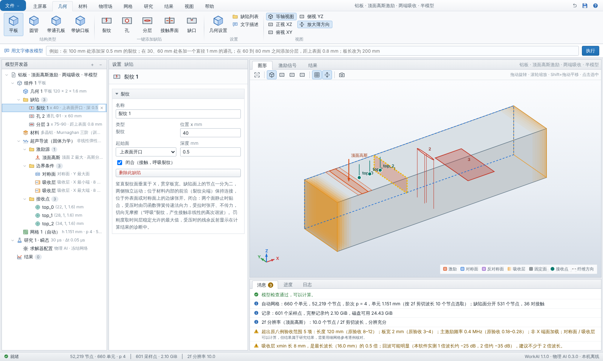

# 缺陷、自动网格与文字描述（软件 1.1）



## 1. 缺陷类型

在平板上一键添加，或在文字框里描述。坐标：x 沿板长从 xmin 端算起，y 沿板宽，z 从底面算起（z 最大为上表面）。

| 类型 | 参数 | 网格中的表示 |
|---|---|---|
| 裂纹 crack | 位置 x、深度；起始面：上表面开口、下表面开口、内部（加中心高度 z）；可设闭合 | 竖直面 x = 常数上的节点一分为二 |
| 分层 delamination | 起点、终点 x，距上表面的深度；可设闭合 | 水平面 z = 常数上的节点一分为二 |
| 接触界面 contact | 竖直截面（整个横截面，位置 x），或水平层间（x 范围、深度） | 节点一分为二，两面之间加单边接触 |
| 缺口 notch | 中心 x、宽度、深度，上或下表面开口 | 删除槽内单元 |
| 孔 hole | 通孔（贯穿板厚，中心 x、y）或横孔（侧钻孔，贯穿板宽，中心 x、z），半径 | 孔周围的曲边 O 型网格 |

规则（`physics/defects.py`）：

- 缺陷目前加在平板上。管和旧的“带通孔板”“带缺口板”保持原样。
- 每个模型最多 12 个缺陷。
- 缺陷之间至少相隔 0.2 mm，目前不支持相交的缺陷。
- 内部缺陷距外表面至少 0.1 mm。
- 不同缺陷的边界在同一方向上不能靠得太近（< 0.08 mm），否则会产生极薄的单元层。

## 2. 网格（`spectral3d/feature_mesh.py`）

板是分块结构的张量网格，网格线穿过每个缺陷的边缘，与冻结网格中带缺口板的做法相同，只是网格线更多。在这张网格上：

- **裂纹、分层、接触界面**：缺陷覆盖的网格面上的节点复制一份，平面正侧的单元改用副本，两个面就能独立运动。
  - 位于材料内部的前沿（裂纹尖端、分层边缘）节点保持共用，裂纹在尖端闭合。
  - 位于外表面或对称面上的边缘节点也复制，裂纹在那里张开。对称面上张开是因为缺陷在镜像的另一半中继续延伸。
- **前沿加密**（1.1.1 起）：位于材料内部的缺陷前沿（裂纹尖端、分层边缘）两侧各加一条网格线，距前沿 h/4，既沿缺陷平面跨过前沿，也跨过缺陷平面本身，所以贴着前沿的单元只有约 h/4 大。
  - 前沿附近的位移按 r^½ 变化（应力奇异），单元越大误差越大。1.1.0 没有这条规则，前沿落在和缺陷层一样厚的单元里。
  - 用独立的二维有限元核对（见第 6 节），自动网格下裂纹算例的误差从 3.4–5.5% 降到 1.1–2.0%，分层（顶面接收点）从 7.3–11.9% 降到 2.4–3.9%。计算时间约为原来的 3–4 倍。
  - 新网格线离已有网格线不到 h/8 时不加，避免出现极薄的单元层。
- **缺口**：删除槽内的单元。
- **孔**：孔周围一块方形区域换成曲边 O 型网格。从方块边界上的每个网格节点向孔边连直线，节点在孔边按角度等分（GLL 分布）。方块边界上的节点就是原网格节点，所以逐节点协调。有孔时整张网格用等参映射。

没有缺陷时调用冻结的 `spectral3d.mesh`，结果逐位相同。

已检查（`graphnet/test_defects.py`）：

- 每种缺陷的体积精确（含孔的圆面积）；
- 均匀应变的应变能精确，刚体平移无内力；
- 节点分开的数目与几何一致；
- 接触面的 GLL 权重之和等于截面积；
- 冻结网络与同一网格上的 GLL 谱元求解器一致到 1e-10。分别检查了含裂纹和缺口的直角网格，以及含孔的曲边网格。

## 3. 接触界面（`graphnet/contact.py`）

闭合裂纹、闭合分层和接触界面的两个面在静止时贴合。对每一对节点（a 在负侧，b 在正侧）取法向间隙 g = (u_b − u_a)·n，界面能量为

```text
U_c = Σ ½ k (min(g, 0))²，k = K·A（A 为该节点对的 GLL 面积权重）
```

- 受压（g < 0）时由罚函数弹簧传递法向力。
- 受拉（g > 0）时张开，不传力。
- 切向无摩擦。

这就是“呼吸”裂纹的拍击非线性。−∂U_c/∂u 加到网络的单元消息上，U_c 计入应变能，所以能量收支照常检查。

罚刚度 K：目标为 10·M/s（M 为纵波模量，s 为最小节点间距），并逐对限制，使界面弹簧单独满足 ω·Δt ≤ 0.6，在网络时间层的稳定范围以内。有限的 K 会让受压的波有一点反射：R = 1/√(1 + (2K/ωZ)²)，Z = ρc_L。这个值写在计算诊断里，在 0.3 MHz 约 1%。

一维核对：1 × 1 mm 杆中间设竖直接触界面，端面加单极 3 μs 脉冲，与无界面的杆比较（`graphnet/test_defects.py`）。

| 加载 | 透射（相对无界面） | 界面前的回波（相对入射） |
|---|---|---|
| 压缩 | 1.004 | 1.3%（预计的罚函数反射约 1%） |
| 拉伸 | 0.0000（界面张开） | 全反射，与自由端相同 |

能量收支误差为 4e-6。

零间隙、无预压的接触是一次齐次的：幅值加倍，响应和谐波都正好加倍。所以与材料非线性不同，接触产生的 2f 与基频之比不随幅值变化。

## 4. 自动网格（`offline/automesh.py`）

用户不再设置单元尺寸和阶次，软件按下面的规则选择。

- **精度**：2f 分辨率 = 每个激励 −30 dB 带宽上限的两倍频率处、剪切波长内的节点数，与“消息”窗口和长记录说明中的定义相同。
  - 记录短于 1 ms 时，目标为 10。
  - 1 ms 及以上目标为 15。按 1 ms 平板实测，11.5 时末段误差约 1%，15 时约 0.1%。
  - 下限 8。
- **范围**：单元尺寸 0.8–2.5 mm（网络验证过的范围），阶次 4。
- **缺陷**：网格线总是穿过缺陷边缘，材料内部的前沿两侧再各加一条加密线（见第 2 节）。最小节点间距因此变小，时间层随之增多，这已计入规模估计。
- **规模**：节点不超过 60 000，单元-节点项不超过 200 000，表面三角形不超过 50 000。
  - 超出时逐步放粗，但不粗于下限 8，并在“消息”中提示分辨率低于目标。
  - 仍然超出时拒绝计算，并给出缩短板长、半宽模型、降低频率等建议。
  - 结果动画在大网格时少取一些帧，使一个响应的显示数据不超过 192 MiB。

请求格式变为 `{"scene": …, "mesh": "auto"}`。旧格式 `{"scene": …, "degree": 4}`（场景里带 h_mm）仍然接受。

## 5. 文字描述（`offline/nlp.py`）

顶部文字框接受中文或英文描述，例如：

```text
在 100 mm 处添加裂纹，深 0.5 mm
在 30、60 mm 处各加一个直径 1 mm 的通孔
在 60 到 80 mm 之间添加闭合分层，距上表面 0.8 mm
在 40 mm 处加一个距上表面 0.6 mm、直径 0.6 mm 的横孔
距右端 20 mm 处添加裂纹；删除所有孔；把裂纹移到 170 mm
板长改为 200 mm；频率 300 kHz；记录时长 1 ms；周期数 3
add a closed crack at x = 40 mm, depth 0.4 mm
```

这是本软件词汇的规则解析器，不是通用语言模型，完全离线。

- 它列出理解到的每一项修改，以及用了哪些默认值，例如“深度未指定，取 0.5 mm”。
- 没理解的文字原样列出，不猜。
- 场景校验不通过的修改不会执行，并写出原因，例如重叠，或位置超出板长并建议先加长板。
- 确认后才修改模型，可以撤销。

## 6. 独立核对与算例

**独立核对（不需要 COMSOL）。** 板宽方向两面都设为对称面时，三维模型就是平面应变问题，所以贯穿全宽的裂纹、分层和闭合接触可以用二维求解器核对。`research/defects/fem2d.py` 是一个与网络无关的二维有限元，接触用精确约束，在三套网格上计算后外推到网格无限细。结果见 [research/defects](../research/defects/README.md)：

| 工况 | 1.1.0 自动网格 | 1.1.1 自动网格 |
|---|---|---|
| 无缺陷 | 0.04% 以内 | 0.04% 以内 |
| 开口裂纹 | 3.4–5.5% | 1.1–2.0% |
| 开口分层（上表面 / 中面） | 7.3–11.9% / 0.4–0.5% | 2.4–3.9% / 0.1–0.2% |
| 闭合裂纹（1 MPa、2 MPa） | 4.5–6.8% | 1.8–2.7% |
| 闭合分层，网格设计频带内 | 1.4–8.7% | 0.7–4.4% |

- 闭合裂纹的 2f / f 与参考解相差 3% 以内；
- 幅值加倍时两个求解器的响应都正好加倍；
- 1.1.0 的误差主要来自缺陷前沿附近的网格太粗，所以 1.1.1 加了前沿加密（第 2 节）。

**COMSOL 场景下的算例。** 与 [COMSOL 运行要求](comsol/defects/README.md) 相同的工况在软件中的结果也在 [research/defects](../research/defects/README.md)：

- 开口缺陷只有线性散射；
- 闭合裂纹后 2f / f 为 0.10–0.16；
- 板厚中面的分层对 S0 几乎不可见，但强烈散射 A0。

COMSOL 现在只建议补一个部分宽度裂纹（D7）。这是二维核对覆盖不到的三维前沿，其余工况可选或不必。
