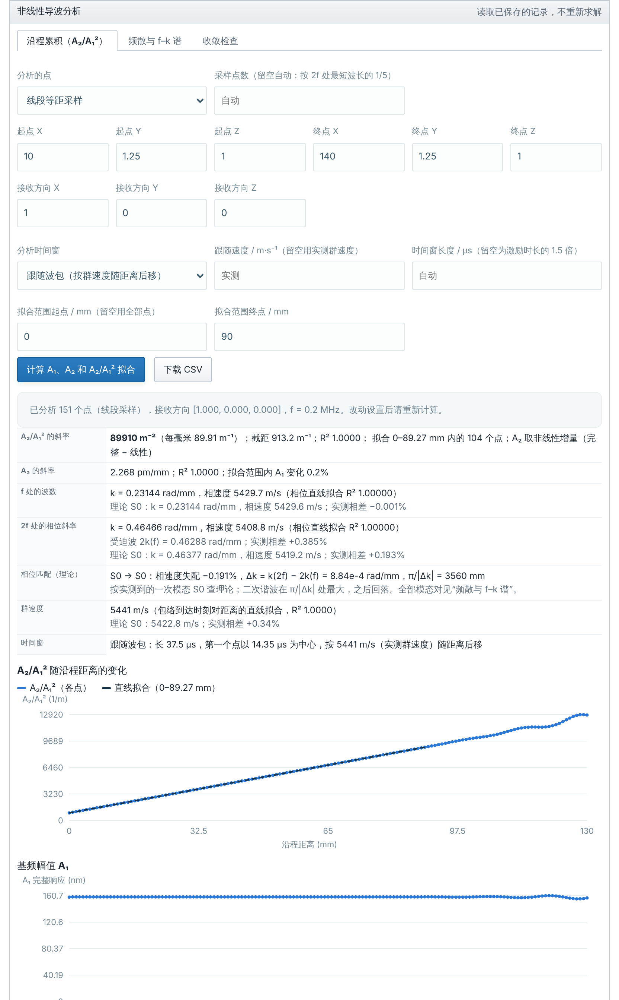
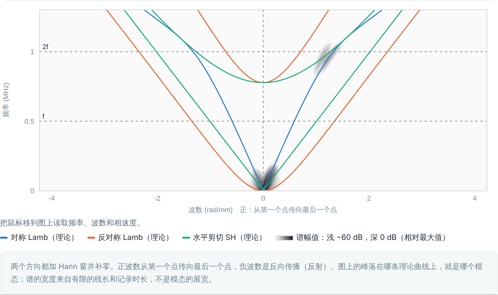

# 非线性导波分析

桌面软件结果页上的后处理，面向非线性导波研究：沿传播方向的 A₂/A₁² 拟合、平板理论频散曲线与 f–k 谱叠加、混频分析、一键收敛检查。它们都读取已保存的记录，不重新求解（收敛检查除外，它要在更细的网格上再算）。

入口：打开一条已完成的计算，结果页最下方的“非线性导波分析”。面板有四个标签页，前三个共用上方的“分析的点”和“接收方向”。

## 1. 分析的点

- **线段等距采样**：填起点和终点，点数留空时自动选取，使相邻点不超过 2f 处最短波长的 1/5（最少 21 个，最多 200 个；f–k 谱最多 256 个）。需要完整记录。
- **使用接收点**：用计算时设置的接收点，按首末两个接收点的连线排序。精简记录只有接收点保存了完整波形，所以只能用这一种。
- **接收方向**：位移在这个方向上的投影。默认取第一个接收点的方向。各模态在表面的位移方向不同（“频散与 f–k 谱”里的模态表给出 x : y : z 的比例），选对方向才看得到想看的模态。

## 2. 沿程累积（A₂/A₁²）

对每个点计算 f 和 2f 处的幅值与相位，方法与结果页相同：分析时间窗上加 Hann 窗、去加权均值、取准确频率处的系数。

- **A₁** 取完整响应。
- **A₂** 取非线性增量（完整 − 线性）。完整响应在 2f 处还含有猝发音自身的线性频谱，那不是非线性效应。只算了完整控制时没有非线性增量，这时 A₂ 取完整响应，结果里会明确提示不能当作非线性的度量。
- 算了全部三组控制时，另外给出几何增量和材料增量各自的 A₂。两者相位相反时，总的 A₂ 会小于其中较大的一个。

### 时间窗

- **跟随波包**（默认）：时间窗以第一个点的包络峰值为中心，按“距离 / 速度”随距离后移。速度留空时用实测群速度（各点包络到达时刻对距离的直线拟合）；长度留空时为激励时长的 1.5 倍。包络到达时刻取第一个达到最大值一半的峰，避免把入射波与反射波叠加处当成到达。
- **各点同一时间窗**：填起点和终点。
- 时间窗早于记录起点的部分按零处理（记录从静止开始）；超出记录末尾的点不参与分析，表里注明。

### 给出的量

| 量 | 含义 |
|---|---|
| A₂/A₁² 的斜率 | A₂/A₁² 对沿程距离的直线拟合，连同截距和 R²。拟合范围可以填（留空用全部点） |
| f 处的波数 | f 系数的相位沿程斜率。平板时与理论模态对照，给出最接近的模态和相对差 |
| 2f 处的相位斜率 | 2f 系数的相位沿程斜率，分别与受迫波 2k(f) 和 2f 处的对称模态对照 |
| 相位匹配（理论） | 按实测到的一次模态查理论：Δk = k(2f) − 2k(f) 和 π/\|Δk\| |
| 群速度 | 包络到达时刻对距离的直线拟合，与理论群速度对照 |

关于 2f 的相位斜率：相位匹配时它等于二次模态的波数。失配时 2f 场是两个成分之和——随基波走的受迫波（波数 2k(f)）和自由传播的二次模态（波数 k(2f)），相位斜率落在两者之间，偏向幅值大的一个，不能用它算 Δk。所以 Δk 按理论给出，两个成分在 f–k 谱里分开看（第 3 节）。

### 提示

出现下列情况时结果上方会列出提示：

- 拟合范围内 A₁ 变化超过 10%（波束扩散、多模态叠加或反射）；
- A₂/A₁² 随距离不是直线（R² < 0.98）：相位失配时二次谐波先增后减，多模态时出现拍；
- 点距大于最短波长的一半：相位斜率只确定到 2π/Δx 的整数倍。等间距的点在平板上，如果恰好只有一个整数倍落在理论值上，就取那一个并说明；否则标为不可靠；
- 没有线性控制、激励不是单一载频、分析线不在板面内。

### 有阻尼时：沿程衰减和扣除衰减后的斜率

模型带[材料阻尼](material-damping.md)时，汇总表多一行“沿程衰减”：

- A₁ 实测的衰减：ln A₁ 对距离的直线拟合。
- 模型给出的衰减：f 处一次模态和 2f 处二次模态各自的 γ / 群速度。
- **扣除衰减后的 A₂/A₁² 斜率**：各点乘以 mX/(1 − e^{−mX})，m = a₂ − 2a₁，X 是从主激励算起的传播距离。图上多一组点和一条拟合线。
- 相位失配的模态对不做修正；拟合范围内有点不在主激励下游时也不做，表里说明原因。

模型没有阻尼而 A₁ 明显变化时，只给出实测的衰减，并说明它来自波束扩散、多模态叠加或吸收层。

### 接收方式

默认按点接收（激光测点）。在“线段等距采样”的点列上可以改成有尺寸的接收换能器（[换能器模型](transducers.md)）：

- **斜楔换能器**：沿线的长度和迹线速度。各点按到中心的距离对齐后取平均，相速度等于迹线速度的波同相叠加。
- **压电片**：长度。取两端位移之差（平均应变 × 长度）。

表中的“点”这时是换能器中心的位置，A₁、A₂ 是换能器读到的量。

### 这个数不是什么

A₂/A₁² 是这个模型、激励和接收方向下的**相对**非线性参数，不是材料的 β。猝发音短于时间窗时，两个幅值都是窗内的平均，A₂/A₁² 的数值与窗长成正比，不同算例之间要用同一窗长比较；它随距离的增长不受此影响。

要与连续波的公式（例如平面纵波的 A₂ = βk²xA₁²/8）比数值，需要扣掉这个因子。包络为 E(t) 的猝发音经窗函数 W(t) 读出的系数是幅值乘 ⟨WE⟩/⟨W⟩，由两个分量相乘产生的分量是 ⟨WE²⟩/⟨W⟩，所以 A₂/A₁² 和混频比都比连续波的值大 ⟨WE²⟩⟨W⟩/⟨WE⟩² 倍。Hann 包络的猝发音配长 1.5 倍的 Hann 窗（默认设置）时这个因子是 1.359。[混频的核对](../research/wave-mixing/README.md)按这个因子比较：和频和二次谐波差 1% 以内，差频差 2.4%。

“下载 CSV”导出拟合结果和每个点的数值。

## 3. 频散与 f–k 谱

### 理论曲线

模型的一个 z 面设为对称面（或反对称面）时，它是两倍厚的板的一半：理论按完整的板厚计算，并且只列出关于中面对称（反对称）的模态。两个 z 面都设了这类条件时不是自由平板，不给理论曲线。

软件按模型的板厚和材料计算自由平板的导波：沿厚度方向用半解析有限元，保留三个位移分量和完整的弹性张量，所以各向同性和各向异性材料用同一套算法。

- **图**：相速度、群速度或波数随频率的变化，按族着色（对称 Lamb、反对称 Lamb、水平剪切 SH）。虚线标出 f 和 2f，圆点是这两个频率处的模态；做过沿程分析后，菱形是实测值。
- **模态表**：f 和 2f 处每个模态的相速度、群速度、波长、波数，以及上表面位移在传播方向、面内横向、厚度方向上的比例。
- **相位匹配表**：f 处的每个一次模态与 2f 处的每个对称模态配对，按相速度失配从小到大列出 Δk 和 π/|Δk|。二次谐波只出现在对称 Lamb 模态里，所以二次模态只列对称族。相位匹配是累积的必要条件，不是充分条件：还要求功率流不为零，群速度决定两个波包能一起走多远。
- **传播方向**：各向异性材料的曲线与方向有关，填传播方向与 x 轴的夹角。偏离材料对称方向时 Lamb 与 SH 不再分开，模态只按中面对称性分成两族。
- 模态按截止频率的顺序编号（S0、S1、…）；群速度与相速度反向的一段保留原名并标为“后向”。

**适用范围**：理论曲线是无限宽板的。两个 y 面都设为对称面时，模型就是无限宽板里沿 x 传播的 Lamb 波，曲线直接适用。侧面自由时模型是一根条带，宽度与波长相当时模态会偏离，面板上会提示。圆管没有理论曲线，f–k 谱仍可计算。

### f–k 谱

沿点列对所选响应做频率–波数变换（两个方向加 Hann 窗并补零），灰度表示幅值（浅 −60 dB，深 0 dB），理论曲线叠在上面。峰落在哪条曲线上就是哪个模态。

- 需要等间距的点，至少 8 个；点距决定能分辨的最大波数 π/Δx，不够时会提示。
- 正波数从第一个点传向最后一个点，负波数是反向传播（反射）。
- 响应可以选完整、线性、非线性增量、几何增量、材料增量；可以限定时间范围和频率上限。
- 鼠标移到图上读取频率、波数、相速度和 dB。
- 非线性增量在零频附近有一个很强的成分：随波包一起走的准静态位移。二次谐波在 2f 处，比它弱。

上图是第 5 节失配算例的非线性增量：2f 处的谱从受迫波（2k(f)，在 S0 曲线左侧）延伸到自由的 S0 模态（曲线上）。

## 4. 混频（f_a ± f_b）

模型有两个不同的载频时（两个激励源，或一个多频信号），“混频”标签页沿点列提取：

- 两个基频 f_a、f_b 的幅值（取完整响应）；
- 和频 f_a + f_b、差频 f_b − f_a 的幅值，以及两个二次谐波 2f_a、2f_b（取非线性增量）；
- 混频比 A±/(A_a·A_b) 随沿程距离的直线拟合；
- 四个分量的相位斜率，与理论模态和受迫波数 k_a ± k_b 对照；
- 相位匹配（理论）：按实测到的两个一次模态，列出和频、差频处最接近 k_a ± k_b 的模态、Δk 和 π/|Δk|。

点列、接收方向、时间窗和拟合范围沿用“沿程累积”页的设置；两个频率默认取模型的两个载频，也可以手动填。

注意：

- 时间窗要分得开这些分量。Hann 窗的主瓣宽 4/T；窗长不足时软件会提示哪两个分量太近。两个频率靠得近，就需要更长的猝发音。
- 混频比与 A₂/A₁² 一样，是这个模型下的相对量，数值与窗长有关（见第 2 节“这个数不是什么”里的因子）。
- 两个频率的合成包络有拍。跟随波包的时间窗按拍的周期平滑后的包络定位，落在整个猝发音的中心。
- 共线的平面纵波，混频比的斜率是 β·k_a·k_b/4（β 是纵波的非线性参数），和频、差频都是相位匹配的。

## 5. 导出

- **图片**：把鼠标移到任何一张图上，右上角出现“PNG”“SVG”。PNG 是 2 倍分辨率；SVG 是矢量图，可以在绘图软件里继续编辑。f–k 谱和位移场是位图，只有 PNG。
- **报告**：结果页上方的“导出报告”把这一页当前显示的内容（图、表、分析结果和提示）存成一个 HTML 文件，用浏览器打开后可以打印成 PDF。它保存的是“现在看到的”：先做完想要的分析，再导出。数值结果仍以“下载全部结果 ZIP”里的记录为准。
- **数据**：沿程累积和混频各有“下载 CSV”。

## 6. 收敛检查

“收敛检查”标签页把同一个模型放到更细的网格上重算，再比较各接收点的结果。

- **加密方式**：每加密一级，单元阶次低于 5 时阶次加一（4 → 5），单元尺寸不变；阶次已是 5 时单元尺寸乘 0.75。提高阶次会加密每个方向的节点，板厚方向只有一层单元的薄板也一样。可选一级或两级。
- **时间步**：自动时间层按每套网格重新选步长，表中列出。步长由稳定性或相位误差上界（0.01 rad）中较严的一个决定，网格变细时不一定缩短。
- **开始前**：列出每套加密网格的节点数、预计耗时、内存和磁盘占用；不能计算的（内存不够、单元小于 0.1 mm）给出原因。
- **运行**：原计算是第一套网格，不重算；加密的计算排队运行，机制与参数扫描相同——可以暂停、继续，关闭软件后可以接着算，期间不能提交别的计算。它也出现在“结果”下，可以打开每套网格各自的结果页。
- **比较**：各套网格相对最细的已完成网格，逐个接收点给出 A₁ 的变化、A₂ 的变化（取非线性增量）、f 处的相位差、线性波形和非线性增量波形在分析时间窗内的相对 L2 差。
- **判据**：原网格的 A₁ 变化不超过 1%、A₂ 变化不超过 5% 时标为“已收敛”，否则建议采用加密网格的结果或再加密一级。判据只说明这个模型在这些接收点上的变化，不是误差的上界。波形差对相位很敏感：相位差 1° 约对应 1.7%。
- 快速引擎在模型自带的粗网格上运行，网格不能加密，不提供收敛检查。

## 7. 核对

两个平面应变算例（铝板，两个 y 面为对称面，x = 0 端面施加 x 方向牵引激发 S0，远端吸收层；接收方向 x，上表面）。

**近似匹配：0.2 MHz，板厚 1 mm**（线段 10–140 mm，151 个点，拟合 0–90 mm）

| 量 | 软件实测 | 理论 | 相差 |
|---|---|---|---|
| f 处波数 | 0.23144 rad/mm | S0：0.23144 rad/mm | −0.001% |
| 2f 处相位斜率 | 0.46466 rad/mm | S0：0.46377 rad/mm | +0.19% |
| 群速度 | 5441 m/s | S0：5422.8 m/s | +0.34% |
| A₂/A₁² 随距离 | 直线，R² = 1.0000，斜率 8.99×10⁴ m⁻² | S0→S0 失配 −0.19%，π/\|Δk\| = 3.56 m，远大于板长 | — |

收敛检查（两级：4 阶 → 5 阶 → 5 阶且单元 ×0.75）：原网格相对最细网格，各接收点 A₁ 最多变化 2×10⁻⁷，A₂ 最多变化 1.4×10⁻⁵；中间一套网格相对最细网格是 2×10⁻⁸ 和 1×10⁻⁶。

**相位失配：0.5 MHz，板厚 2 mm**（线段 10–135 mm，200 个点）

| 量 | 软件实测 | 理论 | 相差 |
|---|---|---|---|
| f 处波数 | 0.58883 rad/mm | S0：0.58870 rad/mm | +0.022% |
| 群速度 | 5124.2 m/s | S0：5123.7 m/s | +0.01% |
| 2f 处相位斜率 | 1.1780 rad/mm | 受迫波 2k(f)：1.1777 rad/mm | +0.030% |
| 非线性增量 f–k 谱在 2f 处的两个峰 | 1.167 和 1.324 rad/mm | 2k(f) = 1.177，S0(2f) = 1.327 rad/mm | 谱的分辨率内一致 |
| A₂ 的第一个极大、极小、第二个极大 | 离激励端 21、45、67 mm | π/\|Δk\| = 21.0 mm 的 1、2、3 倍 | 后两个偏大，见下 |

失配算例里 A₂/A₁² 随距离不是直线（R² = 0.21），软件给出了提示。极小和第二个极大比理论值靠后，是因为两个成分的群速度不同（一次 5124 m/s，二次 2981 m/s）：自由的二次波包逐渐落在受迫波后面，有限长的猝发音不再满足连续波的拍长公式。

这两个算例只核对了 S0，各向异性材料的理论曲线只做了自洽性检查（按对称性分块求解与整体求解一致），没有与外部数据对照。

## 8. 接口

| 请求 | 作用 |
|---|---|
| `POST /api/jobs/<id>/accumulation` | 沿程分析：`points`、`direction`、`window`、`fit_mm`、`receiver` |
| `POST /api/jobs/<id>/mixing` | 混频分析：同上（没有 `receiver`），另有 `frequencies_mhz` |
| `POST /api/jobs/<id>/fk` | f–k 谱：`points`、`direction`、`part`、`range_us`、`frequency_max_mhz` |
| `GET /api/jobs/<id>/dispersion` | 理论曲线、模态和相位匹配表；可选 `angle_deg`、`frequency_max_mhz` |
| `POST /api/jobs/<id>/converge-plan` | 收敛检查的预估：`levels`（1 或 2） |
| `POST /api/jobs/<id>/converge` | 开始收敛检查 |
| `GET /api/jobs/<id>/checks` | 这条计算的收敛检查 |
| `GET /api/scans/<id>/convergence` | 各套网格的比较；可选 `start_us`、`end_us` |

实现：`offline/guided.py`（平板导波理论）、`offline/nonlinear.py`（沿程分析、混频、f–k 谱）、`offline/scan.py`（收敛检查）、`offline/web/nonlinear.js`（界面）、`offline/web/export.js`（图片和报告）。
