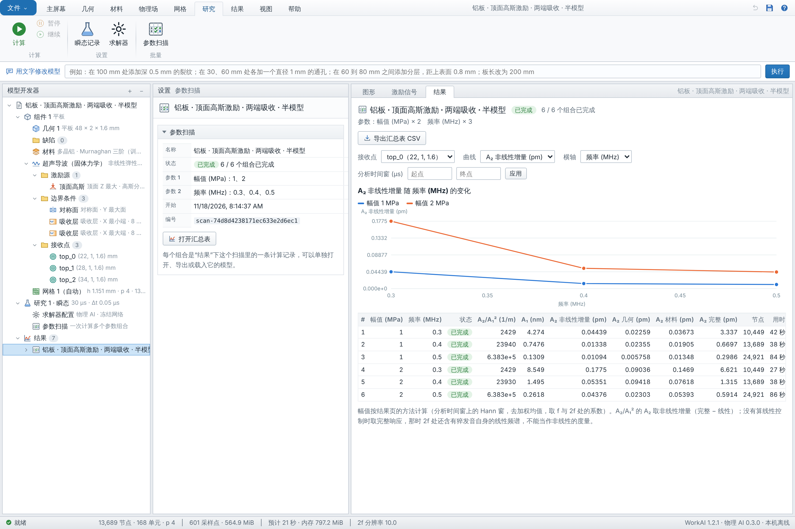

# 参数扫描

桌面软件里的批量计算：让当前模型的一到三个参数各取若干个值，软件逐个组合计算，并把各接收点的基频、二次谐波和 A₂/A₁² 汇总成一张表。入口是功能区“研究 → 参数扫描”，或模型开发器里“研究 1”下的“参数扫描”节点。

## 1. 定义

在“设置”窗口里点“添加参数”，选一个量，填入取值。

- **可以扫描的量**：当前模型里的数值字段。
  - 激励：频率、幅值、周期数、延迟、加载半径、高斯半径、梳状齿距；
  - 几何：板的长、宽、厚，管的长度和内外半径，旧的带孔板和带缺口板的孔、缺口尺寸；
  - 缺陷：位置、深度、宽度、半径、起点和终点；
  - 吸收层长度；
  - 材料常数（ρ、λ、μ、l、m、n），只在材料选了“各向同性 Murnaghan”时出现，默认的多晶铝不能改常数。
- **取值**：用逗号或空格分隔，例如 `0.2, 0.3, 0.4`；也可以写“起点:步长:终点”，例如 `0.2:0.05:0.4`（两端都包含）。
- **组合**：各参数取值的全部组合，最多 3 个参数、每个参数 100 个值、总共 200 个组合。第一个参数变化最慢。
- **跟随规则**：扫描板的长、宽、厚时，位于移动的那个面上的激励中心和接收点跟着移到新的面上，位于中面上的保持在中面；全宽裂纹的宽度范围和通孔的 y 位置同样处理。其余坐标不变。

选好以后，“组合与预计”列出每个组合的网格节点数和预计耗时，以及总耗时、最大内存和磁盘占用。

- 每个组合都按单次计算的全部规则检查。有组合不能计算时用红字标出原因，这时不能开始，改掉对应的取值即可。
- 磁盘占用是记录加结果文件（五种响应的动画）。可用空间不够时会提示；把“求解器配置 → 记录方式”改为“精简记录”可以大幅减小，汇总表不受影响。
- 模型存成文件时，扫描的定义一起保存。

## 2. 运行

点“开始扫描”。每个组合都是一次普通的计算：同样的自动网格、时间层、记录和结果页，与单独计算这个模型完全相同。它们一个接一个地算，每个都用上全部 CPU 核。

| 情况 | 软件的做法 |
|---|---|
| 某个组合计算失败 | 记下原因，继续算下一个 |
| 扫描结束后有失败的组合 | 扫描页出现“重算未完成的 N 个组合”，只重算它们，已完成的不动 |
| 暂停扫描 | 正在算的组合保存检查点后停止；继续时从检查点接着算，然后算后面的组合 |
| 扫描进行中关闭了软件 | 下次启动时扫描处于“已暂停”，可以继续 |
| 扫描进行中提交别的计算 | 拒绝；暂停扫描后可以提交 |

同一时间只能有一个扫描在运行。

## 3. 结果

在模型开发器“结果”下，扫描是一个文件夹，里面是它的各个组合；点扫描打开汇总页，点某个组合打开它自己的完整结果（位移场动画、任意点波形、五种响应、导出 ZIP）。

汇总页有：

- **汇总表**：每个组合一行。可以选接收点。点一行打开那个组合的结果。
- **曲线**：所选的量随某个参数的变化；扫描了两个以上的参数时可以选横轴，其余参数的每个组合一条线（最多画 6 条，全部数值在表和 CSV 里）。
- **分析时间窗**：默认用整段记录；填入起点和终点后，表和曲线按这个时间窗重算。
- **导出汇总表 CSV**：全部组合、全部接收点，一行一个接收点，带 UTF-8 签名，可以直接用电子表格软件打开。

表中的量（都取接收点方向上的位移分量）：

| 列 | 含义 |
|---|---|
| A₁ | 完整响应在基频 f 处的幅值 |
| A₂ 非线性增量 | “完整 − 线性”在 2f 处的幅值：几何与材料非线性合起来产生的二次谐波 |
| A₂ 几何 | “StVK − 线性”在 2f 处的幅值 |
| A₂ 材料 | “完整 − StVK”在 2f 处的幅值 |
| A₂ 完整 | 完整响应在 2f 处的幅值 |
| A₂/A₁² | 相对非线性参数，A₂ 取非线性增量 |

- 幅值的算法与结果页相同：分析时间窗上加 Hann 窗，去掉加权均值，取 f 和 2f 处的傅里叶系数。f 是主激励的频率。
- **完整响应在 2f 处的幅值不能单独当作非线性的度量**：猝发音自身的线性频谱在 2f 处也有分量，它随幅值线性变化。所以 A₂/A₁² 用的是非线性增量。如果“求解器配置 → 计算的响应”选了“仅完整”，没有线性控制可减，这一列改用完整响应，页面上会注明。
- A₂/A₁² 依赖分析时间窗和接收位置，适合在同一设置下比较各组合，不是材料的 β。

## 4. 示例

模板“顶面高斯激励”（48 × 2 × 1.6 mm 铝板，30 μs），幅值取 1、2 MPa，频率取 0.3、0.4、0.5 MHz，共 6 个组合，4 核机器上约 6 分钟：

| 幅值 (MPa) | 频率 (MHz) | A₁ (nm) | A₂ 非线性增量 (pm) | A₂/A₁² (1/m) |
|---|---|---|---|---|
| 1 | 0.3 | 4.274 | 0.04439 | 2429 |
| 2 | 0.3 | 8.549 | 0.1775 | 2429 |
| 1 | 0.4 | 0.7476 | 0.01338 | 23940 |
| 2 | 0.4 | 1.495 | 0.05351 | 23930 |

幅值加倍时 A₁ 加倍、非线性增量的 A₂ 变为 4 倍，A₂/A₁² 不变。

## 5. 实现与限制

- 服务端是 [`offline/scan.py`](../offline/scan.py)，界面是 [`offline/web/scan.js`](../offline/web/scan.js)。扫描存放在数据目录的 `scans/` 下，每个组合是 `jobs/` 下的一条普通计算记录。
- 测试：`offline/test_scan.py`（定义、预检、队列、失败与重算、暂停与重启、汇总表）和 `tests/offline-scan.test.mjs`（取值解析、表单、汇总页、曲线、模型树）；打包后的冒烟测试 `offline/smoke.py` 里跑一个两组合的扫描。
- 组合只有全因子网格一种，没有抽样方案，也不能一次并行多个组合（每个组合已经用上全部核）。
- 汇总表只有接收点处的谐波幅值。沿程拟合、频散叠加等后处理还没有做进软件。
- 命令行工具 `python -m sweep`（见 [参数扫描与数据集](sweep-and-datasets.md)）是另一套：它面向源码环境里的其他求解器、抽样方案和训练数据集，不随桌面软件发布。
