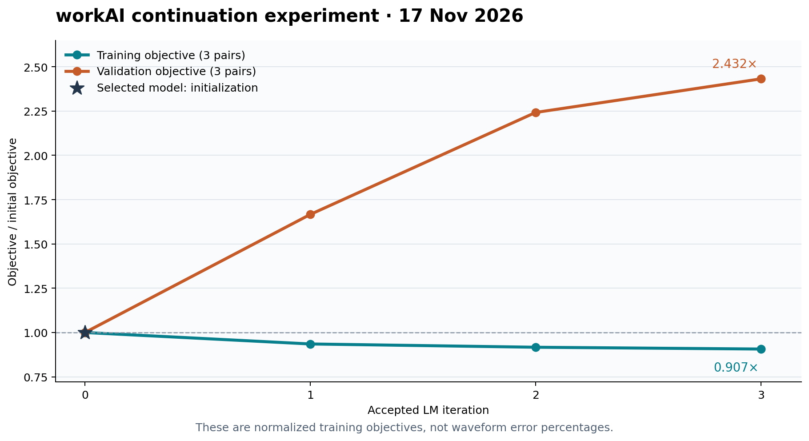

# 短记录继续训练：本轮未选出更优算子（2026-11-17）

本目录记录一次已经执行完成、可以复现的小规模实验，从已有精确模型
`coarsegraph/models/p4-h2-multisource/model.json` 热启动。
它不是原始 13 对训练、5 对验证、16 对测试的完整续训，也不替换软件默认模型。
本轮完成了 18 个基准谱元解、4 个空间细化解、3 次 LM 参数更新和冻结后的三组模型对照。
训练与最终评估在 8 个进程上用时 1172.97 秒（约 19.55 分钟，不含参考解生成）。

## 本轮结果

**训练目标有所下降，但没有一轮更新优于初始化模型的验证目标，最终选中第 0 轮。**
因此，本轮没有得到验证表现更好的新物理算子。候选文件保存了新的训练记录，
它导出的实际算子仍来自初始化模型；最后一次更新的参数保存在检查点 `current` 中，
验证最优参数保存在 `best` 中。

### 优化过程

| 接受迭代 | 训练目标 | 验证目标 | 是否为验证最优 |
|---|---:|---:|---|
| 0（初始化） | 7.96337134e-4 | 7.23300771e-5 | 是，最终选择 |
| 1 | 7.44809737e-4 | 1.20539258e-4 | 否 |
| 2 | 7.30070281e-4 | 1.62181371e-4 | 否 |
| 3 | 7.21971655e-4 | 1.75899067e-4 | 否 |

训练目标累计下降 9.3384%；最后一轮的验证目标是初始化的 2.4319 倍。
这些数字是波形、增量和谐波的归一化残差平方和，**不是波形误差百分比**。
只能说本轮三个训练工况上的收益没有转化为三个验证工况上的收益；
不能据此断言完整训练集上的继续优化也无效。



### 冻结后的精度核对

下表取本轮三个测试工况中、达到相对报告下限的接收点的最差值。
每个工况的波形、f、2f、非线性增量 2f 都不超过 5%，才计为通过。

| 模型 | 训练通过 | 验证通过 | 测试通过 | 测试波形 L2 | 测试 f | 测试 2f | 测试增量 2f |
|---|---:|---:|---:|---:|---:|---:|---:|
| 同网格 GLL | 2/3 | 3/3 | 3/3 | 0.0558% | 0.0787% | 1.0222% | 0.7608% |
| 原精确模型 | 2/3 | 3/3 | 3/3 | 0.1818% | 0.2035% | 1.2033% | 0.5939% |
| 本轮选中候选（第 0 轮） | 2/3 | 3/3 | 3/3 | 0.1818% | 0.2035% | 1.2033% | 0.5939% |

仍未通过的是 **C 训练工况：0.3 MHz、2.0 mm 双贴片**，选中候选的增量 2f 最差差异为
5.79698%（同网格 GLL 为 12.80587%）。这个已知问题没有被本轮选中的模型解决。
三组对照全部得到有效结果。候选与原模型在本次 9 对工况、两种本构的 18 个预测数组上
逐位相同，不能把本轮的测试通过说成新训练带来的改善。

候选的结构约束最大残差为 8.88e-16，积分和质量权重均为正；
最大稳定数为 0.63467，低于原先的 1.5 限值。模型依然标记
`accepted_for_solver_routing=false`。

详细证据：[总报告](evidence/pilot-report.json)、[逐工况评估](candidate/evaluation.json)、
[训练历史](candidate/history.json)、[训练日志](candidate/training-log.jsonl)、
[结果复核](evidence/result-verification.json)。

### 可以接着使用的产物

- [选中候选模型](candidate/model.json)：第 0 轮算子及本轮的完整来源与评估信息。
- [检查点](candidate/checkpoint.json)：最后训练状态、验证最优状态、LM 阻尼、历史和输入身份；本次阶段为 `completed`。
- [预测数组](candidate/predictions.npz)：GLL、原模型和选中候选在全部 9 对工况上的线性与完整响应。
- [参考数据归档](evidence/labels-evidence.tar.gz)：见下文的复读核验与恢复命令。

本次检查点已经完成测试，不能再用 `--resume` 继续选参；该选项用于恢复中断的训练或
同一冻结候选的未完成评估。下一轮应使用 `--init` 和新的输出目录，并在运行前固定实验方案。

本轮补齐了每次接受更新后的原子检查点、物理算子跨参数基恢复、历史最优保留、
真实标签/前向源码身份校验和初始化模型对照。新增恢复测试与原有粗网格回归测试
共 17 项通过。测试命令与环境记录在 [runtime.json](evidence/runtime.json)。

## 预先固定的九对工况

每对均计算 linear 与 Murnaghan 两个控制。每个划分都覆盖 A 顶面高斯、
B 端面轴向、C 双贴片。所有工况严格保留
`coarsegraph/specs/splits.json` 的原划分身份；训练代码只使用训练集求梯度、
验证集选参数，测试只在参数冻结后评分。

| 划分 | A 顶面高斯：MHz / mm | B 端面轴向：MHz / mm | C 双贴片：MHz / mm |
|---|---|---|---|
| 训练 | 0.40 / 1.6 | 0.20 / 2.4 | 0.30 / 2.0 |
| 验证 | 0.20 / 2.0 | 0.30 / 1.6 | 0.20 / 2.0 |
| 测试 | 0.30 / 2.4 | 0.40 / 1.6 | 0.35 / 2.4 |

C 训练中心是已有模型仍未通过增量 2f 门槛的训练工况。包含它是为了检验
继续优化是否有价值。该选择在本轮试验前已固定，不因测试结果改变。
D 梳状激励不在此 pilot 中，不能据此改变软件对梳状激励的支持范围。

## 参考与门槛

原始训练标签未随仓库保存。本实验由原规格重新计算 **实际三维谱元参考解**，
使用四阶、h = 1.5 mm、30 μs、0.05 μs 输出步长；保留场景、代码及结果哈希。
这是重新生成的标签，不声称与历史标签字节相同。输出沿用 `sweep` 格式，
关闭全场和 CSV，仅保存接收点/接收线等现有结果。

训练前对预先指定的 `A-train` 和 `C-train` 做 h = 1.5 → 1.0 mm 的空间细化抽查。
除了现有 `sweep` 报告，还使用与粗网格验收相同的 **10% 相对幅值报告下限**，
要求线性和完整波形、f、2f，以及非线性增量 2f 的差异均不超过 **1%**。
这避免微弱增量被绝对幅值下限直接放行。它只核对这两对工况的空间细化，
不能证明其余工况或时间离散均已收敛。

候选模型仍是四阶、h = 2 mm、10 个共享参数，时域增量权重及谐波权重均为 1，
预先固定最多三轮 LM，以验证损失选择最优；早停条件仍有效。模型验收保持每个可报告接收点的波形、f、2f、增量 2f
同时在 5% 内；验证损失下降不等于通过这些门槛。

## 执行

以下命令从仓库根目录执行，`python` 应指向装有 NumPy、SciPy、Numba 的项目环境。
原配置与输入哈希写入 `protocol.json`，已有输出目录的实验定义不能悄悄改变。

```sh
python research/coarse-continuation-20261117/run.py prepare --output runs/coarse-continuation-20261117

# 只生成第一对，用真实耗时判断能否完成本轮预算；不执行优化。
python research/coarse-continuation-20261117/run.py labels --output runs/coarse-continuation-20261117 --pairs A-train --workers 2

# 断点继续生成其余标签，完成且哈希匹配的结果自动跳过。
python research/coarse-continuation-20261117/run.py labels --output runs/coarse-continuation-20261117 --workers 2

# 四个实际细网格求解：两对控制的 h = 1.0 mm 抽查。
python research/coarse-continuation-20261117/run.py converge --output runs/coarse-continuation-20261117 --workers 2

# 可先打印经过检查的训练命令。
python research/coarse-continuation-20261117/run.py train --output runs/coarse-continuation-20261117 --workers 2 --dry-run
python research/coarse-continuation-20261117/run.py train --output runs/coarse-continuation-20261117 --workers 2
python research/coarse-continuation-20261117/run.py report --output runs/coarse-continuation-20261117

# 保存紧凑标签证据，之后可恢复训练而无需重新生成参考。
python research/coarse-continuation-20261117/run.py archive --output runs/coarse-continuation-20261117
```

`train` 在全九对标签完整且空间抽查通过后才启动。训练输出位于独立的
`candidate/`；若该目录已存在，驱动拒绝重新开始，以免反复查看测试结果后挑选模型。
中断后的恢复应使用训练器明确的检查点恢复入口，保留同一实验和划分。
`converge` 会重新执行所选空间细化，勿把它当作零成本状态查询。

`archive` 生成 `labels-evidence.tar.gz`、SHA-256 校验文件及逐文件
`archive-index.json`，包含固定方案、扫描 manifest、scene/settings、result.json、
lines.npz 和两对空间细化证据；跳过全场、CSV、日志和编译缓存。
将归档解压到新的实验输出目录后，可用逐文件哈希核对数据，再使用同一配置继续。
本目录已经保留本轮的模型、训练日志、验证报告、参考归档及运行源码。

## 已保存的参考数据

本轮已经完成 18 个基准谱元解和 4 个空间细化解。两对抽查的增量 2f 最大相对差异分别为
0.2107%（A）和 0.5895%（C），均在预设的 1% 内；完整指标见
[reference-check.json](evidence/reference-check.json)。18 个基准解的能量收支最大相对误差为
0.004234%，全部通过求解器的应变、雅可比与有限值保护。

紧凑的[参考数据归档](evidence/labels-evidence.tar.gz)为 6,133,526 字节；
[SHA-256](evidence/labels-evidence.tar.gz.sha256)、[逐文件索引](evidence/archive-index.json)和
[解压复读核验](evidence/archive-verification.json)一起保存。独立解压后，全部 107 个索引文件
的字节、9 对工况的时间轴、完整响应及非线性增量数组与原目录完全一致，训练身份也与运行检查点一致。

可直接恢复参考数据，无需重新生成 22 个求解结果：

```sh
mkdir -p data/coarse-continuation-restored
tar -xzf research/coarse-continuation-20261117/evidence/labels-evidence.tar.gz \
    -C data/coarse-continuation-restored
python research/coarse-continuation-20261117/run.py train \
    --output data/coarse-continuation-restored --workers 8
```

本轮使用 Python 3.12、NumPy 2.2.6、SciPy 1.15.3、Numba 0.63.1、llvmlite 0.46.0，
与仓库 CI 的数值依赖版本一致。每个训练进程的 BLAS/OMP/Numba 线程限制为 1；
详细环境与 17 项测试结果见 [runtime.json](evidence/runtime.json)。

## 下一轮与结果范围

优先补齐原来的 13 对训练和 5 对验证，再用相同目标作一次预先固定预算的热启动实验。
本轮已经覆盖其中 3 对训练和 3 对验证，补齐这部分还需 10 对训练、2 对验证，
即 24 个新增基准谱元解，另计完整测试集和预先指定的参考收敛抽查。
当前小样本目标改变了各工况的相对权重，不能用本轮结论代替完整目标的实验。

测试只在参数冻结后评估，本轮测试结果没有被用于改动参数、重新划分数据或改变迭代预算。
本轮没有新增 COMSOL 解；参考来自实际谱元求解和两对空间细化抽查。
结果限于这组 30 μs 铝板工况，不构成 5 ms、缺陷、梳状加载、其他材料或发布级精度结论。
