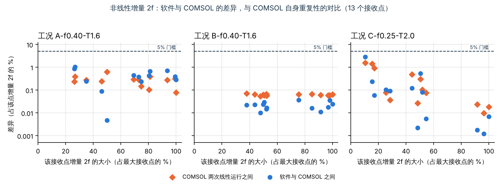

# P1：不运行 COMSOL 能回答多少（2026-11-20）

P1 计划的 24 次 COMSOL 运行完成了 9 次，剩余 15 次（3 次 StVK，12 次时间步和网格的收敛变体），按已完成运行的耗时估计需要 660–860 小时。这个环境里没有 COMSOL，所以这里做的是另一件事：**用软件自身和已有的 9 次结果，回答剩余 15 次运行原本要回答的问题。**

## 结论

| 剩余运行 | 原本要回答的问题 | 现在的答案 | 建议 |
|---|---|---|---|
| 层级 3–4：dt2、mesh2，共 12 次 | 软件与 COMSOL 在非线性增量 2f 上的差（最差接收点 0.04%–2.8%）有多少是 COMSOL 自己的离散误差 | 这个差与 COMSOL 自身的重复性同量级，在最差的接收点上是同一个点；软件一侧的网格和时间步都已收敛，比这个差小 50 倍以上 | **不必运行。** 用现有容差再算，分辨不出比现在更小的差别 |
| 层级 2：StVK，共 3 次 | 几何非线性和材料非线性是否各自正确，而不只是两者之和正确 | 两部分符号相反、在各接收点上的比例不同，所以“和”一致已经约束了每一部分：几何部分的比例误差不超过 0.24%，材料部分不超过 0.32% | **可以不运行。** 需要直接证据时再算，约 74 小时 |

这些运行都是核对，不是训练数据。训练标签来自谱元求解器，COMSOL 只用来确认标签是对的；这一点已由层级 1 的 6 次运行在 5% 门槛内确认。

下面是每条结论的依据。全部数字在 [levels.json](levels.json) 和 [time-integration.json](time-integration.json) 里。

## 1. 软件自身的网格收敛

三个工况在软件里（冻结图网络，与桌面版同一条计算路径）按“先升阶、再减小单元”的顺序算了四级。第一级是谱元标签所用的网格。比较量是非线性增量（Murnaghan − 线性）的 2f 幅值，以 COMSOL 为参考。

| 工况 | 级别（阶次，h） | 节点数 | 与 COMSOL：最差接收点 | 与 COMSOL：全部接收点的向量差 | 与软件最细一级的差 |
|---|---|---:|---:|---:|---:|
| A | 4，1.5 mm | 10,449 | 1.00% | 0.64% | 0.31% |
| A | 5，1.5 mm | 19,481 | 1.05% | 0.67% | 0.044% |
| A | 5，1.125 mm | 26,136 | 1.06% | 0.66% | 0.019% |
| A | 5，0.84 mm | 50,336 | 1.04% | 0.66% | — |
| B | 4，1.5 mm | 10,449 | 0.051% | 0.069% | 0.027% |
| B | 5，1.5 mm | 19,481 | 0.036% | 0.050% | 0.0015% |
| B | 5，1.125 mm | 26,136 | 0.036% | 0.050% | 0.0005% |
| B | 5，0.84 mm | 50,336 | 0.036% | 0.050% | — |
| C | 4，1.5 mm | 10,449 | 2.72% | 0.31% | 0.29% |
| C | 5，1.5 mm | 19,481 | 2.63% | 0.23% | 0.18% |
| C | 5，1.125 mm | 26,136 | 2.75% | 0.23% | 0.054% |
| C | 5，0.84 mm | 73,216 | 2.81% | 0.23% | — |

- 软件自身在收敛：最后一次加密只改变 0.0005%–0.054%。
- 与 COMSOL 的差不随加密变化，是最后一次加密变化量的 50–70 倍。**所以这个差不是软件的网格造成的。**
- 每个工况三种本构一起算，在 4 核容器上用时 12–138 秒。

## 2. 软件自身的时间收敛

软件的时间推进是显式的。为了独立检查它，用仓库里的隐式参考求解器（`spectral3d.implicit`：平均加速度 Newmark，每步把完整的超弹性内力迭代到收敛）在同一网格（4 阶，1.5 mm）上重算，步长逐次减半。这个格式与 COMSOL 用的广义 α（ρ∞ = 1）同属二阶、无数值阻尼。

<!-- time-table -->

- 隐式结果随步长按二阶收敛到软件的结果（工况 A：1.22% → 0.42% → 0.21%，扣除一个约 0.15% 的不随步长变化的底）。**软件的时间推进与一个完全不同的积分格式在步长趋于零时一致。**
- 把隐式求解器的步长取成 COMSOL 的名义步长 0.01 μs，结果并不更接近 COMSOL，反而更远（工况 A：2.2%，软件是 1.0%）。所以 COMSOL 的结果里没有“固定 0.01 μs 步长的二阶格式”那么大的时间误差：它的容差控制很可能让实际步长小于上限。**软件与 COMSOL 的差也不是时间步造成的。**
- 归档里没有基准运行的 `solver.log`，实际步长无法在这里确认。手边有运行文件夹的话，看 `solver.log` 里的步长一列即可，不需要新的计算。

这是用参考求解器做的归因实验，不是软件的计算路径。

## 3. 这个差与 COMSOL 自身的重复性同量级

三个线性基准在 COMSOL 里算过两遍（2026-10-30 和 2026-11-09）：两版模型源码，单元、自由度和求解设置相同。两遍结果之差在 2f 处的大小，除以非线性增量的 2f，就是 COMSOL 在这个量上能重复到什么程度。



| 工况 | 软件与 COMSOL：最差 / 中位 | COMSOL 两次运行之间：最差 / 中位 | 最差的接收点 |
|---|---:|---:|---|
| A | 1.04% / 0.39% | 0.62% / 0.28% | 软件 `top[2]`，COMSOL `mid[1]` |
| B | 0.036% / 0.022% | 0.071% / 0.062% | 13 个点上软件的差都小于 COMSOL 的重复性 |
| C | 2.81% / 0.08% | 1.56% / 0.08% | 都是 `P_far`，该点的增量 2f 只有最大接收点的 10.5% |

- 三个工况的顺序相同（B 最小，A 居中，C 的最差点最大），数值相差不到两倍。
- C 的 2.8% 来自一个信号最弱的接收点，COMSOL 自己在这个点上也只能重复到 1.6%。其余接收点的中位差是 0.08%。
- 原因是量级：非线性增量只有位移的 6×10⁻⁵–4×10⁻⁴，COMSOL 的相对容差是 10⁻⁶，两者之比就是百分之一上下。
- 工况 A 还有一层：两个代码的**线性记录**在 2f 处相差增量 2f 的 1%–20%（线性记录自身的 2f 成分是增量的 60 倍）。这部分在“Murnaghan − 线性”里抵消，剩下 1%。也就是说，A 的增量是两个大数之差，1% 已经是很好的抵消。

**所以现有对照已经到了 COMSOL 的分辨率。** 用同样的容差再算 dt2 和 mesh2，得到的 COMSOL 自身差异预计也在这个量级，分不清是收敛误差还是重复性。要让这些运行有意义，先要把 COMSOL 的容差收紧一到两个量级，耗时会更长。

## 4. 几何和材料两部分

StVK 运行的用途是把增量拆成几何部分（StVK − 线性）和材料部分（Murnaghan − StVK）分别核对。软件里这两部分的情况：

| 工况 | 几何部分 / 增量 | 材料部分 / 增量 | 两部分的夹角余弦 | 几何部分比例误差的上限 | 材料部分比例误差的上限 |
|---|---:|---:|---:|---:|---:|
| A | 0.88 | 1.65 | −0.86 | 1.5% | 0.78% |
| B | 0.25 | 1.25 | −0.9999 | 12% | 2.4% |
| C | 1.24 | 0.93 | −0.61 | **0.24%** | **0.32%** |

（幅值和夹角按 13 个接收点的复 2f 系数计算。）

- 两部分符号相反，各自和增量一样大或更大，增量是它们的差。
- 如果软件把其中一部分算错了一个比例 ε，增量就会偏离 COMSOL ε × 该部分，除非另一部分的误差恰好抵消。能被抵消的只是两部分在各接收点上成比例的那一份。
- 工况 A、C 里两部分并不成比例，所以“增量与 COMSOL 一致”已经限制了每一部分各自的误差。最紧的是 C：几何部分不超过 0.24%，材料部分不超过 0.32%。
- 工况 B 里两部分几乎完全成比例，单靠 B 分不开。但三个工况用的是同一套本构和同一组三阶常数。

这个上限针对的是“某一部分整体差一个比例”的错误，例如某个三阶常数或几何项的系数不对。它不是 StVK 运行的替代品，但说明这三次运行能提供的新信息有限。

## 5. 预测与事后对照

如果以后还是要运行，软件对 15 次运行的预测已经固定：

- [predictions/](predictions/) 里是软件最细一级的 9 个结果（三个工况 × linear、stvk、murnaghan），格式与 COMSOL 交付文件相同，写于任何层级 2–4 的运行存在之前。哈希记在 `levels.json` 的 `prediction_csv_sha256` 里。
- COMSOL 结果到了以后，一条命令出对照：

```sh
python research/comsol-p1-20261024/local_kit.py collect p1-kit/runs --output p1-delivery
python research/comsol-p1-20261024/compare_remaining.py p1-delivery --output p1-remaining.json
```

  `collect` 要求 `runs/` 里有本构自检的文件夹，所以重新生成运行包时带上层级 0（`--tiers 0 2 3 4`，自检只要几分钟）。

  - StVK：几何和材料两部分分别与预测对比，5% 门槛。
  - dt2、mesh2：COMSOL 加密前后的差，以及软件与两者的差。

## 6. 复现

```sh
python research/comsol-p1-20261024/software_levels.py run        # 约 20 分钟，4 核
python research/comsol-p1-20261024/software_levels.py analyse    # levels.json 和 predictions/
python research/comsol-p1-20261024/time_integration.py run       # 约 2 小时，4 核
python research/comsol-p1-20261024/time_integration.py analyse   # time-integration.json
python research/comsol-p1-20261024/software_levels_figure.py     # receivers.png，需要 matplotlib
```

计算结果放在 `WORKAI_P1_JOBS` 指定的目录，默认是系统临时目录。

## 7. 局限

- 没有运行任何新的 COMSOL 计算。上面关于 COMSOL 的判断只来自已有的 9 次结果。
- “COMSOL 自身的重复性”取自两版源码的线性运行，不是同一份源码的两次运行，也没有非线性运行的重复。它是 COMSOL 结果不确定度的一个估计，不是严格的界。
- 没有 COMSOL 的 dt2 和 mesh2，就没有 COMSOL 自身收敛的直接证据。第 2、3 节是间接论证：软件一侧收敛，剩下的差与 COMSOL 的重复性一致。
- 三个工况都是 1.6–2.0 mm 厚的板、0.25–0.40 MHz、30 μs。结论不外推到其他范围。
