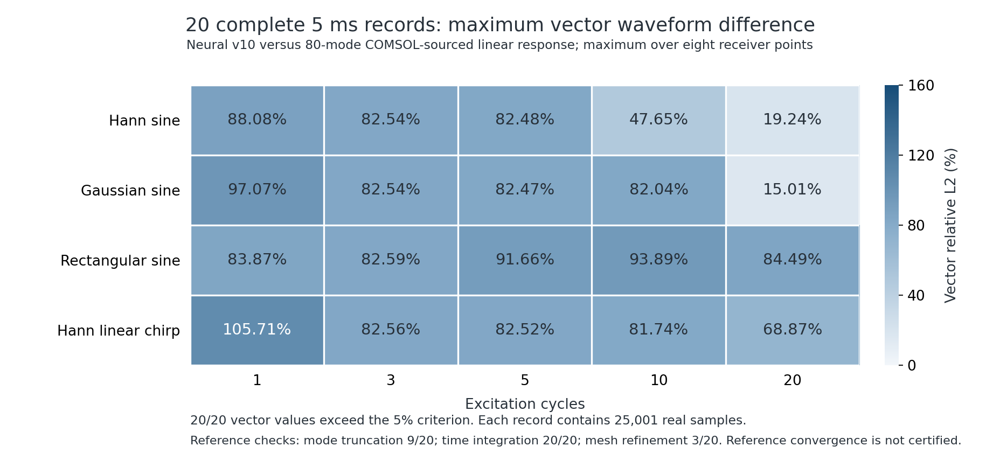

# 第 10 轮：六阶导数与四次非线性场约束

**正式训练、40 组完整 5 ms 成对验证及独立离线复核已完成，仍未获得 5% 精度认证。** 同一六阶网格上，逐组最差接收点向量差异由 **15.12%–106.10%** 变为 **15.01%–105.71%**，全部线性波形/频谱检查通过 **0/20**。候选保留为研究权重，没有替换离线软件默认模型。

## 本轮方案与物理约束

[冻结方案](continuation-v10-plan.json)保持固定端 8 × 3 × 1.5 mm 铝板与 h=1.6 mm，阶数由 P5 提升为 **P6：10 个单元、2821 个节点**。每 0.2 μs 输出采样包含 53 个内部步，实际内部步长为 0.003773584906 μs。材料张量、质量规则、时间权重和完整神经传播代码均保持不变。新增解析六阶导数作为[本轮对照](training/v10-untrained/initialization.json)，原三、四、五阶导数矩阵逐项保持不变。

[空间诊断](diagnostics/spatial-resolution-v10.json)显示，未训练 P5 h=1.6、P6 h=2.5、P6 h=1.6 的主要模态频差分别为 **84.3818、65.2605、48.6601 Hz**。选择 P6 h=1.6 只用了开发用模态，未读取瞬态验证波形。阶数提高带来的改善与本轮权重训练的改善分别报告。

六阶矩阵仍严格满足 GLL 离散分部积分 \(WD+D^TW=B\)、常数/一次/二次导数一致性和反中心对称，剩余 **4 个训练参数**。保留完整 Murnaghan 纵向、两个横向、混合剪切、牵引、应变能和内功率约束，连续方程及归一化见[物理约束说明](NONLINEAR-PHYSICS.md)。

本轮将制造位移场扩展为交替的三次/四次多项式，六个场族在各阶次内均匀覆盖。四次位移的梯度是三次，其首要非线性应力包含六次项，可检查三次位移场难以发现的高阶导数误差；完整非线性仍按原本构计算，没有将高次项截断。

[约束覆盖诊断](diagnostics/quartic-field-coverage-v10.json)注入一个仍满足分部积分的高阶错误：三次场最大残差仅 **0.0094145%**，扩展场为 **4.27017%**，因此会被既定 **2.5% 训练门槛**拒绝。该诊断不属于训练后的独立验收，也不声称这个错误超过 5%。[11 项方程与算子测试](diagnostics/continuation-v10-unit-validation.json)通过，包括实际神经线性内力与模态切线一致性。

## 正式训练与独立物理验收

[预训练](training/v10-preflight/summary.json)使用 48 个场和 24 个检查场。正式训练从相同解析 P6 起点独立开始，使用种子 2026102513 的 **576 个场、31,680 项分量约束**；独立检查使用种子 2026102514 的 **288 个新场、15,840 项分量检查**。每个集合各有一半三次和一半四次位移场。训练硬门槛为 2.5%，独立检查门槛为 5%，检查场不参与优化或参数回退。

SLSQP 原始状态：**Optimization terminated successfully**，成功标记为 `true`；目标函数评估 24 次，总前向评估 128 次，用时 **1069.25 秒**。最终训练最大残差 **2.49500%**。保留原优化状态、训练场约束回退记录和全部源代码快照。

| 同一 P6 网格 | 未训练对照 | v10 |
| --- | ---: | ---: |
| 主模态频差，Hz | 48.660072 | 48.245106 |
| 7 个训练模态频差范数，Hz | 240.578627 | 238.133020 |
| 根据频差计算的主模态 5 ms 末端相位漂移 | 87.5881° | 86.8412° |

相位漂移只是频差诊断，完整多模态波形在下文独立检查。[最大训练约束](diagnostics/v10-largest-training-constraints.json)同时保留各约束的场族、分支、方向和参数边界状态。

原优化参数的最大绝对值为 **1.000000**，触及预定 ±1 边界；可行性回退后为 **0.998001**。最大训练残差来自材料分支的第一横向边界动量，三次和四次场都接近 2.5% 训练门槛。本轮保留这一边界状态，没有根据验证结果扩大参数范围或放宽约束。

| 同一批 288 个独立场的最大物理残差 | 未训练对照 | v10 |
| --- | ---: | ---: |
| 内部动量 | 0.0207997% | 0.566752% |
| 边界动量 | 0.0430844% | 2.49512% |
| 牵引 | 4.39242e-08% | 0.0188219% |
| 应变能 | 1.98911e-07% | 0.00500697% |
| 内功率 | 3.07278e-07% | 0.0499683% |

独立物理检查 **通过**：最大残差 **2.49512%**，失败 **0/15,840**。分部积分矩阵最大绝对残差为 **1.880e-14**；有限刚体运动检查通过。这些是物理算子残差，不能当作位移波形误差。见[相同场成对重算](diagnostics/physics-validation-v10-paired.json)。

## 原生 COMSOL 短时非线性检查

使用已归档的实际 COMSOL Hann 2 周期、0.22 MHz、1 MPa、20 μs 三控制数据。下表是八个接收点 XYZ/向量中可计算相对值的最大差异，保持 1e-13 m 弱信号门槛。

| 比较量 | 同网格未训练对照 | v10 |
| --- | ---: | ---: |
| 线性 / StVK / 完整响应最大值 | 3.68618% | 3.68618% |
| 几何非线性增量 | 9.45634% | 9.51422% |
| 材料非线性增量 | 6.95323% | 6.99752% |
| 总非线性增量 | 6.18157% | 6.22161% |

原生短时整体验收：对照**未通过**，候选**未通过**。完整指标见[对照](diagnostics/native-nonlinear-20us-v10-untrained.json)和[v10](diagnostics/native-nonlinear-20us-v10.json)。[失败明细](diagnostics/native-failures-v10.json)保留波形和频谱的全部超限项及绝对量级，没有因接近弱信号门槛而改判。该原生参考尚未完成此工况的空间、时间收敛验收，不能外推为 20 组 5 ms 原生非线性精度证书。

## 全部 40 组完整 5 ms 记录

[对照工作流](https://github.com/lx016922-dot/workAI/actions/runs/40169422099)与[候选工作流](https://github.com/lx016922-dot/workAI/actions/runs/40170451669)均已完成。Hann、Gaussian、矩形窗正弦、Hann 窗线性扫频，各覆盖 1、3、5、10、20 周期。每组 **5000 μs、25001 点、8 个接收点、三个神经本构控制**。两套共 3920 个原始分块均检查了来源摘要、时序、初边值、能量和比较指标，原始科学判定与独立重算一致。

| 完整长记录检查 | 同网格未训练对照 | v10 |
| --- | ---: | ---: |
| 逐组最差接收点向量相对差范围 | 15.12%–106.10% | 15.01%–105.71% |
| 全部线性波形/频谱检查 | 0/20 | 0/20 |
| 1% 能量收支检查 | 20/20 | 20/20 |
| COMSOL 48/80 模态截断检查 | 9/20 | 9/20 |
| COMSOL 模态积分容差细化检查 | 20/20 | 20/20 |
| COMSOL h=0.35/0.30 mm 空间细化检查 | 3/20 | 3/20 |

同一六阶网格上，训练使 **20/20** 组最大向量差异下降，**160/160** 个接收点改善。逐组最大差异变化为 **-0.62796 至 -0.11418 个百分点**；负值表示下降。阶数提高的作用不计入这项训练收益。见[成对 JSON](diagnostics/v10-same-grid-training.json)、[CSV](diagnostics/v10-same-grid-training.csv)和[完整候选指标](candidate-matrix20-v10/summary.json)。

| 信号与周期 | 对照最大向量差异 | v10 最大向量差异 | 变化，百分点 |
| --- | ---: | ---: | ---: |
| hann-01 | 88.63425% | 88.08096% | -0.55329 |
| hann-03 | 83.16921% | 82.54192% | -0.62729 |
| hann-05 | 83.11058% | 82.48291% | -0.62766 |
| hann-10 | 48.02294% | 47.64799% | -0.37494 |
| hann-20 | 19.38845% | 19.23753% | -0.15092 |
| gaussian-01 | 97.53687% | 97.07012% | -0.46675 |
| gaussian-03 | 83.16384% | 82.53663% | -0.62721 |
| gaussian-05 | 83.09877% | 82.47136% | -0.62741 |
| gaussian-10 | 82.66659% | 82.04067% | -0.62591 |
| gaussian-20 | 15.12151% | 15.00734% | -0.11418 |
| rectangular-01 | 84.47699% | 83.86731% | -0.60968 |
| rectangular-03 | 83.21445% | 82.58649% | -0.62796 |
| rectangular-05 | 92.01130% | 91.65678% | -0.35452 |
| rectangular-10 | 94.29569% | 93.88524% | -0.41045 |
| rectangular-20 | 85.05065% | 84.49432% | -0.55633 |
| chirp-01 | 106.10420% | 105.71008% | -0.39412 |
| chirp-03 | 83.19079% | 82.56332% | -0.62747 |
| chirp-05 | 83.15099% | 82.52313% | -0.62786 |
| chirp-10 | 82.36013% | 81.73815% | -0.62198 |
| chirp-20 | 69.39125% | 68.86708% | -0.52417 |



另用上一轮和本轮的解析未训练对照，在相同物理场景、材料、时间系数、推理源码和 COMSOL 参考下，比较 **P5 / 每采样 38 个内部步**与 **P6 / 每采样 53 个内部步**。这一离散方案变化使 **20/20** 组最大向量差异下降、**160/160** 个接收点改善，逐组最大差异变化 **-45.10664 至 -8.28068 个百分点**。它同时包含空间阶次和随 CFL 自动变化的时间步影响，不计入上面的权重训练收益。共同权重数组及两阶解析导数均已核验，见[离散方案对比](diagnostics/v10-discretization-comparison.json)与[CSV](diagnostics/v10-discretization-comparison.csv)。

五组扫频另做[80 项向量模频带检查](diagnostics/chirp-vector-bands-v10.json)。没有对齐相位、缩放幅值、缩短分析窗或根据验证结果挑选候选。

长记录参考来自实际 COMSOL 本征数据重建的**线性模态响应**，尚未全面收敛；三个神经网络控制不等于三个原生 COMSOL 长记录真值。本轮开始时远端健康检查在线，但安装源码哈希与已归档版本不同。本轮没有覆盖远端未知版本、没有提交新的原生 COMSOL 求解，训练和对比使用已有可核验数据。

## 离线复现与决定

Linux 便携运行时使用发布时固定的依赖，从独立复制的源码目录重新计算预先选定的 Hann 1 周期完整 5 ms、三控制记录，用时 **4791.16 秒**。本次没有重新下载原软件 ZIP；运行时清单内 **7998** 个文件逐项核验长度与 SHA-256。计算不需要联网。

离线与 CI 各 98 个分块均核验。72 个位移分量及全部能量列通过预先固定的浮点复现容差；非弱分量最大相对 L2 差 **0.000e+00**，最大差异 RMS **0.000e+00 m**。所有科学判定、弱信号分类相同。完整轨迹见[traces.npz](development-validation-v10-offline/hann-01/traces.npz)，细节见[核验回执](development-validation-v10-offline/hann-01/verification.json)。复现容差 1e-7 不替代科学精度门槛 5%。

[Windows 便携软件构建、完整性与默认模型实际预测回归](diagnostics/v10-software-regression.json)通过。[最终决定](diagnostics/v10-decision.json)为 **拒绝晋升默认模型**：独立物理检查、短时原生比较、长期波形和参考收敛分别验收；完整原生 COMSOL 非线性 20 组 × 5 ms 三控制参考仍未完成。

## 复现训练

最终候选 SHA-256：`e2f0f2cfefea2ea2428a1771426f4959bb27c00875283b1003303a8747177bd2`。本轮解析 P6 对照为 `1c7f99e25e6da42fe7f02b4f56a0000fd75d8db831e8d59c21bde642f8e7934e`；离线默认权重仍为 `ee413a70b30e6402e174e8d16a92df9ddd96aaa4a6192df472b74f877311df83`。

```sh
OPENBLAS_NUM_THREADS=1 OMP_NUM_THREADS=1 NUMBA_NUM_THREADS=3 \
python -m graphwave.modal_calibration --action train \
  --reference research/comsol-validation/data/eigen-035-v7 \
  --check-reference research/comsol-validation/data/eigen-030-v7 \
  --weights research/comsol-validation/training/v10-untrained/candidate-weights.npz \
  --degree 6 --h-mm 1.6 --consistency-order 2 --summation-by-parts \
  --physics-polynomial-degree 4 --physics-samples 576 --physics-validation-samples 288 \
  --physics-seed 2026102513 --physics-weight 30 --optimizer slsqp \
  --constraint-form rms --physics-limit .025 --gradient-step .0001 \
  --dominant-phase-weight 10 --parameter-bound 1 --optimizer-tolerance .0000001 \
  --max-iterations 80 --output new-v10-training-run
```

[正式配置、原始优化记录、场、权重与源码快照](training/v10/summary.json)完整保留。训练使用 Python 3.12.14、NumPy 2.3.5、SciPy 1.17.0；长记录复核固定 NumPy 2.2.6、SciPy 1.15.3、Numba 0.63.1。所有研究候选继续标记未获长期精度认证。
