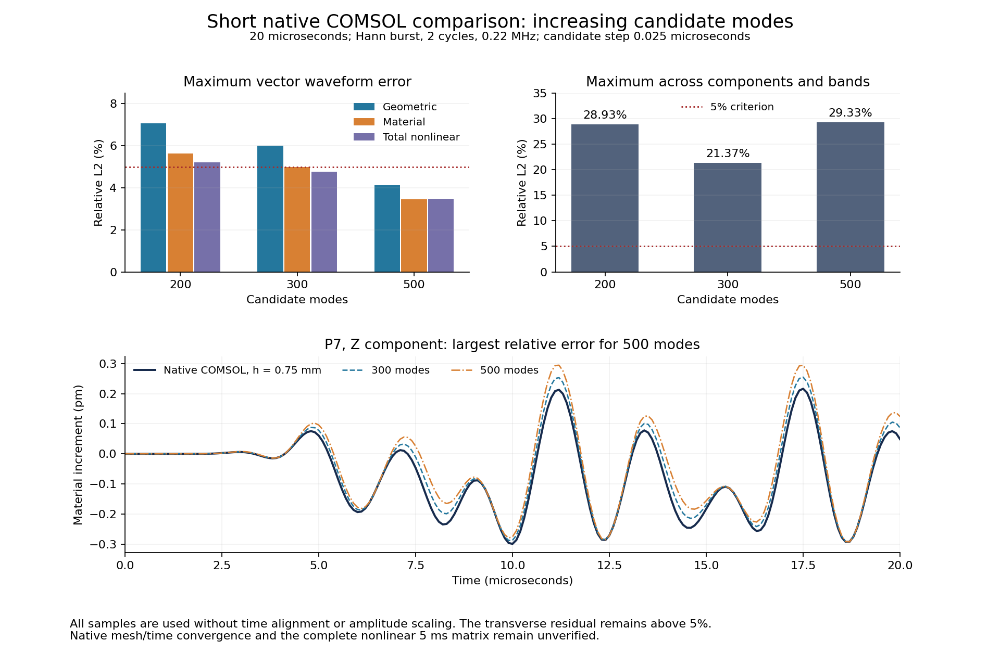

# V11 continuation: nonlinear modal graph research

This is a continuation of the software published at [v0.3.0](https://github.com/lx016922-dot/workAI/releases/tag/v0.3.0).
The default offline weights are unchanged. **V11 has not met the complete 5% accuracy gate.**

The verification matrix remains Hann, Gaussian, rectangular and chirp excitation,
each with 1, 3, 5, 10 and 20 cycles, eight three-component receivers, and complete
5000 microsecond records. Linear, geometric-nonlinear and full Murnaghan controls
start from zero. No time shift, amplitude rescaling or shortened analysis window
is allowed. Nonlinear increments are checked separately from total displacement.

## Research implementation

The new candidate uses its own learned graph tangent to construct a modal basis.
COMSOL arrays do not enter candidate inference. A symmetric fourth-order
composition combines accurately driven candidate linear flow with conservative
nonlinear increments. The external forcing uses DOP853 at a fixed 1e-12 relative
tolerance; free evolution uses the candidate's exact oscillator solution.
Every entry of the learned quadratic/cubic material tensors and
every original quadrature point contributes to the nonlinear force. Truncating the
modal basis still requires independent convergence evidence.

For the rectangular plate under uniform axial traction, exact reflection symmetry
allows a quarter computational domain. Transverse displacement remains present:
its sign changes under the corresponding reflection. The quarter domain fixes only
the appropriate normal displacement at each symmetry plane. Asymmetric loads and
material tensors are rejected. Full-domain/quarter-domain tests independently
check mass, traction, all three constitutive energies and matching eigenfrequencies.

The P6 candidate uses 12 x 3 x 3 quarter-domain elements, with grading ratios
50 x 12 x 12, 26,353 nodes and 200 modes in the loaded symmetry class. Its basis is
compiled from the candidate weights alone. Compiler source snapshots, input and
artifact hashes are retained.

Training retains exact affine/quadratic derivative consistency, summation by parts,
fixed-boundary conditions and objective material energy. Analytic eigenfrequency
sensitivities avoid finite differences of large eigensolves. Each sequential
optimization step rechecks actual eigenfrequencies and the full nonlinear physical
constraints before acceptance.

## Evidence available so far

| Check | Result | Scope |
| --- | --- | --- |
| Moderate graded COMSOL full-domain mesh pair | Maximum relevant frequency change 1.14277 Hz | Fails the 0.5 Hz phase-reference gate |
| Quarter-domain COMSOL, uniform cross section, h = 0.3 / 0.2 mm | Maximum relevant frequency change 6.19566 Hz | Mesh geometry, reflections and modal energy identities verified; phase gate fails |
| Quarter candidate linear development matrix, first 53 modes | 19/20 vector checks; 15/20 complete component/band checks | Actual 5 ms linear responses; not nonlinear certification |
| Quarter candidate versus existing coarse native COMSOL 20 us record | Geometric increment 15.066%; material increment 11.097% maximum vector error | Fails; the coarse reference also needs spatial/time convergence |
| Formal physical training, 576 fields + 288 independent fields | Both pass; validation maximum 0.04662% | Physical residuals are not waveform errors |
| Pinned offline runtime numerical tests | 30 tests pass | Force/energy consistency, sensitivity, mesh, symmetry and independent 5 ms closed-form forcing checks |
| Corrected temporal layer, native 20 us scene, 200 candidate modes | 0.1 versus 0.025 us: maximum nonlinear-increment vector change 0.531%; complete component/band change 3.234% | Short temporal convergence only; not a COMSOL accuracy certificate |
| Candidate versus new native quarter COMSOL, h = 0.75 mm, 20 us | Maximum vector errors: linear 0.530%, geometric increment 7.067%, material increment 5.645%, total nonlinear increment 5.210%; maximum complete check 28.926% | Fails; independent finer native mesh/time checks remain pending |
| Explicit cross-section graded quarter COMSOL, h = 0.3 mm | Rejected: actual y spacing decreases toward the symmetry plane | Mesh orientation differs from the requested outer-surface refinement; excluded from training and convergence admission |
| 300 candidate modes versus the same native h = 0.75 mm, 20 us record | Geometric increment 6.001%, material increment 4.979%, total nonlinear increment 4.761% maximum vector error; maximum complete check 21.368% | Still fails complete native comparison |
| Candidate modal refinement, 200 to 300 modes at 20 us | Maximum complete change 7.758%; common-mode MAC at least 0.9999999999999967 and maximum common frequency change 7.46e-9 Hz | Truncation is not fully converged; improvement is from additional modes, not changed lower frequencies |
| Independent reference reconstruction and evolution tests | Exact Q4 polynomial derivatives, Murnaghan energy/force derivative, and sixth-order flow versus adaptive Duffing integration all pass | Implementation tests only; actual native-reference admission is pending |
| Nonlinear quadrature diagnostic, original GLL to Gauss 9, 200 modes at 20 us | Maximum complete waveform change 0.07168%; native comparison remains approximately 28.926% | Increasing quadrature alone does not resolve the observed discrepancy |
| Independent analytic physical admission, 300 modes and 64 fresh random fields | Original graph passes all 2,496 checks; maximum residual 0.6270%, below the unchanged 2.5% limit | Separate geometric/material/total increments, x/y/z/summed weak momentum, three modal norm scalings and nonlinear energy; not waveform certification |
| Gauss 4 acceleration candidate on the same independent fields | Rejected; maximum raw weak-force error 47.422%, and cancellation-sensitive nonlinear energy error 368.473% | Original graph passes the same checks; reduced quadrature is not used in inference |
| Positive-cubature sketch preflight, 247 retained points | Rejected; maximum independent residual 74.656% | Training states, weights, executed source and failed checks remain archived; no inference use |
| Gauss 5 and Gauss 6 acceleration candidates, 64 fresh fields each | Rejected; maximum residuals 20.956% and 13.511%, respectively | Their original full-graph controls pass the same independent analytic checks; neither approximation is used in prediction |
| Complete-feature positive-cubature training, 948 positive points | Training feature residual 0.09676%, independent preflight maximum 10.6247% | Rejected for inference |
| Broader independent admission, 128 fresh fields and gradient norms up to 8e-4 | Original graph maximum 0.08551% (passes); fitted cubature maximum 11.768% (fails) | All 4,992 geometric/material/total momentum and energy constraints retained; the reduced quadrature is not used in any prediction |
| 500 candidate modes versus native h = 0.75 mm, 20 us, 0.0125 us candidate step | Maximum vector errors: geometric 4.131%, material 3.462%, total nonlinear 3.491%; strict maximum 29.358% | Vector checks improve, but the small P7 Z material increment still fails; its reference RMS is 0.144516 pm and error RMS is 0.042428 pm |
| Same-basis 300 to 500 modes, and 500-mode time refinement | Maximum complete modal change 15.082% (fails); 0.025 to 0.0125 us time change 0.02871% (passes) | Short modal truncation remains unconverged; full 5 ms nonlinear accuracy is still unverified |

The first formal optimization changes the seven-mode frequency-error norm only
from 2.433461 to 2.433270 Hz. The further run reduces this norm to 2.317378 Hz, with maximum training/independent
physical residuals of 0.82185%. It reduces the soft physical loss weight while
retaining the same 2.5% hard per-constraint limit and fresh independent validation
fields. Neither training result is an accuracy certificate.

The later manufactured-modal-field checks retain 39 separate constraints per
field: geometric/material/total nonlinear increments, x/y/z/summed weak momentum
in three modal norms, and each nonlinear energy. The initial Gauss 4/5/6 trials
use maximum gradient norms between 2e-5 and 1e-4. Their archived reports preserve
near-zero energy denominators and failures. The portable
`tools/validate-modal-quadrature.py` additionally records absolute errors and
reference norms, verifies model identity, and supports explicitly declared
gradient ranges. The completed positive-cubature admission uses 128 new fields with
gradient norms up to 8e-4. This is a separate physical check, not a change to the
5% waveform criterion.

A 500-mode candidate with the same phase-training weights and original mesh has
been compiled in [run 40213705025](https://github.com/lx016922-dot/workAI/actions/runs/40213705025).
The immutable release asset is `WorkAI-GraphModal-research-v11-phase500-ci.zip`
(290,978,756 bytes; SHA-256
`91c402ea990cc616650cabe06b084061073c786dfec96ae6960d8f1be16e2f84`).
CI verifies the complete archive, and the published GitHub asset digest agrees.
The follow-up [run 40214419484](https://github.com/lx016922-dot/workAI/actions/runs/40214419484)
uses this single basis for 300/500-mode comparisons and a halved internal time
step, against the same archived native 20 us COMSOL record. All three predictions
completed, and the pinned local runtime independently reproduces the complete CI
comparison report from the downloaded raw arrays. These calculations cannot
establish complete 5 ms accuracy. The default offline model remains unchanged.



The figure uses the same 0.025 us candidate step for all mode counts; the table
also reports the 500-mode result at the halved step. All 201 original samples are
used. The failing transverse response is displayed without alignment, rescaling
or changing the existing small-signal floor. Raw predictions, full metrics, plot
source, a PDF and the plotted CSV are archived together.

`tools/recompare-native-modal-prediction.py` is queued behind the current native
h = 0.5 mm spatial/time solves. It reuses the unchanged saved 500-mode prediction
and checks both successive native refinements. This separates changes in the
reference from changes in the model. Its first comparison against the original
h = 0.75 mm reference reproduces every existing component/band metric exactly.

The ongoing 5 ms offline replay uses the published 200-mode phase archive and the
pinned Python runtime from the existing offline distribution. A queued checker
waits for both this complete record and the matrix's separate audit/publication.
It verifies the complete released Hann evidence ZIP before extracting the
matching case, requires identical prediction identities and complete time grids,
and compares all control/nonlinear component and spectral histories. Replay
thresholds are 0.01% relative and 1e-18 m below the existing small-signal floor.
This verifies software reproducibility; it cannot supply a nonlinear COMSOL
accuracy certificate. The short checker smoke test does not substitute for the
pending complete 5 ms replay.

An independent forcing diagnostic found that the original external-force kick
scheme alone caused 6.934% vector error for the rectangular five-cycle case at a
0.2 us step (29.729% including all component/band checks). The two original batch
runs, 40201236214 and 40201622534, were cancelled and retained as incomplete
evidence. The corrected implementation evolves nonlinear increments around the
accurately forced candidate linear trajectory. The new full-duration plan is
`plans/v11-quarter-driven.json`, with a 0.1 us internal step. Existing compiled
bases remain immutable: their graph tangent and eigenvectors are unchanged, while
each prediction records the separate corrected runtime source hashes.

Native quarter-domain COMSOL spatial/time refinements and an explicitly graded
quarter-domain reference pair are queued separately. The signed transport keeps
the original time-step, export, polynomial-order and element-budget limits.
Each source revision is compiled through the existing compare-and-swap endpoint;
the server retains its previous source and manifest. Unknown submission outcomes
must be resolved by querying the original job identity, never by duplicate POSTs.
Read-only status/log/download requests now recover from bounded transient proxy
failures while preserving signed-response verification. Submission errors and
timeouts are never automatically replayed. Four transport tests cover recovery,
unchanged job identity, signature rejection and the no-duplicate-submission rule.

The actual-axis audit detected that COMSOL's y-edge orientation reverses the
requested one-sided grading. `UltraResearchV11QuarterGradedChecked.java` corrects
that edge and checks all actual axis counts, spacing directions, grading ratios
and Cartesian element counts before solving. The original completed result and
its rejection remain archived. The corrected variant has not yet supplied an
admitted reference.

`UltraResearchV11QuarterNodal.java` prepares a separate research reference: native
COMSOL eigenfields at every Q4 tensor-element node. Coordinates and eigenfrequencies
are stored once in the signed receipt; the compact CSV retains all three field
components in double precision. Two prepared exports contain 78 modes at h =
0.35 mm and 56 at h = 0.3 mm, each below the unchanged two-million-record limit.
The 256 MiB decoded-export limit also remains enforced. They wait behind the native refinement queue.
These are inputs to a future independently validated nonlinear modal reference,
not completed nonlinear COMSOL transients.

`tools/comsol_nodal_reference.py` reconstructs those native eigenfields on their
actual Q4 cells using independently refined Gauss quadrature. It rejects a basis
unless reconstructed modal mass and stiffness agree with the original COMSOL
integrals. Its nonlinear force uses the analytic material constants and complete
Murnaghan Piola stress, without candidate weights. `tools/run-comsol-nodal-transient.py`
uses a sixth-order symmetric time composition, distinct from the candidate's
fourth-order composition. Both use the independently tested forced-oscillator
routine; reference modal force integrals are explicitly multiplied by traction
amplitude in pascals. A Duffing comparison detected this required unit conversion
before any actual reference prediction was admitted.

The queued reference qualification retains separate native COMSOL, spatial,
modal-count, quadrature and temporal checks. A successful model reconstruction or
short transient calculation cannot certify the required complete nonlinear 5 ms
matrix. All original reference budgets and the 5% acceptance criterion remain in
force.

The current complete nonlinear matrix is run
[40204192440](https://github.com/lx016922-dot/workAI/actions/runs/40204192440),
frozen at commit `1cb35bc82c056b9960f3e94d4f7c679afe8f2ee6`.
`tools/audit-modal-matrix.py` independently reloads its saved arrays, verifies the
complete time grid and model identity, reconstructs receivers from saved modal
coordinates, checks energy histories and sampled conservative potentials, and
regenerates each linear COMSOL comparison. The separate audit/publication workflow
requires all 20 source jobs to finish before running. Its acceptance flag remains
false without full-duration nonlinear reference and convergence evidence.

## Reproduction

Use the Python runtime included in the existing offline distribution, or Python
3.12 with NumPy 2.2.6, SciPy 1.15.3, Numba 0.63.1 and llvmlite 0.46.0. All model
prediction and archived-reference comparisons run without a network connection.
Live COMSOL regeneration requires the separately configured licensed server.

```sh
python tools/run-modal-candidate-case.py \
  --model /path/to/extracted/research-model \
  --plan research/comsol-validation/plans/v11-quarter-driven.json \
  --case hann-01 --step-us 0.1 --modes 200 --output results \
  --reference research/comsol-validation/data/eigen-graded20-030-v11 \
  --check-reference research/comsol-validation/data/eigen-graded20-035-v11
```

The runner saves all three complete predictions before loading reference arrays.
It retains modal coordinates, receiver histories, energy histories, source hashes,
model identity and separate reference-convergence checks. A linear reference cannot
set the nonlinear accuracy flag. The research workflow is
`.github/workflows/comsol-modal-validation.yml`; a successful workflow means the
calculation completed, not that the scientific 5% gate passed.

The 20 complete 5 ms predictions have now finished (run 40204192440). The first
independent audit stopped on a near-zero numerical residual, with a difference
of 3.8848e-12, before any evidence release was published. The repaired auditor
checks every component/band diagnostic and preserves every acceptance decision;
its numerical replay allowances do not modify the scientific 5% criterion.

Both native 20 us refinements are collected and signature/hash verified. The
h = 0.75 to 0.50 mm change is at most 0.8362%; halving the native time step from
0.01 to 0.005 us changes the checks by at most 0.2197%. The unchanged 500-mode
prediction still has 29.2749% maximum material-increment error against the finer
time result. Reference convergence therefore does not explain that failure.
The datasets and comparisons remain separate from training. A complete local
5 ms Hann replay has also finished; cloud/offline comparison awaits evidence
publication. Full 5 ms nonlinear COMSOL accuracy remains unverified.
