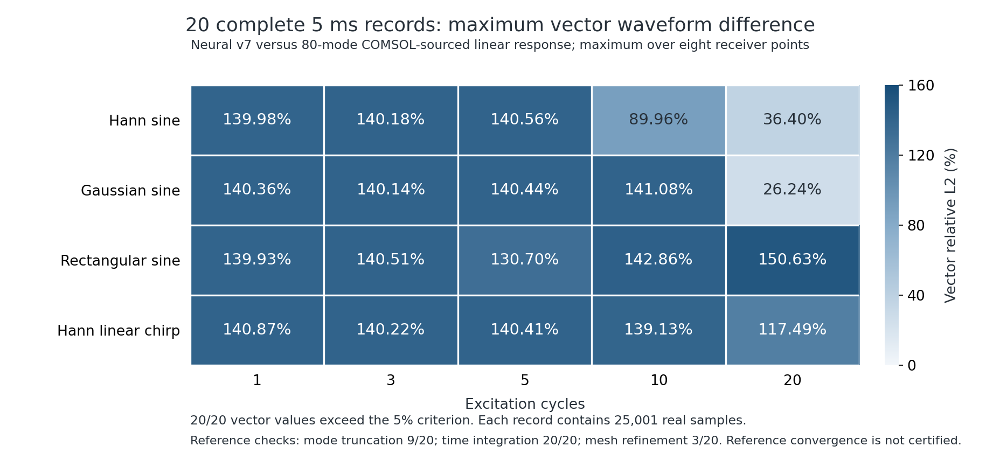

# 第 7 轮：更细 COMSOL 参考与扩大非线性约束

**第 7 轮训练和 20 组真实 5 ms 验证已完成，但长波形退步，不采纳为模型改进。** 同一 COMSOL 参考下，全部 160 个接收点的向量差异略有上升；20 组通过数仍为 **0/20**，每组最差点位的向量相对 L2 差异为 **26.24%–150.63%**。独立制造场物理检查与短窗口核对通过，不能抵消这个失败。研究权重与所有原始结果保留，离线默认模型未替换。

相对同一个 h=0.3 mm COMSOL 标签，主导模态频差从未修改的 v6 的 **206.6292 Hz** 降到 **204.4527 Hz**。这只是约 1.05% 的频差改善；它没有转化为本轮完整 5 ms 波形的改善。

本轮沿用固定端 8 × 3 × 1.5 mm 铝板、h=2.5 mm 四阶预测网格。材料常数、能量参数、质量、时间推进权重及推理源码未变；仅训练四阶空间导数滤波器。约束包括完整三维 Murnaghan 纵向与两个横向运动、混合导数和剪切耦合、六面牵引、应变能与内功率，方程见 [物理约束](NONLINEAR-PHYSICS.md)。

## 训练与独立物理检查

[预定方案](continuation-v7-plan.json)、[训练配置](training/v7/config.json)、[完整汇总](training/v7/summary.json)与源码快照均已保存。正式训练使用种子 2026102451 的 **192 个制造场、10,560 个分量约束**，冻结权重后用种子 2026102452 的 **96 个场**独立检查。主模态按已准入 COMSOL 模态中的载荷参与量选择；没有用验证波形挑选模态或权重。

v6 在扩大后的训练集上最大残差为 3.7194%，超出既定 3.5% 硬约束。训练前只用训练场，将其一致性滤波器向精确多项式导数回退到可行域，保留未修改 v6 的指标。主模态残差乘数设为 10，参数增量边界为 ±1；训练约束仍为 3.5%。SLSQP 正常结束，随后按原训练集作带裕量的可行性回退，最终训练最大残差 **3.4965%**。两次回退均保留全部尝试记录，不在推理时修正响应。

| 指标 | 开始 | 最终 |
| --- | ---: | ---: |
| 同一标签下主模态频差，Hz | 未修改 v6：206.6292 | v7：204.4527 |
| 7 个训练模态频差范数，Hz | 初始可行性回退后：875.0499 | 864.0559 |
| 主模态频差，Hz | 初始可行性回退后：206.9359 | 204.4527 |

下面将两个冻结候选放在**同一批 96 个独立检查场**上比较，不把不同验证集上的最大值直接相减。每项为该组所有分支、方向及场的最大归一化残差，数据见 [成对物理检查](diagnostics/physics-validation-v6-v7.json)。

| 独立物理残差 | v6 | v7 |
| --- | ---: | ---: |
| 内部动量 | 1.7086% | 1.3654% |
| 边界动量 | 3.5551% | 3.6890% |
| 牵引 | 0.03174% | 0.03303% |
| 应变能 | 0.06469% | 0.06465% |
| 内功率 | 0.94116% | 0.90534% |

两候选均通过 5% 制造场门槛，但边界动量与牵引残差略有上升。v7 的有限刚体运动检查通过。制造场量纲与位移波形误差不同，不能用 3.6890% 宣称瞬态精度合格。

[训练残差排序](diagnostics/v7-largest-training-constraints.json)显示，最接近 3.5% 硬边界的是材料非线性分支的横向边界动量，以及扭转场中的纵向边界动量。它们是本轮明确保留的约束，不能为继续压低频差而放宽。这个观察说明当前滤波器已受约束限制，但不证明现有参数化已经达到全局最优。

## 新增真实 COMSOL 求解

本轮实际调用 COMSOL 6.4 完成两个 80 模态本征任务，并导出 765 个 GLL 点、8 个接收点、载荷积分与能量；原始模型、日志、输入、源码和回执保存在数据目录。

| 网格 h | COMSOL 任务 | 数据 |
| --- | --- | --- |
| 0.35 mm | `comsol-e301253e89bc48fcbf3f7fde4fce4d18` | [原始文件](data/eigen-035-v7/) |
| 0.30 mm | `comsol-7dad39c427024efbad336549f45d2b78` | [原始文件](data/eigen-030-v7/) |

主模态由 **160818.2094 Hz** 变化到 **160814.6517 Hz**，差 **3.5577 Hz**；振型 MAC 为 0.9999999991。能量—频率恒等式和训练所用模态筛选通过，但该频差仍超过预定 **0.5 Hz** 的长时程参考门槛，不能将 h=0.3 mm 自动当作收敛真值。公开包保留哈希与传输签名核验记录；原始签名响应头未归档，不能独立重放签名核验。

新旧权重的长记录比较均使用这一对新参考。原 v6 的 h=0.4 mm 结果保留；另从其原始 1960 个接收点分块重算 [v6 对新参考的指标](baseline-v6-reference-v7/summary.json)，预测完全未变。该重算先对旧参考重放，20 组原指标全部复现，见 [重放检查](diagnostics/frozen-recomparison-replay-v7.json)。这样能区分训练变化与参考变化。

## 原生非线性短窗口核对

沿用已归档、真实求解的 COMSOL Hann 2 周期、0.22 MHz、1 MPa、20 μs 三控制数据，检查 v7 的线性、StVK、完整 Murnaghan 以及几何、材料、总增量。所有接收点 XYZ/向量波形与 f/2f 检查通过；最大归一化波形差异为 **2.3678%**，v6 同一比较为 **2.3465%**，本轮略有退步。见 [v7 完整指标](diagnostics/native-nonlinear-20us-v7.json)。

该参考尚未取得本工况的空间/时间收敛证明；这不是 20 组、5 ms 原生非线性验证。较早原生 5 ms 线性时间步细化失败仍保留在 [总报告](README.md)，不能用短窗口结果覆盖。

## 5 ms 矩阵

冻结 v7 后完成 [20 组独立计算](https://github.com/lx016922-dot/workAI/actions/runs/40091530547)：Hann、Gaussian、矩形窗、Hann 窗线性扫频 × 1、3、5、10、20 周期；每组实际推进 5000 μs、25001 点、8 个接收点、三个本构控制。先完成神经网络预测，再加载 COMSOL 模态标签。20 个下载档案的字节数及 SHA-256 均与 GitHub 摘要一致，见 [下载回执](diagnostics/v7-ci-archives.json)。随后独立校验全部 **1960 个接收点分块**、时间连续性、零初值、能量，并重算所有波形、频谱和参考检查；所有科学判定与 CI 结果一致。

| 完整矩阵比较，统一 h=0.30 mm 参考 | v6 冻结预测重新比较 | v7 新预测 |
| --- | ---: | ---: |
| 波形/频谱整组通过数 | 0/20 | 0/20 |
| 每组最大点位向量差异的范围 | 26.11%–150.06% | 26.24%–150.63% |
| v7 相对 v6 改善的组数 | — | 0/20 |
| v7 相对 v6 改善的接收点数 | — | 0/160 |

各组最差向量差异上升 **0.1289–0.7274 个百分点**。成对比较使用同一参考、同一场景、完整记录及固定的 5% / 1e-13 m 判据；没有相位对齐、幅值缩放或窗口截断。见 [逐组对比 CSV](diagnostics/v6-v7-same-reference.csv)、[对比元数据](diagnostics/v6-v7-same-reference.json)和 [v7 全部指标](candidate-matrix20-v7/summary.json)。



图中每格为八个点位中的最大向量相对 L2 差异，并非分量平均值。v7 能量检查 **20/20** 通过；参考自身的 48/80 模态截断、积分容差和 0.35/0.30 mm 空间细化分别 **9/20、20/20、3/20** 通过。参考仍未完整收敛；该项是由真实 COMSOL 本征数据重建的线性模态响应，不能称为 20 次原生非线性瞬态仿真。三控制神经网络记录不等于三控制都已获得独立 5 ms COMSOL 真值。

五组扫频另完成 [80 项向量模频带复核](diagnostics/chirp-vector-bands-v7.json)：将原每复系数 RMS 的分母改成频率格数 × 时间窗数，弱信号分类与通过判定均未变化，仍不通过。原归一化及原数据均保留。

本轮表明，降低选定模态的频差和满足制造场约束，不能保证完整多模态长波形同步改善；有限窗口相位差也不随频差简单单调变化。当前结果不支持继续把这组权重作为“更准确模型”发布。后续需要提高空间离散与参考收敛、检验主导模态的载荷/振型/长期相位，再用保持隔离的验证集验收；不能放宽物理门槛或改动验证窗口来通过。

## 复现与权重

正式权重 SHA-256：`089ab948eb7983b9d6ebb53e1d7a46a1b063cef4acf6a23ea09bc15f834c63ff`。

```sh
OPENBLAS_NUM_THREADS=1 OMP_NUM_THREADS=1 NUMBA_NUM_THREADS=3 \
python -m graphwave.modal_calibration --action train \
  --reference research/comsol-validation/data/eigen-035-v7 \
  --check-reference research/comsol-validation/data/eigen-030-v7 \
  --weights research/comsol-validation/training/v6/candidate-weights.npz \
  --consistency-order 1 --physics-samples 192 --physics-validation-samples 96 \
  --physics-seed 2026102451 --physics-weight 30 --optimizer slsqp \
  --physics-limit .035 --gradient-step .0001 --dominant-phase-weight 10 \
  --parameter-bound 1 --optimizer-tolerance .0000001 --max-iterations 80 \
  --output new-v7-training-run
```

训练运行时及核心方程的 7 项测试见 [检查记录](diagnostics/continuation-v7-unit-validation.json)。长记录 CI 固定 NumPy 2.2.6、SciPy 1.15.3，与训练运行时分别记录。[本轮决策](diagnostics/v7-decision.json)为拒绝晋升：`accepted_for_offline_release=false`、`scientific_accuracy_certified=false`；完整 v6、预试验和失败记录均保留。

[下载第 7 轮离线证据包](https://github.com/lx016922-dot/workAI/releases/download/v0.3.0/WorkAI-COMSOL-physics-evidence-0.3.0-training-v7.zip)，523,479,455 字节，包含原始 COMSOL 文件、训练权重与场、20 组完整接收点记录及复核结果。包内 2586 个文件均逐项读回校验；归档 SHA-256 为 `9382706bf022cce9763d219765051faf1350eab7f8404f0ea82c836e1fca165b`。来源提交为 `d694a5002824d0812963ece818f070aa59138d18`，发布回执见 [六个 ZIP 的核验](../release-validation/v0.3.0-training-v7-assets.json)。此包用于复查，不作为新默认模型的软件升级。
