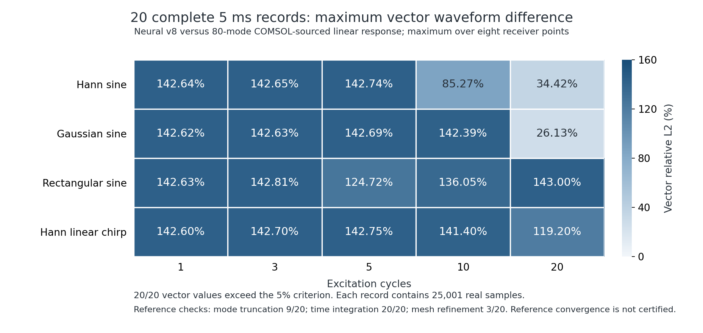

# 第 8 轮：五阶模型、同阶对照与非线性泛化检查

**第 8 轮训练与 20 组完整 5 ms 成对复核已完成，长波形有所改善，但仍未达到 5%，不替换离线默认模型。** 同阶、同参考下，160 个接收点比较全部改善；每组最大向量差异从 **27.25%–149.78%** 降至 **26.13%–143.00%**，整组通过数仍是 **0/20**。候选也未通过独立物理检查和短时原生 COMSOL 几何非线性增量比较，不能以模态拟合或部分指标改善代替整体精度验收。

本轮按[预定方案](continuation-v8-plan.json)，使用固定端 8 × 3 × 1.5 mm 铝板、h=2.5 mm 五阶预测网格，只训练 `derivative_5` 的 12 个参数。材料能量张量、质量规则、时间权重、其他阶次滤波器和推理源码均保持原值。五阶未训练对照与正式候选使用同一[验证方案](plans/v8-p5.json)，用于区分空间阶次变化与训练本身的效果。

同阶对照沿用已发布的 continued 权重；“未训练”仅指尚未执行本轮五阶 COMSOL 校准。

## 正式训练与独立物理验收

训练使用 **192 个制造场、10,560 个分量约束**；另用新种子的 **96 个场、5,280 个分量检查**独立验收。完整三维 Murnaghan 纵向、两个横向运动、混合导数、剪切耦合、六面牵引、应变能与内功率均保留，方程和归一化见[物理约束](NONLINEAR-PHYSICS.md)。训练种子为 2026102483，验证种子为 2026102484。

SLSQP 在预定的 80 次迭代上限内正常终止，共 2266 次前向评估，耗时 3737.17 秒。正式训练采用 `1 − RMS / 0.035 ≥ 0`，与预训练的平方形式具有相同可行域。模态对应的 MAC ≥0.9 也作为约束并在最终重新检查。随后只根据训练场作带裕量的参数回退，最终训练最大残差为 **3.4930%**；独立场未用于调整回退幅度、重新选择权重或改变门槛。

| 频率指标，相同 h=0.30 mm COMSOL 标签 | 五阶未训练起点 | v8 |
| --- | ---: | ---: |
| 主导模态频差，Hz | 111.5624 | 101.7871 |
| 7 个训练模态频差范数，Hz | 549.3068 | 392.9204 |
| 主导模态按频差计算的 5 ms 末端相位漂移 | 200.8123° | 183.2168° |

末端相位漂移仅说明频差的长期累积，不替代完整多模态波形验收。[训练配置、历史、场、权重与源码快照](training/v8/summary.json)均已保存。预训练和失败试算分别保存在 `training/v8-preflight-b`、`training/v8-preflight-failed`，不替代正式结果。

下面比较两个冻结权重在**同一批 96 个独立场**上的各组最大归一化残差：

| 独立物理残差 | 五阶未训练对照 | v8 |
| --- | ---: | ---: |
| 内部动量 | 0.01119% | 2.32047% |
| 边界动量 | 0.02159% | **5.02629%** |
| 牵引 | 3.06e-8% | 0.02693% |
| 应变能 | 1.22e-7% | 0.05372% |
| 内功率 | 3.57e-7% | **5.32909%** |

**5280 项中有 2 项超出 5%，整体验收失败。** 超限项分别是混合场的材料非线性内功率，以及混合剪切场的材料非线性第二横向边界动量，见[失败项及最大残差排序](diagnostics/v8-failed-physics-checks.json)。有限刚体运动检查通过。[成对物理检查](diagnostics/physics-validation-v8-paired.json)同时验证了材料、时间和其他阶次权重未变。

这表明本轮模态拟合以较大的物理残差为代价，训练集上满足 3.5% 并不保证独立场全部低于 5%。物理残差的百分比也不是位移波形误差的百分比。

## 原生 COMSOL 的 20 μs 核对

采用已归档的实际 COMSOL Hann 2 周期、0.22 MHz、1 MPa、20 μs 三控制数据，分别计算同阶对照和 v8。以下是所有接收点 XYZ/向量波形中可计算相对值的最大差异；弱信号仍按预定 1e-13 m 门槛处理。

| 对比量 | 五阶未训练对照 | v8 |
| --- | ---: | ---: |
| 线性 / StVK / 完整响应，三者中的最大值 | 1.76655% | 1.89623% |
| 几何非线性增量 | **5.81857%** | **6.28337%** |
| 材料非线性增量 | 4.54455% | 4.72014% |
| 总非线性增量 | 4.14836% | 4.23612% |

两候选的频谱检查均通过，但波形整体验收均失败。v8 的失败项位于预定义第 8 个接收点的几何增量 x、z 和向量；最大相对差来自 x 分量，参考 RMS 为 2.7279e-13 m，差异 RMS 为 1.7141e-14 m。这个量接近弱信号门槛，仍严格保留原判据。

详见[对照完整指标](diagnostics/native-nonlinear-20us-v8-untrained.json)与[v8 完整指标](diagnostics/native-nonlinear-20us-v8.json)。该原生参考尚未通过本工况的空间与时间收敛验收；这项结果不是 20 组、5 ms 原生非线性精度证明。

## 新增 COMSOL 空间诊断

本轮完成六项新的实际 COMSOL 本征求解，另外保留一次接口参数错误的失败试算。两个同网格对比用于分辨积分与空间分辨率的影响：

| 四阶相同网格 | h=2.5 mm | h=1.4 mm |
| --- | ---: | ---: |
| 原 GLL 积分的主模态与 COMSOL 频差，Hz | 50.08908 | 26.13329 |
| 匹配刚度与一致质量积分后的主模态频差绝对值，Hz | 2.67e-8 | 9.49e-9 |

完整 16 个模态的最大频差分别约 6.1e-7 Hz、2.6e-6 Hz，见[粗网格诊断](diagnostics/quadrature-coarse-v8.json)、[中网格诊断](diagnostics/quadrature-mid-v8.json)。这是使用解析导数的离线数值诊断，**不是修改后的神经网络推理结果**。同网格匹配也不证明空间离散已收敛。

随后对参考网格向固定端及横向边缘进行分级细化。首次实现因不支持的 API 属性失败，修正 API 后的两份网格又因横向对边分布不一致而未通过预定布局检查；原始文件和[失败诊断](diagnostics/graded-reference-v8b.json)均保留。最后对两条平行边施加一致分布，实际导出的坐标和能量—频率恒等式通过检查。

最终两级分级网格为 288 / 640 个单元、63,375 / 136,323 个自由度；h=0.5 / 0.4 mm 是生成单元数量的名义参数，实际最大与最小单元尺寸另行记录。主导频率为 **160807.6584 / 160804.4104 Hz**，仍相差 **3.24794 Hz**；7 个载荷相关模态的最大差为 **10.09419 Hz**，未通过 0.5 Hz 门槛。见[最终分级网格复核](diagnostics/graded-reference-v8c.json)。

这些新分级参考只用于独立诊断，没有用于本轮训练或替换长记录对照标签。本轮两个候选继续使用冻结的 h=0.35 / 0.30 mm 参考。COMSOL 服务已[恢复原始源码并验证就绪](diagnostics/v8-server-restoration.json)。

## 完整 5 ms 成对诊断

五阶未训练对照的[20 组计算](https://github.com/lx016922-dot/workAI/actions/runs/40094953538)和冻结 v8 的[同一矩阵计算](https://github.com/lx016922-dot/workAI/actions/runs/40099779597)均已全部完成：Hann、Gaussian、矩形窗正弦与 Hann 窗线性扫频 × 1、3、5、10、20 周期；每组实际推进 5000 μs、25001 点、8 个接收点和三个本构控制。所有 40 份下载档案的字节数与 SHA-256 均与 GitHub 摘要一致，见[对照回执](diagnostics/v8-untrained-ci-archives.json)和[候选回执](diagnostics/v8-ci-archives.json)。

独立复核两套记录的全部 **3920 个分块**、时间连续性、零初始位移与能量，并重新计算全部波形、频谱和参考检查。所有科学判定与 CI 记录一致；未作相位对齐、幅值缩放、末段截断或补零延长。对照与候选具有相同网格阶次、物理场景、参考数据和 5% / 1e-13 m 判据。

| 完整矩阵，相同五阶网格与 h=0.30 mm 参考 | 五阶未训练对照 | v8 |
| --- | ---: | ---: |
| 波形/频谱整组通过数 | 0/20 | 0/20 |
| 每组最大点位向量差异的范围 | 27.25%–149.78% | 26.13%–143.00% |
| 相对本轮同阶对照改善的组数 | — | 20/20 |
| 相对本轮同阶对照改善的接收点比较数 | — | 160/160 |
| 能量检查通过数 | 20/20 | 20/20 |

逐组最大向量差异降低 **1.1178–6.7807 个百分点**。这说明本轮权重更新改善了这套长记录诊断，但远未达到 5%；物理与短时几何增量的退步也仍然保留。见[逐组对比 CSV](diagnostics/v8-same-order-training.csv)、[成对比较元数据](diagnostics/v8-same-order-training.json)、[对照完整指标](candidate-matrix20-v8-untrained/summary.json)及[v8 完整指标](candidate-matrix20-v8/summary.json)。



图中每格为八个接收点中的最大向量相对 L2 差异，不是分量平均值。两套记录的参考检查均为：48/80 模态截断 **9/20**、时间积分细化 **20/20**、h=0.35/0.30 mm 空间细化 **3/20** 通过。参考尚未全部收敛；该矩阵使用真实 COMSOL 本征数据构造的**线性模态响应**，不能称为 20 次原生 COMSOL 非线性瞬态求解。三控制神经网络记录不等于三个控制各自都有独立的原生 5 ms 真值。

五组扫频另完成 [80 项向量模频带检查](diagnostics/chirp-vector-bands-v8.json)，沿用原门槛，弱信号分类和通过判定均未变化，整组仍不通过。原始复系数归一化和全部记录均保留。

[本轮决定](diagnostics/v8-decision.json)为拒绝晋升。主模态频差仍约 101.8 Hz，完整波形、独立物理约束、短时几何增量及参考收敛均有未通过项；下一步应针对空间积分误差和参考收敛改进模型与标签，再用未参与调整的新检查场验收，不能继续借用本轮验证场选权重或放宽门槛。

## 离线复核与复现

正式权重 SHA-256：`da596ce8f7fe04990abb97a836e2b24daa62993e16cd7c8575f77c55ee4e0008`。五阶未训练对照与离线默认权重逐字节相同，SHA-256 为 `ee413a70b30e6402e174e8d16a92df9ddd96aaa4a6192df472b74f877311df83`。

已使用发布版 Linux 离线 Python 环境，在独立源码目录中重放全部 20 组对照。指标、判定和汇总哈希完全一致，见[离线复核记录](diagnostics/v8-offline-replay.json)。Windows 离线软件构建与原有回归检查也[通过](diagnostics/v8-software-regression.json)，其范围是软件运行，不是 v8 科学精度验收。

```sh
OPENBLAS_NUM_THREADS=1 OMP_NUM_THREADS=1 NUMBA_NUM_THREADS=3 \
python -m graphwave.modal_calibration --action train \
  --reference research/comsol-validation/data/eigen-035-v7 \
  --check-reference research/comsol-validation/data/eigen-030-v7 \
  --weights offline/model/continued-weights.npz --degree 5 --h-mm 2.5 \
  --consistency-order 1 --physics-samples 192 --physics-validation-samples 96 \
  --physics-seed 2026102483 --physics-weight 30 --optimizer slsqp \
  --constraint-form rms --physics-limit .035 --gradient-step .0001 \
  --dominant-phase-weight 10 --parameter-bound 1 \
  --optimizer-tolerance .0000001 --max-iterations 80 --output new-v8-training-run
```

训练环境为 Python 3.12.14、NumPy 2.3.5、SciPy 1.17.0；长记录与离线重放固定 NumPy 2.2.6、SciPy 1.15.3、Numba 0.63.1。五阶物理方程、刚体运动和几何插值的 8 项测试见[检查记录](diagnostics/continuation-v8-unit-validation.json)。候选保持 `accepted_for_offline_release=false`、`scientific_accuracy_certified=false`。

[下载第 8 轮离线证据包](https://github.com/lx016922-dot/workAI/releases/download/v0.3.0/WorkAI-COMSOL-physics-evidence-0.3.0-training-v8.zip)，**943,738,905 字节**。包含原始 COMSOL 数据、训练权重与约束场、训练前后各 20 组完整记录、全部指标及离线复核源码；解压后按 `REPRODUCE.txt`，使用已有 Windows / Linux 便携包的 Python 重算，无需联网或启动 COMSOL。

清单中的 **4986 个文件**已在[发布流程](https://github.com/lx016922-dot/workAI/actions/runs/40102286399)逐项读回校验。归档 SHA-256 为 `01ce08c155d41648cb31720d3fb4e2b025bc85048851ba9a4ec8e16462581652`，来源提交为 `8f2ece24d5f0d54dec67757cd0f8e173fc82f963`。构建摘要、GitHub 资产摘要与实际下载的七个 ZIP 校验清单一致，见[发布核验](../release-validation/v0.3.0-training-v8-assets.json)。本次未再次整包下载；原有六个 ZIP、软件标签和默认模型均保持不变。
