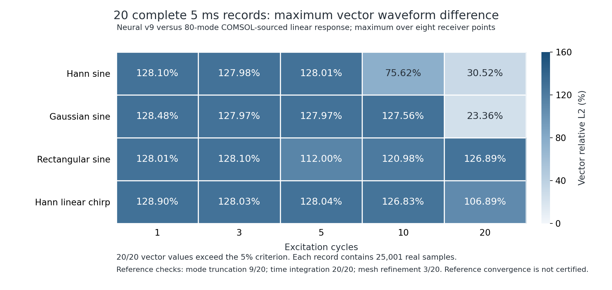

# 第 9 轮：离散分部积分约束与同网格成对训练

**正式训练、40 组完整 5 ms 成对记录与独立复核均已完成，仍未达到 5%。** 本轮修复了第 8 轮两项已知物理失败，并在新的独立场上通过检查，但原生 COMSOL 短时非线性增量比较仍未通过。候选没有替换离线默认模型，不能据此宣称误差已经在 5% 内。

## 本轮改动与冻结方案

[预定方案](continuation-v9-plan.json)采用相同固定端 8 × 3 × 1.5 mm 铝板，将五阶网格从 h=2.5 mm 的 8 个单元、1386 个节点细化到 **h=1.6 mm、10 个单元、1716 个节点**。最小节点间距仍为 0.1762085 mm。材料、质量规则、时间权重、完整非线性传播代码均未修改；只训练五阶空间导数矩阵。

[空间诊断](diagnostics/spatial-resolution-v9.json)使用冻结的 h=0.30 mm COMSOL 模态数据。未训练的解析五阶导数在 h=2.5 / 1.6 / 1.4 mm 时，主模态频差分别为 **111.5624 / 84.3818 / 56.5633 Hz**；分别改用 Gauss 刚度积分、保留 GLL 质量后为 **91.2662 / 69.5564 / 44.1316 Hz**。这说明积分方式只解释部分误差，空间分辨率仍是限制。Gauss 方案仅是离线诊断，没有加入本轮神经网络推理。

网格选择依据模态诊断作出，没有用瞬态测试波形选择网格。本轮另对同一细化网格计算完整未训练对照，以分清网格变化与权重更新的效果。“未训练”指尚未执行本轮 COMSOL 校准，其权重与已经发布的 continued 模型完全相同。

## 新增的严格物理约束

本轮在原有完整 Murnaghan 纵向、两个横向、混合剪切、牵引、应变能与内功率约束上，新增离散分部积分恒等式：

\[
WD+D^TW=B,\qquad B=\operatorname{diag}(-1,0,\ldots,0,1).
\]

其中 W 为正的 GLL 积分权重，D 为学习得到的导数矩阵。对于任意节点值 a、b，这保证

\[
a^TWD b+(Da)^TWb=a_nb_n-a_0b_0.
\]

训练增量同时满足 \(W\Delta D+(\Delta D)^TW=0\)、常数/一次/二次多项式导数一致性和反中心对称。五阶六节点矩阵因此只保留 **2 个自由参数**。这是训练时的参数化约束，推理时没有增加参考修正器；它对任意节点值成立，但并不是连续域精度证书。

实现与任意节点值的恒等式测试见 `graphwave/modal_calibration.py`、`tests/test_nonlinear_constraints.py`；[9 项物理与模态测试](diagnostics/continuation-v9-unit-validation.json)通过。完整连续方程与归一化仍见[非线性物理约束](NONLINEAR-PHYSICS.md)。

## 正式训练与独立检查

先按方案完成 48 个训练场、24 个检查场的[预训练](training/v9-preflight/summary.json)，随后从同一发布权重重新进行正式训练。正式训练使用新种子 2026102593 的 **384 个场、21,120 项分量约束**；独立验收为种子 2026102594 的 **192 个场、10,560 项检查**。六个场族在各自集合中均匀覆盖；训练硬门槛从第 8 轮的 3.5% 收紧为 **2.5%**，独立验收仍为 5%。

SLSQP 正常终止，34 次目标函数评估、70 次总前向评估，用时 **157.89 秒**。最终只根据训练场作带裕量的参数回退，训练最大残差 **2.49500%**。独立场没有参与参数或回退幅度选择。

| 相同细化网格、相同 COMSOL 标签 | 未训练起点 | v9 |
| --- | ---: | ---: |
| 主模态频差，Hz | 84.3818 | 84.1723 |
| 7 个训练模态频差范数，Hz | 419.2509 | 417.9498 |
| 主模态按频差计算的 5 ms 末端相位漂移 | 151.8872° | 151.5101° |

**训练本身只将主模态频差降低约 0.2095 Hz。** 不能把网格细化带来的约 27.18 Hz 变化算作权重学习的收益。末端相位漂移是频差诊断，也不能替代完整多模态波形比较。

[训练约束排序](diagnostics/v9-largest-training-constraints.json)显示，最接近 2.5% 硬门槛的仍是材料非线性分支的两个横向边界动量。参数最大绝对值为 0.4382，尚未触及 ±1 的参数边界。本轮没有为压低频差放宽这些物理门槛。

以下将三个冻结权重放在**同一批新的 192 个独立场**上比较。百分比是归一化物理残差，不是位移波形误差。

| 各组最大残差 | 未训练权重 | 旧 v8 权重 | v9 权重 |
| --- | ---: | ---: | ---: |
| 内部动量 | 0.01013% | 1.61886% | 0.95879% |
| 边界动量 | 0.01954% | 3.85239% | 2.49499% |
| 牵引 | 2.64e-8% | 0.02693% | 0.02787% |
| 应变能 | 2.30e-7% | 0.05372% | 0.00283% |
| 内功率 | 2.93e-7% | 0.45222% | 0.02452% |

三者均通过这批场的 5% 检查；v8 在其原独立集合中失败的事实仍保留，不能用这批新结果覆盖。相对旧 v8，v9 的大部分残差下降，但牵引略升；相对未训练权重，学习仍增大了物理残差。详见[同场成对复核](diagnostics/physics-validation-v9-paired.json)。v9 的分部积分矩阵残差为 **4.23e-15**，有限刚体运动检查通过；旧 v8 的对应矩阵残差为 0.17924，不满足这项新增严格约束。

冻结 v9 后另回放第 8 轮已见过的 96 个检查场，作为**历史回归检查**，不冒充新的独立验收。原两项失败的变化为：

| 已知失败项 | 原 v8 | 冻结 v9 |
| --- | ---: | ---: |
| 混合场、材料分支内功率 | 5.32909% | 0.09993% |
| 混合剪切、材料分支第二横向边界动量 | 5.02629% | 2.33589% |

历史集合所有场也通过，见[回归记录](diagnostics/v9-historical-physics-regression.json)。没有根据这次回放修改 v9 权重。

## 原生 COMSOL 的 20 μs 核对

沿用已归档的实际 COMSOL Hann 2 周期、0.22 MHz、1 MPa、20 μs 三控制数据，比较相同 h=1.6 mm 网格上的未训练对照与 v9。以下为所有八个点位 XYZ/向量波形中可计算相对值的最大差异：

| 对比量 | 本轮同网格对照 | v9 |
| --- | ---: | ---: |
| 线性 / StVK / 完整响应，三者最大值 | 2.46382% | 2.51602% |
| 几何非线性增量 | **7.68669%** | **7.80529%** |
| 材料非线性增量 | **6.03955%** | **6.12349%** |
| 总非线性增量 | **5.52711%** | **5.60052%** |

两者频谱检查通过，波形整体验收均失败。v9 超限项仍集中于预定义第 8 个接收点：几何增量 x/向量、材料增量 x/向量和总增量 x。最大几何相对差的参考 RMS 为 2.7279e-13 m、差异 RMS 为 2.1292e-14 m；虽然接近预定 1e-13 m 弱信号门槛，仍保留原判据。

完整指标见[对照](diagnostics/native-nonlinear-20us-v9-untrained.json)和[v9](diagnostics/native-nonlinear-20us-v9.json)。这份原生参考尚未完成该工况的空间和时间收敛验收；改变预测网格没有改变参考。结果不能外推为 20 组、5 ms 的原生非线性精度证明。

## 完整 5 ms 成对诊断

[同网格对照矩阵](https://github.com/lx016922-dot/workAI/actions/runs/40160150250)与[冻结 v9 矩阵](https://github.com/lx016922-dot/workAI/actions/runs/40160597934)均已完成。覆盖 Hann、Gaussian、矩形窗正弦和 Hann 窗线性扫频 × 1、3、5、10、20 周期；每组均为真实 5000 μs、25001 个采样点、8 个接收点与三个神经网络本构控制。两组共 **40 条完整记录、3920 个原始分块**，已验证下载摘要、零初值、能量记录与 COMSOL 比较指标，所有原始科学判定在独立重算中一致。

| 完整 5 ms 检查 | 同网格未训练对照 | v9 |
| --- | ---: | ---: |
| 每组最差接收点向量波形相对差的范围 | 23.40%–129.05% | 23.36%–128.90% |
| 通过全部线性波形/频谱检查 | 0/20 | 0/20 |
| 通过 1% 能量收支检查 | 20/20 | 20/20 |
| COMSOL 48/80 模态截断检查 | 9/20 | 9/20 |
| COMSOL 模态积分容差细化检查 | 20/20 | 20/20 |
| COMSOL h=0.35/0.30 mm 空间细化检查 | 3/20 | 3/20 |

同一网格上，权重训练使 **20/20** 组最大向量差异下降，**160/160** 个接收点改善。逐组最大值变化为 **-0.22014 至 -0.03846 个百分点**，负值表示下降。原始逐组指标与全部分量验收不受计数用的浮点舍入容差影响。见[成对 JSON](diagnostics/v9-same-grid-training.json)、[CSV](diagnostics/v9-same-grid-training.csv)及[完整 v9 指标](candidate-matrix20-v9/summary.json)。

| 信号与周期 | 同网格对照最大向量差异 | v9 最大向量差异 | 变化，百分点 |
| --- | ---: | ---: | ---: |
| hann-01 | 128.29794% | 128.10346% | -0.19448 |
| hann-03 | 128.18836% | 127.98244% | -0.20593 |
| hann-05 | 128.21721% | 128.01054% | -0.20667 |
| hann-10 | 75.75539% | 75.62335% | -0.13204 |
| hann-20 | 30.56935% | 30.51600% | -0.05335 |
| gaussian-01 | 128.65137% | 128.47909% | -0.17228 |
| gaussian-03 | 128.17468% | 127.96881% | -0.20587 |
| gaussian-05 | 128.17737% | 127.97089% | -0.20648 |
| gaussian-10 | 127.76908% | 127.56161% | -0.20747 |
| gaussian-20 | 23.40220% | 23.36374% | -0.03846 |
| rectangular-01 | 128.21876% | 128.01341% | -0.20535 |
| rectangular-03 | 128.30638% | 128.09995% | -0.20644 |
| rectangular-05 | 112.14207% | 111.99794% | -0.14413 |
| rectangular-10 | 121.18759% | 120.98239% | -0.20520 |
| rectangular-20 | 127.11446% | 126.89432% | -0.22014 |
| chirp-01 | 129.04808% | 128.90020% | -0.14788 |
| chirp-03 | 128.23179% | 128.02572% | -0.20607 |
| chirp-05 | 128.25022% | 128.04375% | -0.20647 |
| chirp-10 | 127.03387% | 126.82937% | -0.20450 |
| chirp-20 | 107.06437% | 106.89176% | -0.17261 |



另以**字节相同的未训练权重、相同物理场景、阶数、推理代码、时间权重和 COMSOL 参考**，对比上轮 h=2.5 mm 与本轮 h=1.6 mm 的两个完整对照矩阵。单独细化网格使 **20/20** 组最大差异、**160/160** 个接收点改善；逐组最大差异变化为 **-22.66634 至 -3.84509 个百分点**。这部分变化不计入上述训练收益，见[仅网格变化的核对](diagnostics/v9-mesh-only.json)。

五组扫频另完成[80 项向量模频带复核](diagnostics/chirp-vector-bands-v9.json)，保留原有 5% / 1e-13 m 科学门槛；两种归一化下的弱信号分类和通过判定均未变化。没有对齐相位、缩放幅值或裁剪记录来改善结果。

长记录参考仍是实际 COMSOL 本征数据重建的线性模态响应，尚未全面收敛；三个神经网络控制并不意味着已有三个控制各自的原生 COMSOL 5 ms 真值。本轮开始时远端服务在线，但安装的源码哈希与上轮恢复版本不同。本轮使用已核验的归档 COMSOL 数据，没有覆盖该远端版本或宣称完成了新的原生求解。

## 离线运行复现与决定

使用与发布软件相同固定依赖的 Linux 便携运行时，从独立复制的源码目录重新计算预先选择的 Hann 1 周期算例，实际用时 **1968.45 秒**，完成 5 ms、25001 点、8 个接收点与三个控制。运行不需要联网。本次没有重新下载已发布的软件 ZIP，运行时的 **7998** 个清单文件均逐项核对长度和 SHA-256。

两个独立运行各自的 98 个分块均已核验。离线与 CI 的 72 个位移分量及全部能量列通过预先固定的浮点复现容差；非弱信号位移分量的最大相对 L2 差为 **0.000e+00**，最大分量差异 RMS 为 **0.000e+00 m**。所有科学判定和弱信号分类完全一致。这里的 1e-7 相对浮点容差只用于复现，不能替代 5% 物理精度判据。全部接收点的完整时域轨迹压缩保存为[traces.npz](development-validation-v9-offline/hann-01/traces.npz)，[核验回执](development-validation-v9-offline/hann-01/verification.json)与[原始指标](development-validation-v9-offline/hann-01/metrics.json)公开；这条记录的 COMSOL 线性比较仍未通过。

[Windows 便携软件构建、完整性与默认模型实际预测回归](diagnostics/v9-software-regression.json)也已通过。软件运行成功与研究候选达到科学精度分别判断。

[本轮决定](diagnostics/v9-decision.json)为 **拒绝晋升默认模型**：新的独立物理检查与历史回归通过，但短时原生非线性增量失败，长记录的差异和参考收敛均未满足要求。不能把物理残差 2.495% 当作波形误差；完整 20 组、5 ms 的原生 COMSOL 非线性三控制验证仍未完成。材料与几何非线性长期精度尚不能认证。

## 复现

正式候选 SHA-256：`9c1ec58c3cf93d27334ffbdcf3cc0ffad54ff1b816ff787acf3d296ab3f401be`。默认权重与本轮未训练对照仍为 `ee413a70b30e6402e174e8d16a92df9ddd96aaa4a6192df472b74f877311df83`。

```sh
OPENBLAS_NUM_THREADS=1 OMP_NUM_THREADS=1 NUMBA_NUM_THREADS=3 \
python -m graphwave.modal_calibration --action train \
  --reference research/comsol-validation/data/eigen-035-v7 \
  --check-reference research/comsol-validation/data/eigen-030-v7 \
  --weights offline/model/continued-weights.npz --degree 5 --h-mm 1.6 \
  --consistency-order 2 --summation-by-parts \
  --physics-samples 384 --physics-validation-samples 192 \
  --physics-seed 2026102593 --physics-weight 30 --optimizer slsqp \
  --constraint-form rms --physics-limit .025 --gradient-step .0001 \
  --dominant-phase-weight 10 --parameter-bound 1 \
  --optimizer-tolerance .0000001 --max-iterations 80 --output new-v9-training-run
```

[正式配置、原始优化记录、场、权重与源码快照](training/v9/summary.json)和预训练记录全部保留。训练使用 Python 3.12.14、NumPy 2.3.5、SciPy 1.17.0；长记录验证固定 NumPy 2.2.6、SciPy 1.15.3、Numba 0.63.1。候选保持 `accepted_for_offline_release=false`、`scientific_accuracy_certified=false`。

## 下载与校验

[下载第 9 轮离线证据包](https://github.com/lx016922-dot/workAI/releases/download/v0.3.0/WorkAI-COMSOL-physics-evidence-0.3.0-training-v9.zip)：**1,009,329,997 字节**，约 **1009 MB**。包含相同网格训练前后各 20 组完整接收点记录、全部训练与约束证据、COMSOL 标签、离线复核源码，以及单独重新计算的 Hann 1 周期离线记录。按包内 `REPRODUCE.txt` 使用软件包的 Python 运行时复核或重新预测，无需联网。

SHA-256：`82dce46680caeb7d386b7b959c03bc8b21c22e6c075b4cb5f49b4a48c3bf9d93`。

[证据构建工作流](https://github.com/lx016922-dot/workAI/actions/runs/40165139849)逐项读回并核验清单内 **5097 个文件**的长度和 SHA-256。新 ZIP 的构建摘要、GitHub 资产摘要、实际下载的八项组合校验清单完全一致；没有在此重复下载整个大 ZIP。原七个 ZIP、软件版本标签与默认权重均保持不变，见[发布核验](../release-validation/v0.3.0-training-v9-assets.json)。证据包来源提交为 `9f3c3b1242510dbf05b8813bf4e9ec16350b5eab`；本发布回执在构建之后单独提交，避免把后写回执冒充归档内已有内容。
