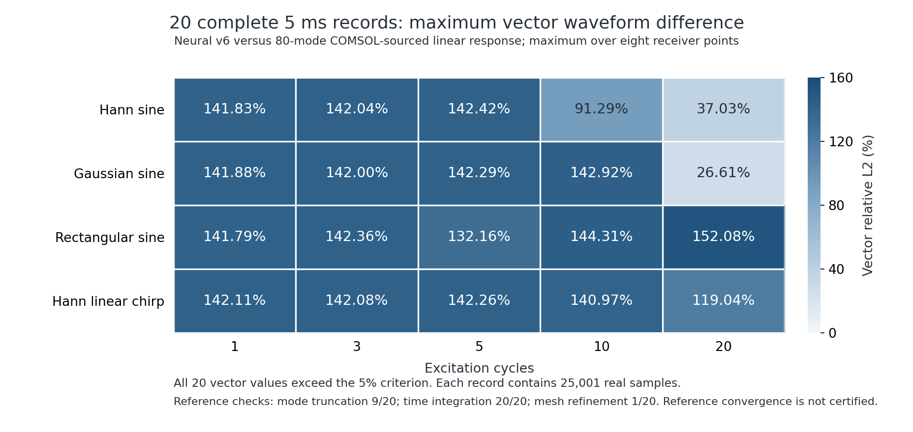
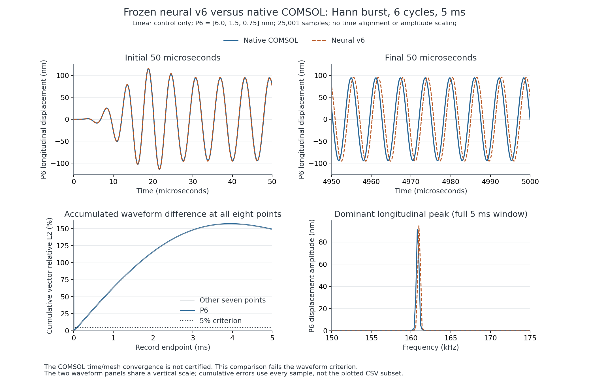

# COMSOL 对照、非线性物理约束与修正训练

已使用实际 COMSOL 6.4 三维求解结果修正训练，新增纵向、两个横向的非线性动量、牵引、能量和内功率约束。**目前没有获得 5 ms、全部信号和周期均在 5% 内的精度认证。** 研究候选与离线默认模型分开保存。

完整方程、耦合项、归一化和硬约束见 [非线性物理约束](NONLINEAR-PHYSICS.md)。[验证协议](protocol.json)固定 5000 μs、0.2 μs、25001 点，不允许对齐相位、重标幅值、截去后段或用补零延长记录。弱信号位移门槛为 1e-13 m；制造场的归一化物理残差不使用这个位移门槛。

**最新第 8 轮训练与完整复核已完成，长波形改善，但仍未达标。** 见[第 8 轮报告](CONTINUATION-V8.md)：五阶模型使用 192 个训练场、10,560 个约束和 96 个独立检查场。相对同阶未训练对照，20 组完整 5 ms 的 160 个接收点比较全部改善；逐组最差向量差异从 **27.25%–149.78%** 降至 **26.13%–143.00%**，通过数仍为 **0/20**。独立物理残差最大 **5.3291%**，5280 项中 2 项失败；短时原生几何增量最大差异 **6.2834%**，同样未通过。本轮还完成六项新的实际 COMSOL 本征诊断，但最终分级参考仍未满足长期相位门槛。候选拒绝晋升，默认权重未变。

[第 7 轮报告](CONTINUATION-V7.md)保留其长波形全部略有退步的原始结论。下面继续保留 v6 基线与历史失败；各轮网格、标签和验证场不同，不直接横比不同参考下的百分比。

## 已完成的证据及范围

| 项目 | 实际完成情况 | 可支持的结论 |
| --- | --- | --- |
| COMSOL 三维本征求解 | h=0.5、0.4 mm，各 80 个模态，765 个网格点及 8 个直接接收点；能量—频率恒等式通过 | 提供真实 COMSOL 频率与振型标签；不等于非线性瞬态解 |
| COMSOL 线性模态长记录诊断 | 四种信号 × 1/3/5/10/20 周期，8 个点、每组 25001 点；与此前冻结的实际神经网络记录比较 | 20/20 完成，0/20 通过全部比较；结果不是 20 次原生 COMSOL 瞬态求解 |
| 线性参考自身检查 | 48/80 模态截断 9/20 通过，时间积分细化 20/20 通过，h=0.5/0.4 mm 空间检查 1/20 通过 | 参考尚不满足全部长时程收敛要求，不能称为已收敛真值 |
| 原生 COMSOL 短时程核对 | 8 μs 六面体线性试算完成；模态重建与原生解的波形、f/2f 检查通过 | 只验证这个短窗口与网格；不外推为 5 ms 证书 |
| 原生 COMSOL 三控制核对 | 20 μs、Hann 2 周期、8 点，线性、StVK、完整 Murnaghan 均实际求解 | v6 的三控制与几何/材料/总增量比较通过，最大归一化差异 2.3465%；本例参考尚未完成空间与时间收敛验收 |
| 非线性物理约束训练 | 96 个训练制造场，5280 个分量约束；48 个新独立检查场；另有 24 组刚体控制检查 | v6 独立制造场最大残差 3.492%，刚体检查通过 |
| 原生 COMSOL 5 ms 瞬态 | Hann 6 周期、8 点、25001 点，0.1 / 0.05 μs 内部步长线性控制均已完成 | v6 最大波形差异 149.13% / 123.33%；两次 COMSOL 结果自身相差 142.64%，时间收敛检查失败 |

线性模态诊断的完整逐组数据见 [80 模态、8 点 CSV](linear-baseline20-80/cases.csv) 与 [JSON](linear-baseline20-80/summary.json)。较早的 [48 模态、2 个中心点诊断](linear-baseline20/cases.csv)保留供追溯，不能代替扩展点位后的结果。单频检查 f/2f 复数系数，扫频检查时频激励带与二倍频带；所有点位均检查 XYZ 和向量。

模态响应由 COMSOL 实际导出的模态及载荷积分重建，受迫段使用经容差细化检查的 DOP853，卸载后按各模态振子解析演化到 5 ms。它没有补零或重复短片段，但仍是**截断的线性模态参考**，不用于证明几何、材料非线性增量的准确性。

## 实际训练结果

所有材料常数、材料能量张量、节点质量与时间推进权重保持原值。v1–v7 训练四阶空间滤波器，v8 训练五阶空间滤波器；v1 保持二次一致性，后续轮次保持常数与仿射一致性，并保持反中心对称。推理阶段不读取 COMSOL 标签、不进行参考解校正。

| 候选 | COMSOL 训练模态误差范数，Hz | 独立物理检查 | 处理 |
| --- | ---: | --- | --- |
| v1 | 726.551 → 236.496，5 个模态 | 本轮尚未加入新增制造场约束 | 保留研究记录 |
| v2 | 726.551 → 126.689，5 个模态 | 后续检查发现严重边界运动残差 | 5 ms 线性诊断约 152.12% 向量误差，拒绝替换默认模型 |
| v3 | 1046.783 → 800.530，7 个模态 | 最大 28.14%，失败 | 软惩罚不足；中止其未完成的长记录试算 |
| v4 | 1046.783 → 807.163，7 个模态 | 最大 4.0002%，5% 检查通过 | 优化器线搜索失败，保留状态 |
| v5 | 1046.783 → 823.191，7 个模态 | 最大 3.6278% | 原始点略超 3.5% 训练硬约束，未直接采用 |
| v5-feasible | 1046.783 → 823.584，7 个模态 | 制造场最大 3.6181%；新增刚体检查失败 | 原滤波器的仿射误差仍被继承，不能声称刚体客观性通过 |
| v6 | 1046.782 → 826.695，7 个模态 | **制造场最大 3.4917%；24 组刚体控制通过** | 先投影完整滤波器以消除原仿射误差，再训练和回退；长波形仍须单独验收 |
| v7 | 875.050 → 864.056，7 个模态；起点为扩大训练集后可行性回退的结果，参考也已细化 | **96 个新独立场最大 3.6890%；刚体控制通过** | SLSQP 正常结束，但长波形全部略有退步，拒绝晋升；见[同参考报告](CONTINUATION-V7.md) |
| v8 | 549.307 → 392.920，7 个模态；五阶网格及其同阶对照 | **96 个新独立场最大 5.3291%，2 项失败；刚体控制通过** | SLSQP 正常结束，160 个长波形比较均改善，但 20 组仍全部未通过；短时几何增量也失败，拒绝晋升；见[成对报告](CONTINUATION-V8.md) |

频率误差范数涉及的模态集合不同，不能横向直接比较 v1/v2 与后续轮次。v5-feasible 将 v5 的参数增量依次乘以 1、0.999、0.998001，用原训练场逐次验证到达硬约束内部；之后才生成种子 2026102422 的新独立检查场。原优化器失败记录没有被改写。该过程只在离线训练中调整权重，不在预测时校正响应。

[各轮配置、权重、源代码快照和检查数据](training/)同时包含失败候选，不包含新增的完整优化器检查点。`candidate-weights.npz` 为约 4 KB 的推理参数。所有轮次均保持 `accepted_for_offline_release=false`。

新增刚体检查发现：早期轮次只约束了参数增量，原滤波器约 1.52e-8 的仿射导数误差仍存在，有限刚体转动会产生不应有的内力。[v5-feasible 补充检查](diagnostics/rigid-motion-v5-feasible.json)保留失败；v6 将完整起始滤波器投影到常数/仿射约束空间，最终 12 个刚体状态 × 两个有限应变控制的最大内力范数为 1.96e-10 N，应变范数为 4.10e-15。原始 SLSQP 线搜索失败状态和后续可行性回退仍分别保留，未改写为优化收敛。

`v5-feasible` 的 [Hann 6 周期开发验证](development-validation/hann-06/metrics.json)已真实完成 5000 μs、25001 点、8 个接收点和三个控制，耗时 542.80 秒；原始轨迹保存在同目录 `traces.npz`。三组能量收支相对差约 6.1e-10，但相对 COMSOL 80 模态线性参考的最大向量波形差异为 **142.71%**，未通过；该参考自身的空间检查也未通过。新增约束不能替代长期相位与参考收敛检查。

v6 已按预定四种信号、五种周期数完成 [20 组完整 5 ms 记录](https://github.com/lx016922-dot/workAI/actions/runs/40076321323)，并独立校验全部 1960 个接收点分块、零初始位移、能量和 COMSOL 比较指标。线性模态波形/频谱整组通过 **0/20**，最大点位向量波形差异的逐组范围为 **26.61%–152.08%**；能量检查 20/20 通过。模态截断、积分容差、空间细化分别 9/20、20/20、1/20 通过。见 [v6 CSV](candidate-matrix20/cases.csv) 和 [逐组完整指标](candidate-matrix20/summary.json)。较早 [v5-feasible 的 20 组结果](candidate-matrix20-v5/summary.json)也保留，未覆盖失败记录。



图中每格为该组八个接收点中最大的向量相对 L2 差异；并非所有分量指标的平均值。20 周期 Gaussian 的 26.61% 与矩形窗的 152.08% 均未通过 5% 门槛，不使用个别组合替代整个矩阵的验收。

原始扫频频带汇总使用复系数 RMS，分母同时包含频率格、时间窗及 XYZ 分量数；它与每个时频格的向量模 RMS 相差 √3。另对 v6 五组扫频的线性响应完成了 [80 项向量模频带补充检查](diagnostics/chirp-vector-bands-v6.json)，分母只取频率格数 × 时间窗数，仍使用 5% / 1e-13 m 判据。本次两种归一化的弱信号分类和通过判定均相同，整组结论仍未通过；原始报告与轨迹未改写。

v6 另有 [Hann 6 周期开发记录](development-validation-v6/hann-06/metrics.json)，实际 621.74 秒完成 5 ms 三控制；相对线性模态参考最大向量差异 142.69%。同一份冻结神经网络轨迹随后用于原生 COMSOL 比较，未重新训练、对齐相位或缩放幅值。

### 原生瞬态比较

[0.1 μs 内部步长的原生 5 ms 比较](diagnostics/native-5ms-v6.json)中，最大向量波形差异为 148.86%，含 XYZ 分量的最大值为 149.13%，未通过。完整窗口的 f/2f 系数检查虽通过，但这些系数均落在 1e-13 m 弱信号门槛以内，不能据此声称主振动频谱准确。原始三维响应和全部指标均保留；图中的 P6 是预先定义的中心线点。



同一工况的 **0.05 μs 内部步长**也已实际积分到 5 ms，求解用时 7144 秒；仍为相同 8 个四阶六面体、8 个接收点、25001 个输出时间点。参数中的 `timecheck` 会将 `max_step_us=0.1` 减半，实际步长见原生回执和日志。比较继续使用同一份冻结 v6 轨迹，未对齐或缩放。

| 完整 5 ms 比较 | 最大 XYZ 分量差异 | 最大向量差异 | 波形判定 |
| --- | ---: | ---: | --- |
| v6 相对 0.05 μs COMSOL | 123.33% | 123.10% | 失败 |
| 0.1 μs COMSOL 相对 0.05 μs COMSOL | 142.64% | 142.53% | 失败 |

见 [候选比较](diagnostics/native-5ms-timefine-v6.json)、[时间细化比较](diagnostics/native-time-refinement.json)与[汇总](diagnostics/native-time-refinement-summary.json)。两项比较的 64 个 f/2f 复系数也都属于弱信号检查；不能据此抵消波形失败。**这两次原生参考尚未通过时间收敛验收**，细步长也不自动成为真值；空间收敛与完整 5 ms 非线性三控制同样未获认证。较小的候选差异来自参考变化，不是新一轮训练改善。

[查看 0.05 μs COMSOL 与冻结 v6 的完整波形对照图](diagnostics/native-5ms-timefine-v6-waveforms.png)。所有差异按全部原始采样计算，原始失败记录保留。

[20 μs 三控制检查](diagnostics/native-nonlinear-20us-v6.json)采用 Hann 2 周期、0.22 MHz、1 MPa，COMSOL 内部步长 0.01 μs。所有点位 XYZ 与向量的波形、f/2f 复系数检查通过；可计算相对误差的波形分量最大值如下，弱信号另用 1e-13 m 绝对门槛：

| 响应 | 最大波形差异 |
| --- | ---: |
| 线性 | 0.9352% |
| StVK | 0.9352% |
| 完整 Murnaghan | 0.9352% |
| 几何增量 | 0.7776% |
| 材料增量 | 2.2852% |
| 总非线性增量 | 2.3465% |

这是单个短时程工况的原生三控制核对，不能代替全部 20 组、5 ms 的原生非线性验证；参考本身尚未取得本例空间/时间收敛证明。

更细 COMSOL 网格的主模态频率仍从 160830.526 Hz 变化到 160822.173 Hz，差 8.354 Hz，在 5 ms 中对应约 15.04° 相位差。它满足用于研究训练的 0.01% 频率筛选，却不满足长记录所要求的 0.5 Hz 参考筛选。物理约束增加后仍需解决空间离散与长期相位误差，不能靠继续降低训练损失宣布准确。

v6 主模态相对当前 h=0.4 mm 标签仍差 199.108 Hz，5 ms 累积约 358.39°，见 [各模态记录](training/v6/frequencies.csv)。在等幅、同初相、单频且相位差较小的理想情况下，整窗相对 L2 近似为 \(2\pi|\Delta f|T/\sqrt3\)；T=5 ms 时，5% 对应约 2.76 Hz。该近似只说明长期相位要求，实际多模态、非线性结果仍按完整记录验收，不用这个公式替代仿真对比。

## 原生 COMSOL 任务与失败记录

- h=0.5 mm、80 模态：`comsol-6b6cec683bd04dcfb426b1a2a123f143`。
- h=0.4 mm、80 模态：`comsol-c420e3febfed41b08d0323e925dd3ad0`。
- 8 μs 线性六面体试算：`comsol-9cd100aa37324b8ba36619527d3f8674`。
- 常量矩阵复用试算：`comsol-72db9b3961594c22bd2b81ce52a49433`，与原试算相对差 4.87e-15；没有据此宣称加速。
- BDF5 开发试算：`comsol-a8718a74aba54b039cb78b5525a6afb9`，在 145.485 μs 求解失败，不构成完整 200 μs 参考。
- DOPRI5 开发试算：`comsol-317647a1e3a240e18365bf187feaacf9`，刚性与非有限值错误，不用于训练。
- 原生 5 ms 线性任务：`comsol-5ad4631fb9cb42d6a4404db8287e530b`，Hann 6 周期、8 点、0.1 μs 内部步长，已完成并校验；与 v6 比较失败。
- 原生 20 μs 三控制：`comsol-a8829266780c4a69890f438967bdd3ba`，已完成并校验。
- 0.05 μs 时间细化任务：`comsol-d76645ce4270458abce5add03c3dacad`，与首组保持相同物理场景和输出时刻，已完成并校验；时间细化与 v6 波形比较均失败。

[data/](data/)保留完成或失败的原始 CSV、MPH、日志、模型输入、源码和回执。CSV 如采用 `workai_gzip_csv_v1` 容器，按回执校验解压后的字节数与 SHA-256，保留原始 17 位有效数字；不是低精度重采样。传输时已校验服务签名，公开包保存哈希与签名校验记录；原始签名响应头没有存档，故不宣称公开包支持第三方独立重放密码学签名验证。

## 复现

本次本地训练使用 Python 3.12.14、NumPy 2.3.5、SciPy 1.17.0、Numba 0.63.1、llvmlite 0.46.0（见 `unit-validation.json`）。CI 长记录诊断另固定 NumPy 2.2.6 与 SciPy 1.15.3，保留各自运行记录。物理约束与模态训练使用 CPU，不需要 COMSOL 许可证；重新运行原生模型需要合法安装的 COMSOL。COMSOL 标签不能从神经网络或此前数值参考伪造。

```sh
OPENBLAS_NUM_THREADS=1 OMP_NUM_THREADS=1 NUMBA_NUM_THREADS=3 \
python -m unittest tests.test_nonlinear_constraints tests.test_comsol_modal_response

OPENBLAS_NUM_THREADS=1 OMP_NUM_THREADS=1 NUMBA_NUM_THREADS=3 \
python -m graphwave.modal_calibration --action train \
  --reference research/comsol-validation/data/eigen-half-05 \
  --check-reference research/comsol-validation/data/eigen-finer-05 \
  --consistency-order 1 --physics-samples 96 --physics-validation-samples 48 \
  --physics-seed 2026102433 --physics-weight 30 --optimizer slsqp \
  --physics-limit .035 --gradient-step .00001 --output new-training-run
```

当前训练入口会先投影完整滤波器，并在输出前执行物理可行性回退。各轮精确源码保存在该轮 `source_snapshot/`，可复现历史版本。7 项独立物理与模态时间响应测试通过；测试通过不等于长波形准确。

从仓库中的原生数据和冻结轨迹复算时间细化与候选比较，不需要重新启动 COMSOL：

```sh
python tools/compare-comsol-reference.py \
  --case research/comsol-validation/data/native-5ms-linear-timecheck-01 \
  --other research/comsol-validation/data/native-5ms-linear-01 \
  --output replay/native-time-refinement.json
python tools/compare-comsol-reference.py \
  --case research/comsol-validation/data/native-5ms-linear-timecheck-01 \
  --prediction-archive research/comsol-validation/development-validation-v6/hann-06 \
  --output replay/native-5ms-timefine-v6.json
```

发布页的 `WorkAI-COMSOL-physics-evidence-0.3.0-supplement.zip` 是另行保存的完整科学证据快照，含此次时间细化和扫频补充检查；不覆盖原四个发布 ZIP。将其解压到 `evidence/` 后，可用固定 NumPy 2.2.6、SciPy 1.15.3 复算扫频补充检查：

```sh
python tools/check-comsol-chirp-vector-bands.py \
  --input evidence/candidate-cases \
  --audit research/comsol-validation/candidate-matrix20/summary.json \
  --output replay/chirp-vector-bands-v6.json
```
