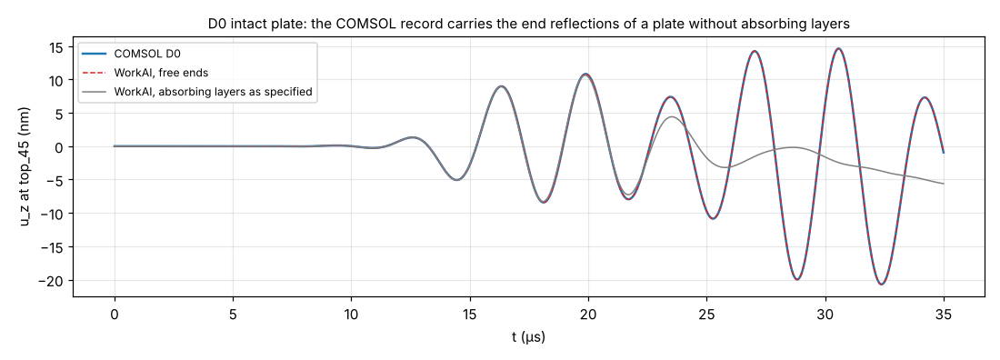
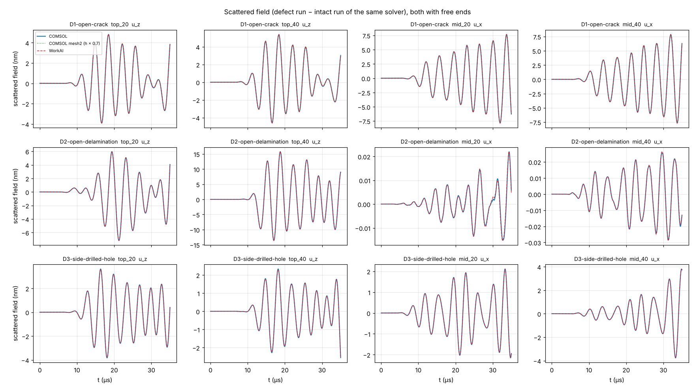

# 缺陷：独立核对与软件结果

## 1. 独立核对：二维平面应变有限元（不需要 COMSOL）

板宽方向两面（y 最小、y 最大）都设为对称面时，位移不随 y 变化，三维模型就是严格的平面应变问题。所以贯穿全宽的裂纹、分层和闭合接触，可以用一个二维求解器做独立核对。

### 1.1 参考解（`fem2d.py`）

它与网络没有共用的代码，离散方法也不同：

| | 网络（软件） | 参考解 |
|---|---|---|
| 单元 | 4 阶 GLL 谱元，自动网格 h ≈ 1.5 mm | 一次四边形单元（Q1，2 × 2 高斯积分），均匀网格 0.05、0.025、0.0125 mm（板厚方向 32、64、128 层） |
| 裂纹、分层 | 节点一分为二，前沿节点共用 | 同样的做法，在自己的网格上独立实现 |
| 闭合接触 | 罚函数单边弹簧 | **精确约束**：前向增量拉格朗日乘子法（Carpenter、Taylor、Katona 1991），每一步把将要穿透的节点对沿法向推回，动量守恒，间隙正好为 0 |
| 时间积分 | 网络时间层 | 中心差分，集中质量 |

两者相同的只有物理模型：激励为 x = 0 端面上的均匀牵引，同一个吸收层阻尼场 α(x)。

三套网格的结果外推到网格无限细（Richardson 外推，收敛阶从波形本身测出）：

- 裂纹、分层的前沿是奇异的，测得的收敛阶为 1.0–1.5，符合 r^½ 奇异场的预期；
- 外推值与最细网格之差 0.03–1.0%，这就是参考解自身的不确定度。

无缺陷板只算了两套网格，按二阶收敛外推。

### 1.2 工况（`plane_strain.py`）

- 60 × 1.6 mm 铝板，ρ = 2700 kg/m³，λ = 58.1 GPa，μ = 26.1 GPa，线性弹性；
- x = 0 端面均匀牵引，方向 45°（x 与 z 各一半），同时激发 S0 与 A0；0.3 MHz、5 周期 Hann，1 MPa；
- x = 60 端 10 mm 吸收层（三次方，60 dB）；记录 35 μs；
- 接收点：x = 20（缺陷前）、40 mm（缺陷后），上表面取 u_z、板厚中面取 u_x。

| 编号 | 缺陷 |
|---|---|
| PS0 | 无缺陷 |
| PS1 | 开口表面裂纹 x = 30，深 0.8 mm（板厚一半） |
| PS2 | 开口分层 x = 25–35，距上表面 0.5 mm |
| PS4、PS5 | 闭合裂纹（无摩擦接触，零间隙），1 MPa、2 MPa |
| PS6 | 闭合分层 |

网络用三维条带：宽 1.5 mm，两侧为对称面，网格由软件自动选择，与界面里计算时相同。

```sh
python research/defects/plane_strain.py network          # 网络，自动网格
python research/defects/plane_strain.py fem 0.05 0.025   # 参考解，两套网格（每个工况 1–4 分钟）
python research/defects/plane_strain.py fem 0.0125 PS1-open-crack PS2-open-delamination PS4-closed-crack-1MPa PS6-closed-delamination
python research/defects/plane_strain.py analyse          # → plane-strain-results.json
```

0.0125 mm 网格每个工况约 30 分钟，算了 PS1、PS2、PS4、PS6。PS5 的参考解取 PS4 的 2 倍，因为参考解是严格一次齐次的（PS5 − 2·PS4 的最大差为 3e-13）。

### 1.3 结果

表中是整段波形（35 μs）的相对 L2 差：‖网络 − 参考‖ / ‖参考‖，每格为两个接收点的范围。

| 工况 | 1.1.0 上表面 | 1.1.0 中面 | **1.1.1 上表面** | **1.1.1 中面** | 计算时间 1.1.0 → 1.1.1 |
|---|---|---|---|---|---|
| PS0 无缺陷 | 0.02–0.04% | 0.00% | 0.02–0.04% | 0.00% | 2.3 min（不变） |
| PS1 开口裂纹 | 3.4–4.1% | 5.0–5.5% | **1.1–1.3%** | **1.8–2.0%** | 2.4 → 10 min |
| PS2 开口分层 | 7.3–11.9% | 0.4–0.5% | **2.4–3.9%** | **0.1–0.2%** | 3.6 → 8.3 min |
| PS4 闭合裂纹 1 MPa | 4.5–4.7% | 4.8–6.8% | **1.8–2.0%** | **1.9–2.7%** | 2.3 → 10 min |
| PS5 闭合裂纹 2 MPa | 同 PS4 | 同 PS4 | 同 PS4 | 同 PS4 | 同 PS4 |
| PS6 闭合分层 | 6.2–10.6% | 7.7–7.8% | **3.4–5.7%** | **4.3–4.4%** | 3.6 → 8.1 min |
| PS6，网格设计频带内（≤ 0.81 MHz） | 4.4–8.7% | 1.4–1.5% | **1.9–4.4%** | **0.7%** | |

计算时间是 4 核虚拟机上几个任务同时运行时的值，只看相对大小。

**散射场**（缺陷工况减去无缺陷板，即缺陷本身产生的波）的误差，1.1.1：

- 裂纹 1.9–3.2%（1.1.0 为 5.8–8.1%）；
- 开口分层上表面 3.4–5.3%（1.1.0 为 10–16%）。

中面的分层散射只有入射的 3%，这个小量的相对误差在 3.5–5.8%。

**非线性（闭合缺陷的 2f / f）**：

| 接收点 | 闭合裂纹：网络 1.1.1 | 闭合裂纹：参考 | 闭合分层：网络 1.1.1 | 闭合分层：参考 |
|---|---|---|---|---|
| 上表面 x = 20 | 0.1286 | 0.1296 | 0.0118 | 0.0108 |
| 上表面 x = 40 | 0.1099 | 0.1117 | 0.0370 | 0.0374 |
| 中面 x = 20 | 0.0416 | 0.0416 | 0.0282 | 0.0260 |
| 中面 x = 40 | 0.1525 | 0.1570 | 0.0180 | 0.0166 |

- 闭合裂纹的 2f / f 与参考解差 0–2.9%。
- 闭合分层的 2f 只有基频的 1–4%，差 1–9%。
- 幅值加倍（PS5 对 PS4）：网络的响应正好是 2 倍（最大差 0，逐位相同），参考解差 3e-13。零间隙接触是一次齐次的，两个求解器都给出这一点。

### 1.4 发现的问题和修正：缺陷前沿的网格

1.1.0 的自动网格只让网格线穿过缺陷的边缘，前沿（裂纹尖端、分层边缘）落在与缺陷层一样大的单元里。前沿附近的位移按 r^½ 变化，这类奇异场的误差与贴着前沿的单元尺寸成正比。

网格研究（开口裂纹，上表面 x = 20 的误差）：

| 网格 | 贴着裂纹尖端的单元（x × z） | 误差 |
|---|---|---|
| 1.1.0 自动，h = 1.535 mm | 1.5 × 0.8 mm | 3.4% |
| h = 1.0 mm | 1.0 × 0.8 mm | 2.7% |
| h = 0.8 mm | 0.8 × 0.8 mm | 2.4% |
| h = 0.79 mm（厚度方向每层分成两个单元） | 0.8 × 0.4 mm | 1.8% |
| **1.1.1 自动，h = 1.535 mm，前沿两侧加密 h/4** | 0.38 × 0.38 mm | **1.1%** |

只在 x 方向加密（h 1.535 → 1.0 → 0.8）几乎没用，因为厚度方向的单元没变。所以 1.1.1 在材料内部的每个前沿两侧各加一条距前沿 h/4 的网格线，既沿缺陷平面跨过前沿，也跨过缺陷平面本身（`spectral3d/feature_mesh.py` 中的 `_front_cuts`）。这比整体加密到 h = 0.79 mm 更准，也更便宜（10 分钟对 17 分钟）。

开口分层也一样：h 1.535 → 1.0 → 0.79 的误差为 7.3 → 4.8 → 3.9%（上表面 x = 20），按 h 的一次方下降，前沿加密后为 2.4%。

### 1.5 结论

- 无缺陷时网络与独立参考差 0.04% 以内，说明激励、吸收层、接收点和网络本身都没有问题。
- 有缺陷时误差来自前沿附近的网格，不来自网络或接触算法。1.1.1 的自动网格下，开口缺陷和闭合裂纹差 1.1–3.9%，闭合分层在设计频带内差 0.7–4.4%，都在此前 COMSOL 对照约定的 5% 门槛以内。
- 罚函数接触与精确接触给出相同的谐波（闭合裂纹差 3% 以内），罚刚度不是误差的主要来源。
- 闭合分层的拍击会产生 4f、5f…… 高于网格设计频带（激励 −30 dB 带宽上限的两倍）的成分，这部分没有按精度设计，全频带误差因此大一些。

## 2. 孔：新的 O 型网格与解析解

1.1 的孔是平板上的缺陷，网格是孔周围的 O 型曲边网格（`spectral3d/feature_mesh.py`）。它与 1.0 的“带通孔板”网格（冻结的 `spectral3d/curved_mesh.py`）是两套独立的代码。后者已经用平面应力解析解（Pao & Mow）核对过，见 [research/scattering](../scattering/README.md)。

这次把同一个算例换成缺陷孔重算：

- 48 × 48 × 1 mm 铝板，中心半径 4 mm 的通孔；
- 两个 y 面为对称面，入射波是严格的直峰 S0 平面波，0.25 MHz，ka = 1.16；
- 与解析解比较，比较窗口、入射波处理都与原算例相同。

```sh
python research/scattering/scripts/hole.py run ogrid     # 缺陷孔（O 型网格），约 8 分钟
python research/scattering/scripts/hole.py run plate     # 无孔板，提供入射波
python research/scattering/scripts/analyze_hole.py ogrid # → research/scattering/results/hole-ogrid.json
```

| 接收点（r, θ） | 散射场误差：O 型网格（1.1） | 散射场误差：带通孔板网格（1.0） | 散射峰值比（软件 / 解析），O 型网格 |
|---|---|---|---|
| 4.02 mm，180° | 0.11% | 0.11% | 0.9992 |
| 4.02 mm，135° | 0.29% | 0.28% | 0.9991 |
| 4.02 mm，90° | 0.46% | 0.47% | 0.9961 |
| 4.02 mm，45° | 0.38% | 0.37% | 1.0013 |
| 4.02 mm，0° | 0.23% | 0.23% | 0.9978 |
| 8 mm，180° | 0.09% | 0.09% | 0.9994 |
| 8 mm，90° | 0.57% | 0.57% | 0.9956 |
| 8 mm，0° | 0.26% | 0.27% | 0.9992 |

- 两套网格的误差几乎逐位相同。剩下的 0.1–0.6% 来自解析解本身的近似：平面应力不含 S0 的频散（0.1%），以及镜像孔的回波，与网格无关。
- O 型网格用了 39 200 个节点，原网格 86 240 个；最小节点间距 0.114 mm 对 0.049 mm，所以时间层也少一半以上。

横孔（侧钻孔，D3）用同一段 O 型网格代码，只是轴的方向不同。

## 3. COMSOL 场景下的软件结果

这里是 [COMSOL 运行要求](../../docs/comsol/defects/README.md) 中各工况在软件 1.1.1 里的计算（D6 未算）。场景与 `docs/comsol/defects/cases/` 完全相同：

- 60 × 2（半宽，y 最大面对称）× 1.6 mm 铝板；
- 顶面 x = 15 mm 高斯激励，0.3 MHz、5 周期 Hann；
- 两端 10 mm 吸收层，记录 35 μs；
- 自动网格：h 1.535 mm，p 4，2f 分辨率 10。含裂纹、分层时加前沿加密，约 2.6–2.8 万个节点；D7 约 4.9 万个。

只取线性控制（不含材料非线性），所以看到的是缺陷本身的散射，以及闭合缺陷的接触非线性。

```sh
python research/defects/run_cases.py run D0-intact D1-open-crack D2-open-delamination D3-side-drilled-hole D4-closed-crack-1MPa D5-closed-crack-2MPa D7-part-width-crack
python research/defects/run_cases.py analyse     # → results.json
```

每次计算的节点数、时间层数、耗时和能量收支在 `out/*.json`，能量收支误差为 1.4e-6–1.1e-5。接收点波形（`out/*.npz`）不入库，可用上面的命令重算：

- 每个工况 5–20 分钟，D7 约 40 分钟；
- D7 的网格大，这个脚本把所有帧放在内存里（上限 512 MiB），所以 D7 按 0.1 μs 输出。软件本身把计算流式写到磁盘，没有这个限制。

## 结果

下表数值都取整段记录的频谱。

- **f 透射比**：缺陷后接收点（x = 40 mm）在 f 处的幅值 / 无缺陷板同一点。
- **2f / f、3f / f**：该接收点自身的谐波比。顶面取 u_z，板厚中面取 u_x。

整段记录里既有直达波，也有吸收层的残余回波，所以这些比值只用来看趋势。和 COMSOL 逐点比较波形时不用它们。括号里是 1.1.0 网格（无前沿加密）的值。

| 工况 | 顶面 f 透射比 | 中面 f 透射比 | 顶面 2f / f | 中面 2f / f | 中面 3f / f |
|---|---|---|---|---|---|
| D0 无缺陷 | 1 | 1 | 0.0002 | 0.0001 | — |
| D1 开口裂纹（深 0.8 mm，板厚一半） | 0.80（0.81） | 0.69（0.70） | 0.0005 | 0.0001 | 0.0001 |
| D2 开口分层（x 25–35，板厚中面） | 0.86（0.86） | 1.00 | 0.0002 | 0.0001 | 0.0001 |
| D3 横孔（半径 0.4 mm，中面） | 0.91 | 0.96 | 0.0002 | 0.0002 | 0.0001 |
| D4 闭合裂纹 1 MPa | 0.88（0.89） | 0.70（0.72） | **0.099**（0.097） | **0.160**（0.153） | **0.030**（0.026） |
| D5 闭合裂纹 2 MPa | 0.88（相对 2 MPa 无缺陷） | 0.70 | 0.099 | 0.160 | 0.030 |
| D7 部分宽度裂纹（完整模型中长 2 mm，深 0.8 mm） | 0.99 | 0.93 | 0.0003 | 0.0003 | 0.0001 |

D3 没有分开的节点，前沿加密对它不起作用，结果不变。

## 看得出的物理

- **开口缺陷不产生谐波。** 线性材料下，开口裂纹、分层和横孔后面的 2f / f 都停在无缺陷板的水平（1e-4 量级）。它们只有线性散射：开口裂纹挡住约 20%–30% 的 f 幅值，横孔约 10%。
- **闭合裂纹的接触产生强谐波。**
  - 裂纹后中面的 2f / f = 0.16、3f / f = 0.03，是无缺陷板的上千倍。
  - 闭合裂纹受压传力，所以 f 的透射（顶面 0.88）高于开口裂纹（0.80）。
  - 这就是“呼吸”裂纹的拍击非线性，也是非线性超声检测闭合裂纹的依据。平面应变核对（第 1 节）确认了网络的 2f / f 与精确接触的参考解相差 3% 以内。
- **零间隙接触是一次齐次的。** 2 MPa 的波形正好是 1 MPa 的 2 倍（D5 − 2·D4 的最大差为 0，逐位相同），谐波比不随幅值变化。这和材料非线性不同：材料非线性的 2f / f 随幅值线性增长。
- **板厚中面的分层对 S0 几乎不可见。**
  - 中面 u_x 主要来自对称的 S0 模态，S0 在中面上没有剪应力，低频时法向应力也很小，所以中面分层的自由面几乎不扰动它：中面透射比 1.00，x = 40、45 mm 处中面散射不到 1%。
  - 顶面 u_z 主要来自反对称的 A0，被强烈散射：缺陷后顶面散射 / 入射为 1.7–2.2。
  - 这与导波检测中 “中面分层用 A0 而不是 S0 检测” 的经验一致。
- **只占部分宽度的裂纹散射弱得多。** D7 的裂纹长 2 mm（板宽 4 mm），与 D1 同样深。正后方的透射为 0.99（顶面）、0.93（中面），D1 为 0.80、0.69。裂纹后的散射场幅值只有 D1 的约三分之一：顶面 0.18–0.20 对 0.57–0.63。波从裂纹两端绕过去，填补了裂纹后面的阴影。

开口裂纹、分层和闭合接触已经用独立的二维有限元核对（第 1 节），孔已经用解析解核对（第 2 节）。D7 的三维裂纹前沿还没有独立求解器核对，这是 COMSOL 唯一建议补算的工况，见[运行要求](../../docs/comsol/defects/README.md)。

## 4. 与 COMSOL 的对照（2026-11-14 交付：D0、D1、D1 mesh2、D2、D3）

COMSOL 数据在 `comsol-results/20261114/`：四阶六面体单元，小应变线性弹性，广义 α 法（ρ∞ = 1，步长 0.005 μs），每次运行 1.1–4.7 小时。软件用同一场景走应用程序的记录通道（自动网格、自动时间层、只算线性控制），每个工况 5–15 秒。

```sh
python research/defects/comsol_compare.py run --free-ends D0-intact D1-open-crack D2-open-delamination D3-side-drilled-hole
python research/defects/comsol_compare.py run --free-ends --h 1.0 D0-intact D1-open-crack D2-open-delamination D3-side-drilled-hole   # 软件自身的网格收敛
python research/defects/comsol_compare.py run D0-intact D1-open-crack D2-open-delamination D3-side-drilled-hole                        # 按要求的场景（带吸收层）
python research/defects/comsol_compare.py report      # → comsol-results/comparison.json
```

逐接收点的数值在 `comsol-results/comparison.json`；软件每次计算的网格、时间层、耗时和能量收支在 `comsol-results/software*/*.json`。软件的接收点波形（同目录的 `*.npz`）不入库，用上面的命令重算，共约 3 分钟。

### 4.1 先说明一件事：这批 COMSOL 运行里吸收层没有起作用

运行要求里两端各有 10 mm 吸收层，元数据里也写了（`absorbing.method`）。但数据表现为**两端自由**的板：

- 完好板 D0 与软件“去掉吸收层、两端自由”的结果，在 10 个接收点的 u_x、u_z 上相差 0.02–0.08%，f 处幅值差不超过 0.09%；
- 与软件“带吸收层”的结果，在端面反射到达之前逐点接近（例如 top_20 的 u_z 在 2–10 μs 每隔 2 μs 的采样值相差不超过 1%），之后完全不同，整段波形差最大 100%；
- 开始出现差别的时刻随接收点离端面的路程增加而推迟（x = 20 mm 处 u_z 在 13.5 μs，x = 45 mm 处在 21.6 μs）。

按估算，阻尼哪怕只有要求值的万分之一，反射波也会差 0.1% 以上，所以阻尼体载荷实际上没有加上，而不是偏弱。原因要在 COMSOL 模型里查（体载荷节点是否启用、选择的域、速度变量和单位）；软件这边看不到模型文件。



这不影响核对缺陷：把软件也设成两端自由，两边就是同一个问题，而且波在板里来回反射，比有吸收层时更严。下面的对照都是这样做的。D4、D5、D7 用的是同一个模型，交付后同样按两端自由对照，**不需要重算**；只请把元数据里的吸收层一项改成实际状态。

### 4.2 结果（两端自由）

每格是 10 个接收点、u_x 和 u_z 两个分量中的最大值（幅值不到该接收点最大分量 2% 的分量不比）。散射场 = 缺陷运行 − 同一求解器的完好板运行。

| 对比 | 波形差 | f 幅值差 | f 相位差 | 散射场波形差 | 散射场 f 幅值差 |
|---|---|---|---|---|---|
| D0 完好板：软件 对 COMSOL | 0.08% | 0.09% | 0.04° | — | — |
| D1 开口裂纹：软件 对 COMSOL 基准网格 | 2.04% | 6.55% | 4.68° | 1.7% | 1.5% |
| D1 开口裂纹：软件 对 COMSOL mesh2 | **0.05%** | **0.06%** | 0.09° | 0.1% | 0.1% |
| D2 开口分层：软件 对 COMSOL 基准网格 | 1.39% | 1.73% | 0.90° | 2.0% | 0.9% |
| D3 横孔：软件 对 COMSOL 基准网格 | 0.64% | 1.95% | 0.46° | 1.9% | 1.9% |



图由 `comsol_compare.py report` 生成（只要已经运行过 `run --free-ends` 和 `run D0-intact`）。

- 波形差全部在 5% 门槛内（最大 2.04%）。
- f 幅值差只有一处超过 5%：D1 的 top_45 u_x 对 COMSOL 基准网格为 6.55%。这是 COMSOL 基准网格自己的误差：它与 COMSOL mesh2 在同一处相差 6.09%，而软件与 mesh2 只差 0.06%。
- D2 的散射场一栏只统计散射场不小于完好板的波的 5% 的分量。另有 5 个板厚中面的 u_x 分量，散射场只有完好板的波的 0.2–3.7%（分层在中面附近，几乎不散射对称模态），相对差 2.5–7.8%，折合完好板的波的 0.01–0.19%。

### 4.3 网格收敛：差别来自哪一边

软件再用 h 1.0 mm（自动网格为 1.535 mm）算一遍；下表每行以后者为准。

| 对比 | 波形差 | f 幅值差 | 散射场波形差 |
|---|---|---|---|
| D0：软件自动网格 对 软件 h 1.0 | 0.04% | 0.08% | — |
| D0：COMSOL 对 软件 h 1.0 | 0.06% | 0.02% | — |
| D1：COMSOL 基准网格 对 COMSOL mesh2 | 2.03% | 6.09% | 1.6% |
| D1：软件自动网格 对 COMSOL mesh2 | 0.05% | 0.06% | 0.1% |
| D1：软件自动网格 对 软件 h 1.0 | 1.25% | 3.88% | 1.0% |
| D1：COMSOL mesh2 对 软件 h 1.0 | 1.25% | 3.94% | 1.0% |
| D1：COMSOL 基准网格 对 软件 h 1.0 | 3.27% | 9.79% | 2.7% |
| D2：软件自动网格 对 软件 h 1.0 | 0.93% | 1.10% | 1.3% |
| D2：COMSOL 基准网格 对 软件 h 1.0 | 2.31% | 2.88% | 3.2% |
| D3：软件自动网格 对 软件 h 1.0 | 0.03% | 0.13% | 0.2% |
| D3：COMSOL 基准网格 对 软件 h 1.0 | 0.62% | 1.86% | 2.0% |

- **完好板和孔**：软件已经收敛（0.03–0.04%）。孔与 COMSOL 相差 0.6%；这是 COMSOL 基准网格的误差还是两边模型的差别，没有 mesh2 无法区分。
- **裂纹**：四个解按网格从粗到细排成一列——COMSOL 基准网格、COMSOL mesh2 与软件自动网格（两者重合到 0.05%）、软件 h 1.0，相邻两级相差 1.3–2%。裂纹尖端的场是奇异的，收敛慢，第 1 节的平面应变核对也看到同样的慢收敛。软件自动网格的离散误差约 1.3%（波形），最敏感的一个分量上 f 幅值约 4%，在门槛内。
- **分层**：软件自动网格的离散误差约 0.9%。COMSOL 基准网格离软件细网格更远（2.3%），与裂纹的情形相同；D2 没有 mesh2，这一点只是推断。
- 软件与 COMSOL mesh2 在裂纹上重合到 0.05%，是两套独立的三维离散（谱元节点分裂 对 COMSOL 的裂纹边界）在相近分辨率下给出同一个解。

### 4.4 还没有的

- D4、D5（闭合裂纹，接触）和 D7、D7 mesh2（部分宽度裂纹）还在算；到了以后用同一个脚本按两端自由对照。D7 是二维核对覆盖不到的工况。
- D2、D3 没有 COMSOL mesh2。
- 吸收层在三维里没有得到这批 COMSOL 数据的核对（它在 P1 和平面应变核对里核对过）。
