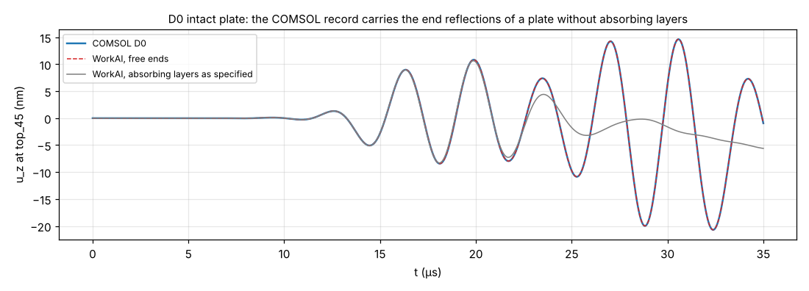
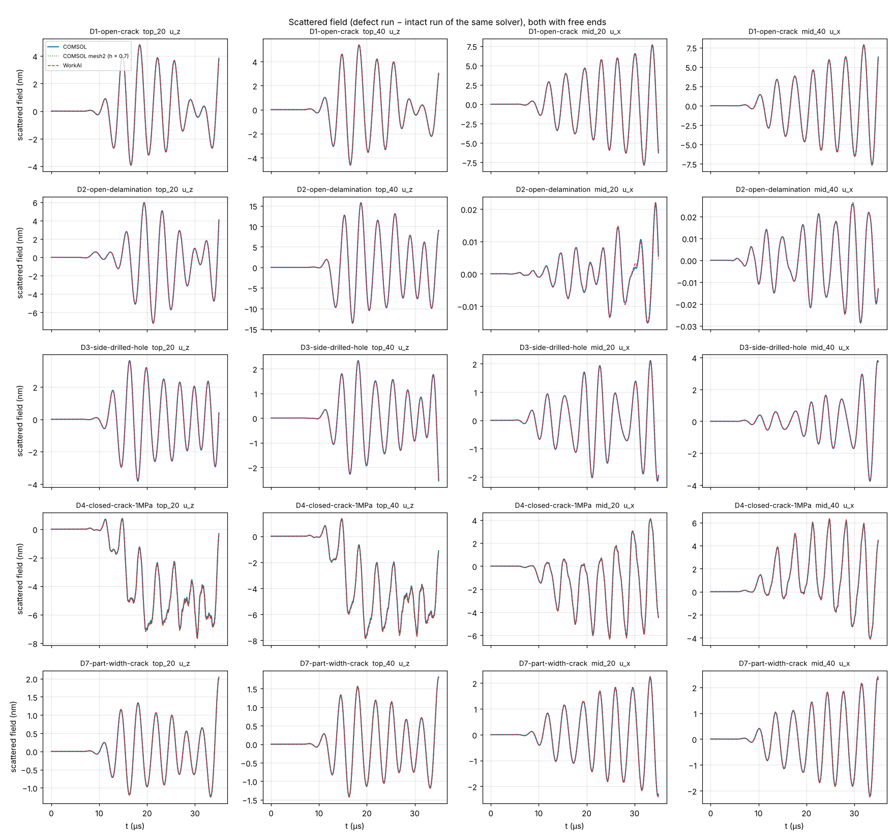

# 缺陷：独立核对与软件结果

## 1. 独立核对：二维平面应变有限元（不需要 COMSOL）

板宽方向两面（y 最小、y 最大）都设为对称面时，位移不随 y 变化，三维模型就是严格的平面应变问题。所以贯穿全宽的裂纹、分层和闭合接触，可以用一个二维求解器做独立核对。

### 1.1 参考解（`fem2d.py`）

它与网络没有共用的代码，离散方法也不同：

| | 网络（软件） | 参考解 |
|---|---|---|
| 单元 | 4 阶 GLL 谱元，自动网格 h ≈ 1.5 mm | 一次四边形单元（Q1，2 × 2 高斯积分），均匀网格 0.05、0.025、0.0125 mm（板厚方向 32、64、128 层） |
| 裂纹、分层 | 节点一分为二，前沿节点共用 | 同样的做法，在自己的网格上独立实现 |
| 闭合接触 | 罚函数单边弹簧 | **精确约束**：前向增量拉格朗日乘子法（Carpenter、Taylor、Katona 1991），每一步把将要穿透的节点对沿法向推回，动量守恒，间隙正好为 0 |
| 时间积分 | 网络时间层 | 中心差分，集中质量 |

两者相同的只有物理模型：激励为 x = 0 端面上的均匀牵引，同一个吸收层阻尼场 α(x)。

三套网格的结果外推到网格无限细（Richardson 外推，收敛阶从波形本身测出）：

- 裂纹、分层的前沿是奇异的，测得的收敛阶为 1.0–1.5，符合 r^½ 奇异场的预期；
- 外推值与最细网格之差 0.03–1.0%，这就是参考解自身的不确定度。

无缺陷板只算了两套网格，按二阶收敛外推。

### 1.2 工况（`plane_strain.py`）

- 60 × 1.6 mm 铝板，ρ = 2700 kg/m³，λ = 58.1 GPa，μ = 26.1 GPa，线性弹性；
- x = 0 端面均匀牵引，方向 45°（x 与 z 各一半），同时激发 S0 与 A0；0.3 MHz、5 周期 Hann，1 MPa；
- x = 60 端 10 mm 吸收层（三次方，60 dB）；记录 35 μs；
- 接收点：x = 20（缺陷前）、40 mm（缺陷后），上表面取 u_z、板厚中面取 u_x。

| 编号 | 缺陷 |
|---|---|
| PS0 | 无缺陷 |
| PS1 | 开口表面裂纹 x = 30，深 0.8 mm（板厚一半） |
| PS2 | 开口分层 x = 25–35，距上表面 0.5 mm |
| PS4、PS5 | 闭合裂纹（无摩擦接触，零间隙），1 MPa、2 MPa |
| PS6 | 闭合分层 |

网络用三维条带：宽 1.5 mm，两侧为对称面，网格由软件自动选择，与界面里计算时相同。

```sh
python research/defects/plane_strain.py network          # 网络，自动网格
python research/defects/plane_strain.py fem 0.05 0.025   # 参考解，两套网格（每个工况 1–4 分钟）
python research/defects/plane_strain.py fem 0.0125 PS1-open-crack PS2-open-delamination PS4-closed-crack-1MPa PS6-closed-delamination
python research/defects/plane_strain.py analyse          # → plane-strain-results.json
```

0.0125 mm 网格每个工况约 30 分钟，算了 PS1、PS2、PS4、PS6。PS5 的参考解取 PS4 的 2 倍，因为参考解是严格一次齐次的（PS5 − 2·PS4 的最大差为 3e-13）。

### 1.3 结果

表中是整段波形（35 μs）的相对 L2 差：‖网络 − 参考‖ / ‖参考‖，每格为两个接收点的范围。

| 工况 | 1.1.0 上表面 | 1.1.0 中面 | **1.1.1 上表面** | **1.1.1 中面** | 计算时间 1.1.0 → 1.1.1 |
|---|---|---|---|---|---|
| PS0 无缺陷 | 0.02–0.04% | 0.00% | 0.02–0.04% | 0.00% | 2.3 min（不变） |
| PS1 开口裂纹 | 3.4–4.1% | 5.0–5.5% | **1.1–1.3%** | **1.8–2.0%** | 2.4 → 10 min |
| PS2 开口分层 | 7.3–11.9% | 0.4–0.5% | **2.4–3.9%** | **0.1–0.2%** | 3.6 → 8.3 min |
| PS4 闭合裂纹 1 MPa | 4.5–4.7% | 4.8–6.8% | **1.8–2.0%** | **1.9–2.7%** | 2.3 → 10 min |
| PS5 闭合裂纹 2 MPa | 同 PS4 | 同 PS4 | 同 PS4 | 同 PS4 | 同 PS4 |
| PS6 闭合分层 | 6.2–10.6% | 7.7–7.8% | **3.4–5.7%** | **4.3–4.4%** | 3.6 → 8.1 min |
| PS6，网格设计频带内（≤ 0.81 MHz） | 4.4–8.7% | 1.4–1.5% | **1.9–4.4%** | **0.7%** | |

计算时间是 4 核虚拟机上几个任务同时运行时的值，只看相对大小。

**散射场**（缺陷工况减去无缺陷板，即缺陷本身产生的波）的误差，1.1.1：

- 裂纹 1.9–3.2%（1.1.0 为 5.8–8.1%）；
- 开口分层上表面 3.4–5.3%（1.1.0 为 10–16%）。

中面的分层散射只有入射的 3%，这个小量的相对误差在 3.5–5.8%。

**非线性（闭合缺陷的 2f / f）**：

| 接收点 | 闭合裂纹：网络 1.1.1 | 闭合裂纹：参考 | 闭合分层：网络 1.1.1 | 闭合分层：参考 |
|---|---|---|---|---|
| 上表面 x = 20 | 0.1286 | 0.1296 | 0.0118 | 0.0108 |
| 上表面 x = 40 | 0.1099 | 0.1117 | 0.0370 | 0.0374 |
| 中面 x = 20 | 0.0416 | 0.0416 | 0.0282 | 0.0260 |
| 中面 x = 40 | 0.1525 | 0.1570 | 0.0180 | 0.0166 |

- 闭合裂纹的 2f / f 与参考解差 0–2.9%。
- 闭合分层的 2f 只有基频的 1–4%，差 1–9%。
- 幅值加倍（PS5 对 PS4）：网络的响应正好是 2 倍（最大差 0，逐位相同），参考解差 3e-13。零间隙接触是一次齐次的，两个求解器都给出这一点。

### 1.4 发现的问题和修正：缺陷前沿的网格

1.1.0 的自动网格只让网格线穿过缺陷的边缘，前沿（裂纹尖端、分层边缘）落在与缺陷层一样大的单元里。前沿附近的位移按 r^½ 变化，这类奇异场的误差与贴着前沿的单元尺寸成正比。

网格研究（开口裂纹，上表面 x = 20 的误差）：

| 网格 | 贴着裂纹尖端的单元（x × z） | 误差 |
|---|---|---|
| 1.1.0 自动，h = 1.535 mm | 1.5 × 0.8 mm | 3.4% |
| h = 1.0 mm | 1.0 × 0.8 mm | 2.7% |
| h = 0.8 mm | 0.8 × 0.8 mm | 2.4% |
| h = 0.79 mm（厚度方向每层分成两个单元） | 0.8 × 0.4 mm | 1.8% |
| **1.1.1 自动，h = 1.535 mm，前沿两侧加密 h/4** | 0.38 × 0.38 mm | **1.1%** |

只在 x 方向加密（h 1.535 → 1.0 → 0.8）几乎没用，因为厚度方向的单元没变。所以 1.1.1 在材料内部的每个前沿两侧各加一条距前沿 h/4 的网格线，既沿缺陷平面跨过前沿，也跨过缺陷平面本身（`spectral3d/feature_mesh.py` 中的 `_front_cuts`）。这比整体加密到 h = 0.79 mm 更准，也更便宜（10 分钟对 17 分钟）。

开口分层也一样：h 1.535 → 1.0 → 0.79 的误差为 7.3 → 4.8 → 3.9%（上表面 x = 20），按 h 的一次方下降，前沿加密后为 2.4%。

### 1.5 结论

- 无缺陷时网络与独立参考差 0.04% 以内，说明激励、吸收层、接收点和网络本身都没有问题。
- 有缺陷时误差来自前沿附近的网格，不来自网络或接触算法。1.1.1 的自动网格下，开口缺陷和闭合裂纹差 1.1–3.9%，闭合分层在设计频带内差 0.7–4.4%，都在此前 COMSOL 对照约定的 5% 门槛以内。
- 罚函数接触与精确接触给出相同的谐波（闭合裂纹差 3% 以内），罚刚度不是误差的主要来源。
- 闭合分层的拍击会产生 4f、5f…… 高于网格设计频带（激励 −30 dB 带宽上限的两倍）的成分，这部分没有按精度设计，全频带误差因此大一些。

## 2. 孔：新的 O 型网格与解析解

1.1 的孔是平板上的缺陷，网格是孔周围的 O 型曲边网格（`spectral3d/feature_mesh.py`）。它与 1.0 的“带通孔板”网格（冻结的 `spectral3d/curved_mesh.py`）是两套独立的代码。后者已经用平面应力解析解（Pao & Mow）核对过，见 [research/scattering](../scattering/README.md)。

这次把同一个算例换成缺陷孔重算：

- 48 × 48 × 1 mm 铝板，中心半径 4 mm 的通孔；
- 两个 y 面为对称面，入射波是严格的直峰 S0 平面波，0.25 MHz，ka = 1.16；
- 与解析解比较，比较窗口、入射波处理都与原算例相同。

```sh
python research/scattering/scripts/hole.py run ogrid     # 缺陷孔（O 型网格），约 8 分钟
python research/scattering/scripts/hole.py run plate     # 无孔板，提供入射波
python research/scattering/scripts/analyze_hole.py ogrid # → research/scattering/results/hole-ogrid.json
```

| 接收点（r, θ） | 散射场误差：O 型网格（1.1） | 散射场误差：带通孔板网格（1.0） | 散射峰值比（软件 / 解析），O 型网格 |
|---|---|---|---|
| 4.02 mm，180° | 0.11% | 0.11% | 0.9992 |
| 4.02 mm，135° | 0.29% | 0.28% | 0.9991 |
| 4.02 mm，90° | 0.46% | 0.47% | 0.9961 |
| 4.02 mm，45° | 0.38% | 0.37% | 1.0013 |
| 4.02 mm，0° | 0.23% | 0.23% | 0.9978 |
| 8 mm，180° | 0.09% | 0.09% | 0.9994 |
| 8 mm，90° | 0.57% | 0.57% | 0.9956 |
| 8 mm，0° | 0.26% | 0.27% | 0.9992 |

- 两套网格的误差几乎逐位相同。剩下的 0.1–0.6% 来自解析解本身的近似：平面应力不含 S0 的频散（0.1%），以及镜像孔的回波，与网格无关。
- O 型网格用了 39 200 个节点，原网格 86 240 个；最小节点间距 0.114 mm 对 0.049 mm，所以时间层也少一半以上。

横孔（侧钻孔，D3）用同一段 O 型网格代码，只是轴的方向不同。

## 3. COMSOL 场景下的软件结果

这里是 [COMSOL 运行要求](../../docs/comsol/defects/README.md) 中各工况在软件 1.1.1 里的计算（D6 未算）。场景与 `docs/comsol/defects/cases/` 完全相同：

- 60 × 2（半宽，y 最大面对称）× 1.6 mm 铝板；
- 顶面 x = 15 mm 高斯激励，0.3 MHz、5 周期 Hann；
- 两端 10 mm 吸收层，记录 35 μs；
- 自动网格：h 1.535 mm，p 4，2f 分辨率 10。含裂纹、分层时加前沿加密，约 2.6–2.8 万个节点；D7 约 4.9 万个。

只取线性控制（不含材料非线性），所以看到的是缺陷本身的散射，以及闭合缺陷的接触非线性。

```sh
python research/defects/run_cases.py run D0-intact D1-open-crack D2-open-delamination D3-side-drilled-hole D4-closed-crack-1MPa D5-closed-crack-2MPa D7-part-width-crack
python research/defects/run_cases.py analyse     # → results.json
```

每次计算的节点数、时间层数、耗时和能量收支在 `out/*.json`，能量收支误差为 1.4e-6–1.1e-5。接收点波形（`out/*.npz`）不入库，可用上面的命令重算：

- 每个工况 5–20 分钟，D7 约 40 分钟；
- D7 的网格大，这个脚本把所有帧放在内存里（上限 512 MiB），所以 D7 按 0.1 μs 输出。软件本身把计算流式写到磁盘，没有这个限制。

## 结果

下表数值都取整段记录的频谱。

- **f 透射比**：缺陷后接收点（x = 40 mm）在 f 处的幅值 / 无缺陷板同一点。
- **2f / f、3f / f**：该接收点自身的谐波比。顶面取 u_z，板厚中面取 u_x。

整段记录里既有直达波，也有吸收层的残余回波，所以这些比值只用来看趋势。和 COMSOL 逐点比较波形时不用它们。括号里是 1.1.0 网格（无前沿加密）的值。

| 工况 | 顶面 f 透射比 | 中面 f 透射比 | 顶面 2f / f | 中面 2f / f | 中面 3f / f |
|---|---|---|---|---|---|
| D0 无缺陷 | 1 | 1 | 0.0002 | 0.0001 | — |
| D1 开口裂纹（深 0.8 mm，板厚一半） | 0.80（0.81） | 0.69（0.70） | 0.0005 | 0.0001 | 0.0001 |
| D2 开口分层（x 25–35，板厚中面） | 0.86（0.86） | 1.00 | 0.0002 | 0.0001 | 0.0001 |
| D3 横孔（半径 0.4 mm，中面） | 0.91 | 0.96 | 0.0002 | 0.0002 | 0.0001 |
| D4 闭合裂纹 1 MPa | 0.88（0.89） | 0.70（0.72） | **0.099**（0.097） | **0.160**（0.153） | **0.030**（0.026） |
| D5 闭合裂纹 2 MPa | 0.88（相对 2 MPa 无缺陷） | 0.70 | 0.099 | 0.160 | 0.030 |
| D7 部分宽度裂纹（完整模型中长 2 mm，深 0.8 mm） | 0.99 | 0.93 | 0.0003 | 0.0003 | 0.0001 |

D3 没有分开的节点，前沿加密对它不起作用，结果不变。

## 看得出的物理

- **开口缺陷不产生谐波。** 线性材料下，开口裂纹、分层和横孔后面的 2f / f 都停在无缺陷板的水平（1e-4 量级）。它们只有线性散射：开口裂纹挡住约 20%–30% 的 f 幅值，横孔约 10%。
- **闭合裂纹的接触产生强谐波。**
  - 裂纹后中面的 2f / f = 0.16、3f / f = 0.03，是无缺陷板的上千倍。
  - 闭合裂纹受压传力，所以 f 的透射（顶面 0.88）高于开口裂纹（0.80）。
  - 这就是“呼吸”裂纹的拍击非线性，也是非线性超声检测闭合裂纹的依据。平面应变核对（第 1 节）确认了网络的 2f / f 与精确接触的参考解相差 3% 以内。
- **零间隙接触是一次齐次的。** 2 MPa 的波形正好是 1 MPa 的 2 倍（D5 − 2·D4 的最大差为 0，逐位相同），谐波比不随幅值变化。这和材料非线性不同：材料非线性的 2f / f 随幅值线性增长。
- **板厚中面的分层对 S0 几乎不可见。**
  - 中面 u_x 主要来自对称的 S0 模态，S0 在中面上没有剪应力，低频时法向应力也很小，所以中面分层的自由面几乎不扰动它：中面透射比 1.00，x = 40、45 mm 处中面散射不到 1%。
  - 顶面 u_z 主要来自反对称的 A0，被强烈散射：缺陷后顶面散射 / 入射为 1.7–2.2。
  - 这与导波检测中 “中面分层用 A0 而不是 S0 检测” 的经验一致。
- **只占部分宽度的裂纹散射弱得多。** D7 的裂纹长 2 mm（板宽 4 mm），与 D1 同样深。正后方的透射为 0.99（顶面）、0.93（中面），D1 为 0.80、0.69。裂纹后的散射场幅值只有 D1 的约三分之一：顶面 0.18–0.20 对 0.57–0.63。波从裂纹两端绕过去，填补了裂纹后面的阴影。

开口裂纹、分层和闭合接触已经用独立的二维有限元核对（第 1 节），孔已经用解析解核对（第 2 节）。D7 的三维裂纹前沿还没有独立求解器核对，这是 COMSOL 唯一建议补算的工况，见[运行要求](../../docs/comsol/defects/README.md)。

## 4. 与 COMSOL 的对照（D0、D1、D1 mesh2、D2、D3：2026-11-14 交付；D4、D5、D7、D7 mesh2：2026-11-18 交付；D4 mesh2：2026-11-25 交付）

COMSOL 数据在 `comsol-results/20261114/`、`comsol-results/20261118/` 和 `comsol-results/20261125/`：四阶六面体单元，小应变线性弹性，广义 α 法（ρ∞ = 1，步长 0.005 μs）。开口缺陷每次运行 0.7–4.7 小时；闭合裂纹 D4、D5 用 COMSOL 的 Crack Closure 罚函数接触（罚刚度 1.4 × 10¹⁵ Pa/m，零间隙、无预压、无摩擦），分别算了 61 和 40 小时；D4 的 mesh2（h × 0.7，49.9 万自由度）算了 120 小时。2026-11-25 还交付了全部 10 次运行的压缩包：波形文件与此前交付的逐字节相同，元数据里的吸收层一项已改成实际状态（没有生效）。软件用同一场景走应用程序的记录通道（自动网格、自动时间层、只算线性控制），每个工况 5–15 秒。

```sh
python research/defects/comsol_compare.py run --free-ends D0-intact D1-open-crack D2-open-delamination D3-side-drilled-hole D4-closed-crack-1MPa D5-closed-crack-2MPa D7-part-width-crack
python research/defects/comsol_compare.py run --free-ends --h 1.0 D0-intact D1-open-crack D2-open-delamination D3-side-drilled-hole D4-closed-crack-1MPa D5-closed-crack-2MPa D7-part-width-crack   # 软件自身的网格收敛
python research/defects/comsol_compare.py run D0-intact D1-open-crack D2-open-delamination D3-side-drilled-hole                        # 按要求的场景（带吸收层）
python research/defects/comsol_compare.py report      # → comsol-results/comparison.json
```

逐接收点的数值在 `comsol-results/comparison.json`；软件每次计算的网格、时间层、耗时和能量收支在 `comsol-results/software*/*.json`。软件的接收点波形（同目录的 `*.npz`）不入库，用上面的命令重算，共约 6 分钟。

### 4.1 先说明一件事：这批 COMSOL 运行里吸收层没有起作用

运行要求里两端各有 10 mm 吸收层，元数据里也写了（`absorbing.method`）。但数据表现为**两端自由**的板：

- 完好板 D0 与软件“去掉吸收层、两端自由”的结果，在 10 个接收点的 u_x、u_z 上相差 0.02–0.08%，f 处幅值差不超过 0.09%；
- 与软件“带吸收层”的结果，在端面反射到达之前逐点接近（例如 top_20 的 u_z 在 2–10 μs 每隔 2 μs 的采样值相差不超过 1%），之后完全不同，整段波形差最大 100%；
- 开始出现差别的时刻随接收点离端面的路程增加而推迟（x = 20 mm 处 u_z 在 13.5 μs，x = 45 mm 处在 21.6 μs）。

按估算，阻尼哪怕只有要求值的万分之一，反射波也会差 0.1% 以上，所以阻尼体载荷实际上没有加上，而不是偏弱。2026-11-18 交付的元数据确认了原因：保存的模型用的体载荷类型取的是全为零的分量，阻尼表达式写在一个对这种载荷不起作用的字段里。



这不影响核对缺陷：把软件也设成两端自由，两边就是同一个问题，而且波在板里来回反射，比有吸收层时更严。下面的对照都是这样做的。D4、D5、D7 用的是同一个模型，交付后同样按两端自由对照，**不需要重算**；只请把元数据里的吸收层一项改成实际状态。

### 4.2 结果（两端自由）

每格是 10 个接收点、u_x 和 u_z 两个分量中的最大值（幅值不到该接收点最大分量 2% 的分量不比）。散射场 = 缺陷运行 − 同一求解器、同一激励幅值的完好板运行（D5 为 2 MPa，减去 2 倍的 D0）。

| 对比 | 波形差 | f 幅值差 | f 相位差 | 散射场波形差 | 散射场 f 幅值差 |
|---|---|---|---|---|---|
| D0 完好板：软件 对 COMSOL | 0.08% | 0.09% | 0.04° | — | — |
| D1 开口裂纹：软件 对 COMSOL 基准网格 | 2.04% | 6.55% | 4.68° | 1.7% | 1.5% |
| D1 开口裂纹：软件 对 COMSOL mesh2 | **0.05%** | **0.06%** | 0.09° | 0.1% | 0.1% |
| D2 开口分层：软件 对 COMSOL 基准网格 | 1.39% | 1.73% | 0.90° | 2.0% | 0.9% |
| D3 横孔：软件 对 COMSOL 基准网格 | 0.64% | 1.95% | 0.46° | 1.9% | 1.9% |
| D4 闭合裂纹（接触）1 MPa：软件 对 COMSOL 基准网格 | 2.48% | 3.22% | 0.96° | 2.3% | 1.7% |
| D4 闭合裂纹（接触）1 MPa：软件 对 COMSOL mesh2 | **1.61%** | **0.75%** | 0.21° | 1.5% | 0.3% |
| D5 闭合裂纹（接触）2 MPa：软件 对 COMSOL 基准网格 | 2.48% | 3.22% | 0.96° | 2.3% | 1.7% |
| D7 部分宽度裂纹：软件 对 COMSOL 基准网格 | 1.29% | 6.94% | 3.46° | 2.2% | 2.3% |
| D7 部分宽度裂纹：软件 对 COMSOL mesh2 | **0.06%** | **0.22%** | 0.25° | 0.3% | 0.3% |



图由 `comsol_compare.py report` 生成（只要已经运行过 `run --free-ends` 和 `run D0-intact`）。

- 波形差全部在 5% 门槛内（最大 2.48%）。
- f 幅值差超过 5% 的只有两处，都是对 COMSOL 基准网格、在接收点最弱的 u_x 分量上：D1 的 top_45（6.55%）和 D7 的 top_35（6.94%）。这是 COMSOL 基准网格自己的误差：它与 COMSOL mesh2 在同一处相差 6.09% 和 7.22%，而软件与 mesh2 只差 0.06% 和 0.22%。
- D2 的散射场一栏只统计散射场不小于完好板的波的 5% 的分量。另有 5 个板厚中面的 u_x 分量，散射场只有完好板的波的 0.2–3.7%（分层在中面附近，几乎不散射对称模态），相对差 2.5–7.8%，折合完好板的波的 0.01–0.19%。

### 4.3 网格收敛：差别来自哪一边

软件再用 h 1.0 mm（自动网格为 1.535 mm）算一遍；下表每行以后者为准。

| 对比 | 波形差 | f 幅值差 | 散射场波形差 |
|---|---|---|---|
| D0：软件自动网格 对 软件 h 1.0 | 0.04% | 0.08% | — |
| D0：COMSOL 对 软件 h 1.0 | 0.06% | 0.02% | — |
| D1：COMSOL 基准网格 对 COMSOL mesh2 | 2.03% | 6.09% | 1.6% |
| D1：软件自动网格 对 COMSOL mesh2 | 0.05% | 0.06% | 0.1% |
| D1：软件自动网格 对 软件 h 1.0 | 1.25% | 3.88% | 1.0% |
| D1：COMSOL mesh2 对 软件 h 1.0 | 1.25% | 3.94% | 1.0% |
| D1：COMSOL 基准网格 对 软件 h 1.0 | 3.27% | 9.79% | 2.7% |
| D2：软件自动网格 对 软件 h 1.0 | 0.93% | 1.10% | 1.3% |
| D2：COMSOL 基准网格 对 软件 h 1.0 | 2.31% | 2.88% | 3.2% |
| D3：软件自动网格 对 软件 h 1.0 | 0.03% | 0.13% | 0.2% |
| D3：COMSOL 基准网格 对 软件 h 1.0 | 0.62% | 1.86% | 2.0% |
| D4：COMSOL 基准网格 对 COMSOL mesh2 | 2.18% | 3.85% | 2.0% |
| D4：软件自动网格 对 COMSOL mesh2 | 1.61% | 0.75% | 1.5% |
| D4：软件自动网格 对 软件 h 1.0 | 1.83% | 2.07% | 1.7% |
| D4：COMSOL mesh2 对 软件 h 1.0 | 1.97% | 1.33% | 1.8% |
| D4：COMSOL 基准网格 对 软件 h 1.0 | 3.36% | 5.13% | 3.1% |
| D7：COMSOL 基准网格 对 COMSOL mesh2 | 1.27% | 7.22% | 2.1% |
| D7：软件自动网格 对 COMSOL mesh2 | 0.06% | 0.22% | 0.3% |
| D7：软件自动网格 对 软件 h 1.0 | 0.83% | 4.69% | 1.4% |
| D7：COMSOL mesh2 对 软件 h 1.0 | 0.85% | 4.92% | 1.4% |
| D7：COMSOL 基准网格 对 软件 h 1.0 | 2.11% | 12.49% | 3.5% |

- **完好板和孔**：软件已经收敛（0.03–0.04%）。孔与 COMSOL 相差 0.6%；这是 COMSOL 基准网格的误差还是两边模型的差别，没有 mesh2 无法区分。
- **裂纹**：四个解按网格从粗到细排成一列——COMSOL 基准网格、COMSOL mesh2 与软件自动网格（两者重合到 0.05%）、软件 h 1.0，相邻两级相差 1.3–2%。裂纹尖端的场是奇异的，收敛慢，第 1 节的平面应变核对也看到同样的慢收敛。软件自动网格的离散误差约 1.3%（波形），最敏感的一个分量上 f 幅值约 4%，在门槛内。
- **分层**：软件自动网格的离散误差约 0.9%。COMSOL 基准网格离软件细网格更远（2.3%），与裂纹的情形相同；D2 没有 mesh2，这一点只是推断。
- **部分宽度裂纹 D7**：与 D1 的情形完全相同——软件自动网格与 COMSOL mesh2 重合到 0.06%，COMSOL 基准网格更粗一级。这是二维核对覆盖不到的三维裂纹前沿（含 y 方向的端点），现在也有了独立核对。
- **闭合裂纹 D4**（mesh2 于 2026-11-25 交付）：
  - 软件自动网格与 COMSOL mesh2 的 f 幅值差 0.75%（对基准网格是 3.22%），相位差 0.21°。原先对基准网格的差别主要是 COMSOL 基准网格的误差，这一点得到确认：基准网格与 mesh2 之间相差 2.18%（波形）、3.85%（f 幅值）。
  - 但整段波形仍差 1.61%，没有像开口裂纹那样重合到 0.05%。按频带分开看（下表），3.5 f 以下——基频、二次和三次谐波所在的频带——只差 0.62%；差别主要在 2 MHz 以上（1.46%）。那是接触拍击产生的高频成分，占整段波形的 13.5%（两个求解器给出的份额相同），已经超出两边网格的设计频带。在这个频带里，下表四组对比都相差 1.2%–1.6%，加密哪一边都不收敛到一起。
  - 所以结论分两层：**基频和二次、三次谐波与 COMSOL 细网格一致到 1% 左右；接触产生的 2 MHz 以上的成分，两个求解器都只算到百分之一点几的水平。**

| D4：差别所在的频带（最差分量，相对整段波形） | 全频带 | 3.5 f 以下 | 3.5 f – 2 MHz | 2 MHz 以上 |
|---|---|---|---|---|
| 软件自动网格 对 COMSOL mesh2 | 1.61% | 0.62% | 0.46% | 1.46% |
| 软件 h 1.0 对 COMSOL mesh2 | 1.98% | 1.54% | 0.19% | 1.55% |
| COMSOL 基准网格 对 COMSOL mesh2 | 2.18% | 1.79% | 0.24% | 1.24% |
| 软件自动网格 对 软件 h 1.0 | 1.83% | 1.11% | 0.41% | 1.44% |

- 软件与 COMSOL mesh2 在两种开口裂纹（D1、D7）上都重合到 0.06% 以内，是两套独立的三维离散（谱元节点分裂 对 COMSOL 的裂纹边界）在相近分辨率下给出同一个解。

### 4.4 闭合裂纹的谐波（接触非线性）

两个求解器的接触算法不同：软件是节点对上的单边无摩擦罚函数弹簧，罚刚度取时间层稳定所允许的最大值（第 3 节）；COMSOL 是 Crack Closure 罚函数接触（1.4 × 10¹⁵ Pa/m，最大穿透 0.5 nm，最大接触压力 0.73 MPa）。

| 谐波 | COMSOL 的范围（20 个分量） | 软件 对 COMSOL 基准网格 | 软件 对 COMSOL mesh2 | COMSOL 基准网格 对 mesh2 |
|---|---|---|---|---|
| 2f / f | 0.015–0.36 | −2.5% 到 +2.8% | **−0.9% 到 +1.1%** | −3.6% 到 +3.7% |
| 3f / f，3f / f ≥ 0.01 的 3 个分量 | 0.012–0.049 | −0.2% 到 +5.9% | **−0.3% 到 +1.5%** | −4.2% 到 +0.5% |
| 3f / f，全部 20 个分量 | 0.001–0.049 | −4.4% 到 +12.8% | −11.7% 到 +4.2% | −7.6% 到 +0.5% |

mesh2 的接触诊断：最大穿透 0.37 nm，最大接触压力 0.52 MPa（基准网格为 0.52 nm、0.73 MPa；接触压力在裂纹尖端是奇异的，随网格变化）。

- 二次谐波在每个接收点、每个分量上，对 COMSOL 基准网格在 3% 以内，对 mesh2 在 1.1% 以内。这是闭合裂纹非线性的主要指标；第 1 节平面应变用精确接触得到的是 3% 以内。COMSOL 自己两套网格之间差 3.7%，比软件与 mesh2 之间大。
- 三次谐波只有基频的 0.1–5%。较大的 3 个分量对 mesh2 在 1.5% 以内（对基准网格 6% 以内）；其余的只有基频的 1% 以下，相对差可到 12%，折合基频的 0.03% 以下。
- 线性的开口裂纹 D1 在同一批接收点上 2f / f 只有 0.0002–0.0035，所以 D4 的谐波全部来自接触。

**一次齐次性（D5 对 D4）。** 零间隙、无预压的接触是一次齐次的：激励幅值加倍，整个响应正好加倍，谐波比不变。

- **COMSOL**：D5 − 2·D4 在最差的分量上为 D5 的 1.3 × 10⁻⁴（相对 L2），即它自身迭代容差的量级。2f / f 从 1 MPa 到 2 MPa 的变化在 −0.005% 到 +0.024% 之间；最大接触压力（0.73 → 1.50 MPa）和最大穿透（0.52 → 1.07 nm）约为 2 倍。
- **软件**：D5 − 2·D4 为 0，逐位相同。
- 所以 D5 对 COMSOL 的各项差别与 D4 完全相同（上表），谐波也一样：2f / f 相差 −2.5% 到 +2.8%。
- 这与材料非线性不同：材料非线性的 2f / f 随幅值线性增长；接触的谐波比与幅值无关，两个求解器都给出这一点。

### 4.5 还没有的

- 接触拍击产生的 2 MHz 以上的成分没有收敛的参考解：两个求解器、各两套网格，相互之间相差 1.2%–1.6%（第 4.3 节）。要核对这一部分，两边都需要按更高的频率设计网格。
- D2、D3 没有 COMSOL mesh2。
- 吸收层在三维里没有得到这批 COMSOL 数据的核对（它在 P1 和平面应变核对里核对过）。

## 5. 薄板里的中面闭合分层：板厚方向要不要加密（2026-11-27）

起因是一个实际算例：200 × 200 × 2 mm 的板，连续波激励 1 ms，中间有一处 10 mm 的闭合分层。软件判定“模型太大”；只建半块板也有 97 万节点、时间步 1.94 ns，一组控制预计要算 17 小时。

原因在缺陷前沿的加密规则（第 1.4 节）。它在前沿两侧 ± h/4 处各加一条网格线，分层平面的法向（板厚方向）也加。网格是张量积的，所以这两条线把**整块板**沿厚度切成 4 层单元：

| | 板厚方向的单元层 | 板厚方向节点 | 最小节点间距 |
|---|---|---|---|
| 无缺陷的 2 mm 板（h = 2.5 mm） | 1 层（2 mm） | 5 | 0.345 mm |
| 中面分层，只按分层面切开 | 2 层（各 1 mm） | 9 | 0.173 mm |
| 再加法向加密线（1.5.1 及以前） | 4 层（0.375、0.625、0.625、0.375 mm） | 17 | 0.065 mm |

节点多了近一倍，时间步缩到三分之一，而两层 1 mm 的单元本来就不比加密的目标（h/4 = 0.625 mm）粗多少。

### 5.1 新规则

一条加密线只在它要切开的单元层不窄于 2 × (h/4) 时才加（`spectral3d/feature_mesh.py` 的 `FRONT_SPLIT_MIN`）：加密线离前沿 h/4，把一层切成 h/4 和余下的部分；层再窄，余下的部分就比加密的目标还细。已经够薄的层不再切。

- 第 1、3、4 节核对过的全部算例（D1–D7、PS1–PS6），网格与原来逐节点相同：它们的层都不窄于这个门槛。
- 只有“板厚不超过单元尺寸”的薄板里靠近中面的分层受影响，也就是上面这种情况。

### 5.2 核对

同一种情况放到平面应变里，用第 1 节的独立参考解（`fem2d.py`，精确接触）对照：120 × 2 mm，两端自由，端面 45° 牵引（S0 和 A0 都有），0.1 MHz、5 周期，1 MPa，记录 120 μs（波在板里来回几趟）；分层在 x = 55–65 mm、深 1 mm。参考解用 0.1、0.05、0.025 mm 三套网格外推，最细一套距外推值 0.7%。

```sh
python research/defects/thin_plate.py fem 0.1 0.05 0.025     # 参考解，最细一套约半小时
python research/defects/thin_plate.py network                # 软件：各种网格，走应用程序的计算通道
python research/defects/thin_plate.py analyse                # → thin-plate-results.json
```

波形差是 4 个接收点（分层前、正上方、正下方、分层后）u_z 的最大值；计算量 = 节点数 × 时间层数，取最省的一行为 1。

**闭合分层：**

| 网格 | 板厚方向节点 | 时间步 | 计算量 | 波形差 |
|---|---|---|---|---|
| h 2.5 mm，原规则 | 17 | 1.92 ns | 9.0 | 1.77% |
| h 2.5 mm，新规则 | 9 | 3.23 ns | 2.9 | 2.68% |
| h 4 mm，新规则 | 9 | 5.00 ns | 1.2 | 3.19% |
| h 5 mm，新规则 | 9 | 5.00 ns | 1.0 | 3.69% |
| h 1.25 mm（两种规则网格相同） | 17 | 1.61 ns | 20.6 | 0.87% |

**张开的分层**：1.61%（原规则）、2.61%（新规则）、3.01%（h 4）、3.34%（h 5）、0.68%（h 1.25）。**完好板**：0.03%（h 2.5）、0.14%（h 4）、0.63%（h 5）。

- **新规则把计算量降到原来的三分之一（9.0 → 2.9），波形差从 1.8% 升到 2.7%，仍在 5% 的门槛内。**
- 误差来自缺陷前沿的离散：完好板在 h 2.5 mm 下只差 0.03%，单元减半后分层算例的误差降到 0.7%–0.9%。需要更准时，用结果页的收敛检查。
- 单元再放大到 4–5 mm（现在的上限是 2.5 mm），波形差到 3.2%–3.7%，计算量再降到 1/2–1/3。上限没有改：放开它还要给激励的空间分布加一条分辨率规则，这次没有做。

### 5.3 一个要知道的现象：中面处的闭合分层几乎不产生接触谐波

分层在中面时，上下两层一样厚，弯曲时一起动，界面只滑不拍。参考解里：

- 闭合与张开两种分层，在离缺陷 30 mm 的接收点上波形只差 0.05%；只有分层正上方、正下方差 6%。
- 分层正上方、正下方的 2f / f = 0.0019 / 0.0011，3f / f = 0.0008 / 0.0007（张开的分层和完好板在同一位置是 0.0004–0.0008 和 0.00005，那是猝发音自己的旁瓣）。也就是说，接触谐波只有基频的 0.1%–0.2%。
- 软件对这么弱的谐波只算到 ±30% 左右（h 1.25 mm 时 ±20%），原规则和新规则没有差别。

第 1 节里偏离中面的分层（1.6 mm 板里深 0.5 mm）拍击明显，谐波与参考解差 0.7%–4.4%。所以**研究接触非线性时，缺陷的深度很重要**：贴近中面的闭合界面，谐波本身就很弱，软件也算不准它。

### 5.4 对实际算例的效果

200 × 200 × 2 mm 板、0.1 MHz 连续波 1 ms、中面 10 × 10 mm 闭合分层，只算完整响应一组，4 核：

| | 节点 | 时间步 | 1 ms 的耗时 |
|---|---|---|---|
| 半块板，原规则 | 968,477 | 1.94 ns | 约 25 小时（按计算量折算） |
| 半块板，新规则 | 512,853 | 3.23 ns | **约 8 小时（实测折算）** |
| 整块板，原规则 | 超过 100 万节点的上限，不能计算 | | |
| 整块板，新规则 | 1,022,650 | 3.23 ns | 约 16 小时（按节点数折算） |

实测：半块板、新规则、带上表面波场记录（Z 分量、每 4 个采样点存一次），算 40 μs 用了 1189 秒（本仓库的 4 核测试机），按时间步数折算每毫秒约 8 小时（1189 秒 × 25，含一次性的建网格时间，略偏保守）。
提交前“消息”窗口给出的预计耗时（新规则 5.3 小时、原规则 16.6 小时）在这个算例上偏乐观，约为实测的三分之二。

含缺陷网格的节点上限同时从 100 万提到 400 万：这个上限原先只是保守取值，100 万节点的网格生成只需 0.5 秒、0.3 GB 内存，模型能不能算由本机内存另行检查。

## 6. 圆形分层：台阶网格与独立的轴对称参考解（2026-11-27）

`circular_delamination.py`、`axisym.py`，结果在 `circular-delamination-results.json`。

用户要算的是 200 × 200 × 2 mm 板里直径 10 mm 的圆形闭合分层。网格是张量网格，圆的边缘只能用台阶逼近。问题是台阶取多细、圆盘取多大。

### 6.1 检验问题

有一类三维问题可以精确地化成二维：100 × 100 × 2 mm 铝板，上表面中心作用高斯分布的法向载荷（σ 2 mm），正下方是直径 10 mm 的圆形分层。波到达板边之前，一切都是轴对称的，解就是 (r, z) 平面问题的解。

- `axisym.py` 解这个轴对称问题：Q1 四边形、带环向应变、集中质量、中心差分，接触用前向增量拉格朗日乘子法（精确的单边约束，没有罚刚度）。它和软件不共用任何代码，单元、时间步、接触算法都不同。
- 0.2 MHz 两周期 Hann 猝发，记录 16 μs（最快的波从板边返回到 r = 10 mm 要 16.7 μs）。载荷对分层上方的薄层又推又拉，闭合分层会张开、拍击。
- 接收点在上表面 r = 0、2.5、5、7.5、10 mm，沿 x 方向和沿 (3, 4)/5 方向各一组（后者不是网格方向），下表面 r = 0、5 mm。
- 参考解用 0.05、0.025、0.0125 mm 三套网格外推。最细网格距外推值：完好板 0.01%，张开分层 0.5%，中面闭合分层 0.8%，浅层闭合分层 3.4%（这一例参考解本身收敛得慢，下面对它的数字只能看量级）。

先核对设置：**完好板上软件与参考解相差 0.01%–0.04%**。

### 6.2 只按面积相等取台阶：一阶收敛，偏硬

取“格心在圆内、面积等于圆面积”的格子（张开分层，深 1 mm）：

| 台阶 | 分层上方的波形差 | 分层外（r 7.5–10） | 下表面中心 | 分层上方运动比参考解快 |
|---|---|---|---|---|
| h/2（1.02 mm） | 19.7–22.2% | 3.5–5.0% | 44% | 3.05% |
| h/4（0.51 mm） | 9.6–11.0% | 2.5–2.7% | 21% | 1.55% |

误差正比于台阶宽度，方向是偏硬：分层上方的薄层振动得比参考解快。原因是台阶边缘上的节点保持连接，台阶的内角又伸进圆里，起作用的分层比同面积的圆小一圈。

### 6.3 校正：圆盘半径加 0.2 个台阶

把目标面积改成 π (r + κ a)²（a 是台阶宽度），在台阶 h/2 上试 κ = 0、0.1、0.2，快慢依次是 +3.05%、+1.60%、+0.12%，线性，过零点约 0.21。取 κ = 0.2，再到 h/4 上验证（没有重新调）：

| 算例 | 台阶 | 分层上方 | 分层外 | 正好在边缘（r = 5） | 下表面中心 | 快慢 |
|---|---|---|---|---|---|---|
| 张开，深 1 mm | h/2 | 1.3–1.4% | 1.5–1.8% | 1.7–8.6% | 5.6% | +0.12% |
| 张开，深 1 mm | h/4 | 0.8–1.1% | 0.8–1.2% | 3.1–8.3% | 1.7% | −0.12% |
| 闭合，深 1 mm | h/2 | 2.1–2.8% | 1.8–2.1% | 2.1–9.5% | 3.5% | +0.23% |
| 闭合，深 1 mm | h/4 | 2.2–3.3% | 1.1–1.4% | 4.2–9.2% | 4.1% | −0.17% |
| 闭合，深 0.5 mm | h/2 | 2.7–3.4% | 6.1–8.8% | 6.1–22% | 28% | +0.63% |
| 闭合，深 0.5 mm | h/4 | 0.9–1.5% | 1.8–2.4% | 4.2–24% | 7.9% | +0.05% |

- 同一个 κ 在两种台阶宽度、张开和闭合、两个深度下都成立（快慢都回到 ±0.25% 以内，浅层粗台阶 +0.63%）：分层上方的误差从约 10–20% 降到 1–3%。
- **正好在分层边缘上的点误差大（3–9%）**。台阶边缘的位置本身差零点几毫米，边缘处场的梯度又大。读波场时离边缘一个台阶以内的点不要单独引用。
- 中面的闭合分层：h/4 并不比 h/2 明显更好（分层上方 2–3% 对 2–3%，分层外 1.1–1.4% 对 1.8–2.1%），而计算量是 2.6 倍。这时误差已经不是台阶造成的。
- 浅层的闭合分层（0.5 mm 厚的薄层盖在分层上，拍击最剧烈）：台阶粗细差别很大。h/4 下分层上方 0.9–1.5%、分层外 1.8–2.4%；h/2 下分层外 6–9%，下表面中心 28%。**分层偏离中面时用标准网格。**这一例参考解自己只收敛到 3.4%，数字看量级。
- 接触谐波：参考解在分层中心上、下表面的 2f/f 是 0.03–0.31。软件的 2f/f：中面分层相差 4–19%（两种台阶都是），浅层分层 h/4 下相差 0–6%、h/2 下相差 4–36%；3f/f 相差 2–11%。两周期猝发的谱很宽，这个比值本身就粗。

### 6.4 实现

`spectral3d.feature_mesh.circle_lattice`：以圆心为中心的正方形格子，取格心在某个半径内的格子；格子边长由 N a² = π (r + 0.2 a)² 定出，所以面积不随网格跳变；在不超过前沿单元（标准 h/4，较粗 h/2）的边长里取最大的。

### 6.5 前沿网格“较粗”和用户的算例

缺陷多了一个选项 `front_mesh: "coarse"`：前沿单元 h/2，上表的“台阶 h/2”就是它。已核对的 14 个算例（D0–D7、PS0–PS6）的网格与改动前逐字节相同。

200 × 200 × 2 mm 整板，0.2 MHz 连续波 1 ms，中面直径 10 mm 圆形闭合分层，只算完整响应：

| 前沿网格 | 节点 | 板厚方向节点 | 时间步 | 时间层数 | 计算量（节点 × 层数） |
|---|---|---|---|---|---|
| 标准（h/4） | 3,873,282 | 17 | 2.53 ns | 395,000 | 1.53 × 10¹² |
| 较粗（h/2） | 1,720,058 | 9 | 3.51 ns | 285,000 | 4.9 × 10¹¹ |

- 单元 1.978 mm（按 2f 剪切波长 15 个节点）。标准网格下 h/4 = 0.49 mm，1 mm 厚的层刚好不窄于它的两倍，所以板厚方向又被切成四层（第 5 节的规则没有省掉它）；较粗网格保持两层。
- 按第 5 节在 4 核测试机上的实测速度（约 5.3 × 10⁶ 节点·层/秒）折算：标准约 80 小时，较粗约 26 小时。用户的机器是 32 核，会快几倍，具体倍数没有实测。
- 标准网格在用户的板上是四层、台阶 h/4；6.3 的表里“h/4”是两层的。四层的对比：张开分层（深 1 mm）分层上方 1.4–1.9%、分层外 1.1–1.6%、快慢 −0.25%，与两层的 0.8–1.1%、0.8–1.2%、−0.12% 相当，计算量是 2.2 倍（板厚方向加密后前沿分辨得更好，0.2 的校正略微过头）。闭合分层的四层对比还在算。

