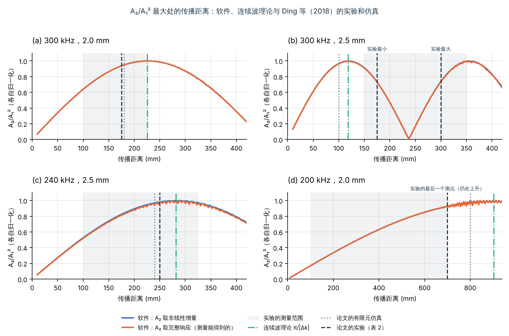

# 与公开实验数据的对照：铝板低频 S0 模态的二次谐波

软件此前的核验都是对解析解、文献公式或其他求解器，没有实验。这里用一篇开放获取论文里的实验做第一次对照。

## 1. 结论

- **与实验部分一致，不能算通过。** 四个工况里：一个工况（240 kHz、2.5 mm）在实验的采样间隔内一致；一个工况（300 kHz、2.5 mm）极小到极大的间距一致（差 6%），但绝对位置差约 60 mm；一个工况（200 kHz、2.0 mm）实验没有测到最大值，只能说不矛盾；一个工况（300 kHz、2.0 mm）软件给出的最大值位置比实验远 51 mm（29%）。
- **软件与连续波理论一致。** 四个工况里 A₂/A₁² 第一个极大的位置，软件与 π/|Δk| 的差都在 1% 以内；基频波数差 10⁻⁵ 量级，群速度差 0.03% 以内。
- **论文自己的有限元仿真与理论不一致。** 用论文表 1 的材料常数算，理论值比论文仿真给出的距离长 11%–20%，四个工况方向相同。原因我没有查清。
- **差别不能归到软件上，也不能归到实验上。** 这个距离对频率、板厚和泊松比极其敏感（约 −3.7、−2.7、−2.5 次方），实验里距离的起点（楔块下方）也没有交代。板厚偏 10%，或者起点偏 50 mm，都足以解释，但论文里的信息不足以区分。

所以这次对照的价值是有限的：它确认了软件算出的现象与实验是同一个现象、量级和趋势相符，但没有给出“软件与实验相差百分之几”这样的结论。



## 2. 数据来源

X. Ding, Y. Zhao, N. Hu, Y. Liu, J. Zhang, M. Deng, “Experimental and Numerical Study of Nonlinear Lamb Waves of a Low-Frequency S0 Mode in Plates with Quadratic Nonlinearity”, *Materials* 11 (2018) 2096，[doi:10.3390/ma11112096](https://doi.org/10.3390/ma11112096)，CC BY 4.0。

**实验**（论文第 4 节）：

- 试件：AL-6061-T6 铝板。
- 激励：RITEC RAM-5000 SNAP 发出 10 周期、Hanning 窗的猝发音，经 250 kHz 的压电换能器和 30° 有机玻璃楔块在板中激发 S0 模态。
- 接收：粘在板面上的压电片，取垂直于板面的位移。
- 量：声学非线性参数 A₂/A₁² 随传播距离的变化，测点间隔 25 mm，每个工况重复 40 次以上。0–100 mm 的信号测不到。

**可对照的量**：论文表 2 列出四个频率–板厚组合的“色散距离 L”，实验和论文自己的平面应变有限元仿真（ABAQUS/Explicit）各一列。这个量不依赖幅值标定，所以选它。

| 工况 | 论文仿真 | 论文实验 |
|---|---|---|
| 300 kHz，2.0 mm | 180 mm | 175 mm |
| 300 kHz，2.5 mm | 100 mm | 125 mm |
| 240 kHz，2.5 mm | 240 mm | 250 mm |
| 200 kHz，2.0 mm | 800 mm | 700 mm |

**读这张表时要注意的三点**（都是对照论文的图得出的）：

1. 论文式 (1) 把 L 定义为 2π/|k(2ω) − 2k(ω)|（整个拍长），但表 2 的数值对应的是 A₂/A₁² **第一次达到最大**的距离，即半个拍长 π/|Δk|。论文图 7 的仿真曲线在表中的距离处到达峰值。
2. 300 kHz、2.5 mm 这一行，实验从 150 mm 才开始有测点，曲线在 175 mm 处最小、300 mm 处最大。表里的 125 mm 是这两处的**间距**，第一个极大在测量范围之外。
3. 200 kHz、2.0 mm 这一行，实验曲线到最远的测点 700 mm 仍在上升。700 mm 是测量范围的终点，不是测到的最大值位置，只能当作下限。

实验曲线的原始数值论文没有给，图 8 的位置是我从图上读的，精度不会好于测点间隔（25 mm）。

**论文里两处不一致**：实验一节写的板厚是 1.5 mm 和 2 mm，而结果里的工况是 2.0 mm 和 2.5 mm；仿真一节写“最高频率 1200 kHz（基频 600 kHz）”，与 300 kHz 的工况不符。

## 3. 软件里的模型

与论文的仿真同样的理想化：平面应变条带。

- 宽 1.6 mm（一个单元），两个 y 面为对称面；远端 40 mm 吸收层。
- 材料：论文表 1 的常数，作为软件的 Murnaghan 材料（ρ = 2704 kg/m³，λ = 51.1 GPa，μ = 26.3 GPa，l = −282 GPa，m = −339 GPa，n = −416 GPa）。这不是软件训练用的铝。
- 激励：x = 0 端面上沿 x 的均匀牵引，10 周期 Hann 猝发音，2 MPa。这样只激发 S0。实验用的是楔块，模态不会这么纯。
- 接收：上表面的离面位移，每 2.5 mm 一个点。
- 计算路径与桌面软件相同：自动网格、自动时间层、`offline.worker`、完整记录；只算完整和线性两组控制。

| 工况 | 板长 | 记录 | 单元 | 节点 | 用时（4 核） |
|---|---|---|---|---|---|
| 300 kHz，2.0 mm | 470 mm | 130 μs | 1.77 mm | 47 925 | — |
| 300 kHz，2.5 mm | 470 mm | 130 μs | 1.77 mm | 47 925 | 249 s |
| 240 kHz，2.5 mm | 470 mm | 140 μs | 2.21 mm | 38 385 | 187 s |
| 200 kHz，2.0 mm | 990 mm | 245 μs | 2.50 mm | 39 625 | 249 s |

第一个工况计算时机器上同时在跑别的任务，用时不列。200 kHz 的工况板长 990 mm，是因为软件的模型最长 1000 mm；论文的仿真到 950 mm，这里到 940 mm。

A₂/A₁² 用三种方式形成，结果一致：

| 方式 | A₁ | A₂ |
|---|---|---|
| 整段信号的频谱，完整响应 | 完整响应在 f 处 | 完整响应在 2f 处（测量能得到的） |
| 整段信号的频谱，非线性增量 | 同上 | 完整 − 线性 在 2f 处 |
| 软件的沿程分析 | 跟随波包的 Hann 窗 | 非线性增量 |

最大值的位置取峰顶附近（峰值的 90% 以上）各点的抛物线顶点，这样曲线上的小波纹不影响读数。

## 4. 结果

A₂/A₁² 第一个极大的传播距离（mm）：

| 工况 | 论文实验 | 论文仿真 | 连续波理论 π/\|Δk\| | 软件（频谱） | 软件（沿程分析） | 软件对理论 |
|---|---|---|---|---|---|---|
| 300 kHz，2.0 mm | 175 | 180 | 225.5 | 226.3 | 223.6 | +0.4% |
| 300 kHz，2.5 mm | （见下） | 100 | 118.3 | 118.6 | 116.7 | +0.3% |
| 240 kHz，2.5 mm | 250 | 240 | 281.9 | 283.0 | 279.6 | +0.4% |
| 200 kHz，2.0 mm | > 700 | 800 | 902.8 | 909.7 | 901.0 | +0.8% |

300 kHz、2.5 mm 工况的极小和第二个极大：

| 量 | 论文实验（读图） | 连续波理论 | 软件 |
|---|---|---|---|
| 极小的位置 | 175 mm | 236.6 mm | 237.5 mm |
| 其后极大的位置 | 300 mm | 354.9 mm | 356.2 mm |
| 两者的间距 | 125 mm | 118.3 mm | 118.7 mm |

把软件的曲线按实验的方式采样（实验的测量范围内每 25 mm 一个点）：

| 工况 | 实验最大的测点 | 软件最大的测点 |
|---|---|---|
| 300 kHz，2.0 mm | 175 mm | 225 mm |
| 300 kHz，2.5 mm | 最小 175、最大 300 mm | 最小 225、最大 350 mm |
| 240 kHz，2.5 mm | 250–275 mm | 275 mm |
| 200 kHz，2.0 mm | 700 mm（末点，仍在上升） | 700 mm（末点，仍在上升） |

模型里的其他量：

- f 处的波数与理论 S0 的差：1×10⁻⁵ 到 6×10⁻⁵。
- 群速度（包络到达时刻的直线拟合）与理论差 0.03% 以内，例如 5301.9 对 5302.5 m/s。
- 连续波理论用软件的平板导波模块（`offline/guided.py`）计算，并用 Rayleigh–Lamb 方程的根（`dispersion/lamb.py`）独立核对，两者给出相同的四个数。

**猝发音长度的影响**：300 kHz、2.0 mm 工况改用 20 周期（带宽减半），最大值位置 225.8 mm，与 10 周期的 226.3 mm 相同。所以有限带宽不是软件与论文仿真相差 20% 的原因。

200 kHz 工况的曲线在 700 mm 以后有约 1% 的波纹，最大值处很平，读出的位置不确定度约 ±20 mm。

## 5. 差别的可能原因

**这个量非常敏感。** 用理论计算 π/|Δk| 对各参数的对数导数：

| 工况 | 对频率 | 对板厚 | 对泊松比（杨氏模量不变） | 要与实验一致需要 |
|---|---|---|---|---|
| 300 kHz，2.0 mm | −3.66 | −2.66 | −2.54 | 频率 +7.2%，或板厚 +10.0%，或泊松比 +10.5% |
| 300 kHz，2.5 mm | −4.19 | −3.19 | −2.48 | （间距：板厚 −1.7%） |
| 240 kHz，2.5 mm | −3.66 | −2.66 | −2.54 | 频率 +3.3%，或板厚 +4.6%，或泊松比 +4.8% |
| 200 kHz，2.0 mm | −3.26 | −2.26 | −2.59 | 无约束（实验只给下限） |

板厚的公差、换能器频响造成的实际中心频率偏移、所用铝板的弹性常数与表 1 的差别，任何一项有百分之几，这个距离就差一到两成。

**距离的起点。** 实验用楔块激励，S0 波在楔块底面下方的一段长度上生成，论文没有说明距离从哪里量起，只说 0–100 mm 测不到。如果实际的传播距离比标称值长几十毫米，实验的位置就会系统性偏小：

| 工况 | 实验位置 − 软件位置 |
|---|---|
| 300 kHz，2.0 mm 的极大 | −51 mm |
| 300 kHz，2.5 mm 的极小 | −62 mm |
| 300 kHz，2.5 mm 的极大 | −56 mm |
| 240 kHz，2.5 mm 的极大 | −33 到 −8 mm |

三个 300 kHz 的位置差接近同一个值，而不受起点影响的量（300 kHz、2.5 mm 的极小到极大间距）差 6%，在测点间隔之内。这与“起点偏移”的解释相容，但只是相容：同样的数据也可以用板厚偏大约 10% 来解释，论文里的信息不足以区分。

**论文的仿真为什么比理论短 11%–20%，我没有查清。** 它用的材料常数与这里相同，同样是平面应变、端面激励、10 周期猝发音。我排除了两种可能：

- 有限带宽：20 周期的结果与 10 周期相同。
- A₂ 的取法：用完整响应或用非线性增量，最大值位置相同。

没有排除的：论文仿真的数值色散（0.2 mm 的线性减缩积分单元）、它提取 A₁、A₂ 的具体做法、三次多项式拟合的范围。这些论文没有给出足够的细节。

## 6. 这次对照说明了什么

**说明了的：**

- 软件对一种不是训练材料的铝（论文的 Murnaghan 常数），在 0.4–0.75 MHz·mm 的范围内，二次谐波的相位失配行为与精确的线性频散理论一致到 1% 以内。
- 实验观察到的现象——A₂/A₁² 随距离先增后减、频厚积越大拍长越短、200 kHz 时在 700 mm 内一直上升——软件都给出了，量级相符。
- 不受距离起点影响的那个量（极小到极大的间距）与实验一致。

**没有说明的：**

- 软件与实验的定量一致程度。一个工况差 29%，原因不能确定。
- 二次谐波的幅值。实验的 A₂/A₁² 是任意单位，而且带有很大的本底（工况 a 的曲线只在 0.079–0.097 之间变化），来自仪器自身的非线性，无法与软件的绝对值比较。
- 三阶弹性常数的影响。这里对照的距离只取决于线性频散，换一组 l、m、n 结果不变。
- 三维效应。实验是 625 mm 宽的板和有限宽度的波束，软件和论文的仿真都是平面应变。

**要得到定量结论，需要的数据：** 原始波形（而不是图），板厚和波速的实测值，以及距离起点的定义。我检索了 Zenodo、Mendeley Data 和 figshare，没有找到带原始波形的非线性导波公开数据集；公开的导波数据集（Open Guided Waves 等）是线性的，材料多为复合材料层合板。如果你有自己的实验数据，对照可以做得比这里严格得多。

## 7. 复现

```bash
# 计算五个模型（记录共约 9 GB，放在仓库之外）
WORKAI_EXPERIMENT_JOBS=/path/to/jobs python research/experiment-comparison/scripts/cases.py
# 分析，写 results/results.json
cd research/experiment-comparison/scripts && WORKAI_EXPERIMENT_JOBS=/path/to/jobs python analyze.py
# 画图（需要 matplotlib）
python plots.py
```

| 文件 | 内容 |
|---|---|
| `scripts/cases.py` | 论文的材料常数、四个工况和表 2 的数值；每个工况的模型；用软件的计算进程运行 |
| `scripts/analyze.py` | 从记录读上表面离面位移，三种方式形成 A₂/A₁²，读极值位置，与理论对照 |
| `scripts/plots.py` | 图 1 |
| `results/results.json` | 每个工况的曲线和读出的数值 |
