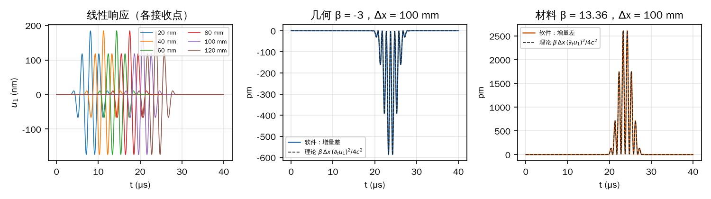
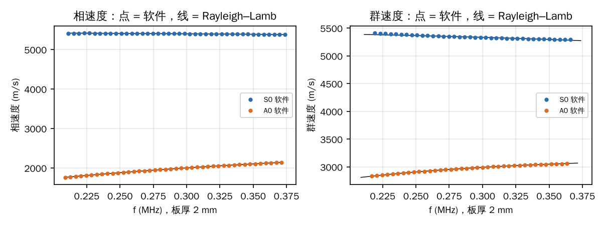
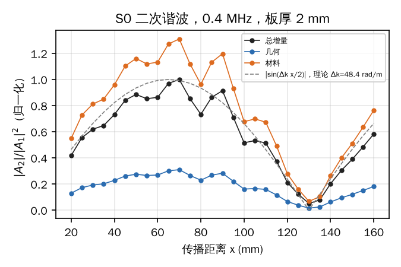
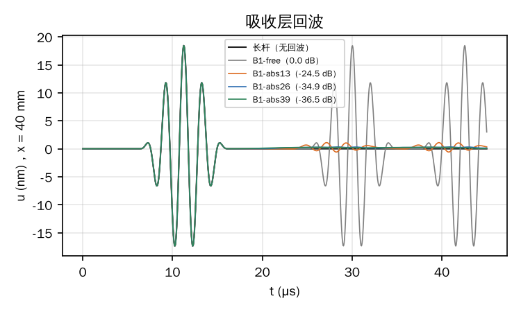

# 仿真软件功能核验：文献与解析解对照

2026-11-10。用户要求验证仿真软件现有功能是否正确，并可参考网上论文。本次核验离线工作台的默认引擎“物理 AI · 冻结网络”，以及材料模块与界面辅助计算。每个算例都走工作台的同一条路径：

1. `offline.domain.validate_request` 校验请求；
2. 子进程 `python -m offline.worker` 计算；
3. 用结果页“任意点波形”所用的 `offline.recording.traces` 读取完整 float64 记录。

对照值来自经典解析解和公开文献，不来自本软件的其他求解器，也不来自 COMSOL。参考解都由独立编写的脚本计算（[`scripts/theory.py`](scripts/theory.py)），不导入软件的频散模块。传播算例的理论 β 用到材料的 C₁₁、C₁₁₁，这两个量取自软件的材料模块，它先在第 1 节单独与闭式关系核对。

## 结论

| # | 核对的功能 | 参考 | 本软件结果 | 判定 |
|---|---|---|---|---|
| M1 | Murnaghan 材料的二阶、三阶弹性常数（精确路径与自定义 W(E) 路径） | Murnaghan 能量式与 Landau 换算（Destrade & Ogden 2013 式 7.21、7.26）；Thurston–Brugger 关系 | 9 个常数最大相对差 4e-16（精确）、1.3e-12（自定义 W） | 通过 |
| M2 | 横观各向同性工程常数 → 刚度（界面“写入 C11…”按钮） | 横观各向同性柔度矩阵求逆（Jones 1999） | 最大相对差 3.5e-8（界面取 8 位有效数字） | 通过 |
| M3 | CFRP 各方向相速度（Christoffel） | 横观各向同性闭式解（Auld 1973） | 0–90° 与纤维转 90°，最大相对差 4.4e-16 | 通过 |
| L1 | 纵波速度、端面牵引加载幅值与波形 | c = √(C₁₁/ρ)；牵引驱动半空间 v = σ s(t)/(ρc) | 波速 −2.1e-5；质点速度波形相对 L2 差 1.1e-6 | 通过 |
| N1 | 二次谐波：几何、材料、完整三种响应 | 经典平面纵波解 u₂ = βx(∂ₜu₁)²/(4c²)，A₂ = βk²xA₁²/8（Lund 2024；Matlack 等 2015） | β 拟合：几何 −3.000（理论 −3）、材料 13.363（13.364）、完整 10.363（10.364）；A₂ 与教科书公式差 0.1–0.2%，随 x 线性增长 | 通过 |
| N1b | 二次谐波随幅值平方变化 | 同上 | 10 MPa / 5 MPa：线性比 2.000，几何、材料增量比 4.000 | 通过 |
| L2 | Lamb 波频散（2 mm 铝板，0.21–0.37 MHz） | Rayleigh–Lamb 方程（Lamb 1917；Rose 2014） | 相速度：A0 ≤ 0.012%，S0 ≤ 0.11%；群速度：A0 ≤ 0.19%，S0 ≤ 0.52% | 通过 |
| N2 | S0 二次谐波的相位失配与周期性 | 非同步模态对的 sinc 规律（de Lima & Hamilton 2003；Müller 等 2010） | Δk 拟合 48.1 rad/m，Rayleigh–Lamb 给出 48.35（−0.5%）；幅值在 70 mm 附近最大，130 mm 处接近零（2π/Δk = 130 mm） | 通过 |
| C1 | CFRP 自定义应变能：沿纤维波速与用户三阶项 | c = √(C₁₁/ρ)；β = −(3 + C₁₁₁/C₁₁)，C₁₁₁ = 6a₁ | 波速 +8.7e-6；β：几何 −3.000、材料 8.695（8.695）、完整 5.695 | 通过 |
| C2 | CFRP 横向（纤维转 90°）：波速与几何非线性 | c = √(C₂₂/ρ)；无三阶项时 β = −3 | 波速 −1.8e-5；β 几何 −3.000，材料增量恒为 0；A₂ 与公式差 0.05% | 通过 |
| B1 | 吸收层回波 | 吸收层长度应大于 2 倍波长（Wu 等 2013） | 层长 0.5/1/2/3 倍波长：−11.2 / −24.5 / −34.9 / −36.5 dB | 与文献一致；默认层长偏短，已加提示 |
| G1 | 应变超过 1e-3 时的报错 | — | 原来显示无法理解的 `SystemError`；已修复为说明原因和处理办法的中文提示 | 已修复 |

总体结论：

- **符合解析解与文献：** 材料常数换算与闭式关系一致，差别在舍入误差水平。线性波速与频散、加载幅值，以及几何、材料两类二次谐波的产生、累积和幅值平方律，与经典解析解和文献公式的差别在 2e-5 到 0.5% 之间。S0 二次谐波随距离先增后减的周期，也与 Rayleigh–Lamb 频散给出的相位失配一致。
- **发现两个问题，已修复：**
  - 超出应变范围时，报错不可读；
  - 默认吸收层（8 mm）对低频 S0 偏短，现在预检会提示。
- **结论的适用范围：** 本页只覆盖短记录（≤ 80 μs）、平板和规则网格。1 ms 记录的精度见 [1 ms 长记录精度](../long-record-accuracy/README.md)。缺口、孔和管的散射没有文献定量对照（第 8 节）。

## 方法

**一维单轴应变杆。** 板的四个侧面（y、z 最小/最大面）都设为对称面，法向位移为零、切向自由。这样整根杆就是单轴应变介质，端面 xmin 施加均匀轴向牵引，得到严格的一维平面纵波。

- 截面 0.8 × 0.8 mm，h = 0.8 mm，4 阶图，节点间距 0.2 mm；
- 杆长 200 mm，记录 40 μs，期间远端反射不到达分析的接收点；
- 0.5 MHz、5 周期 Hann 脉冲，幅值 10 MPa 和 5 MPa。

**平面应变板。** 板的 y 两面设为对称面，就是 Lamb 波问题。2 mm 厚铝板，端面加载：

- 轴向均匀牵引在厚度方向对称，只激发 S0；
- 厚度方向均匀牵引反对称，只激发 A0。

频带 0.21–0.37 MHz（fd ≤ 0.75 MHz·mm），低于 A1（约 1.55 MHz·mm）和 S1 的截止。远端 30 mm 吸收层。

**读数。** 全部波形都在结果页可读取的任意点上提取。

## 1. 材料模块

- **M1：** Destrade & Ogden（2013，arXiv:1302.4556）式 7.21 给出基于 Green 应变的 Murnaghan 能量。

  ```text
  W = ½(λ+2μ)i₁² − 2μi₂ + ⅓(l+2m)i₁³ − 2m i₁i₂ + n i₃
  ```

  式 7.26 给出 Landau 常数 Ā = n、B̄ = m − n/2、C̄ = l − m + n/2。本软件的能量式与此逐项相同（见[铝材料文档](../../docs/aluminum-material.md)）。

  由该能量可得 Brugger 常数：C₁₁₁ = 2l + 4m、C₁₁₂ = 2l、C₁₂₃ = 2l − 2m + n、C₁₄₄ = m − n/2、C₁₅₅ = m、C₄₅₆ = n/4。文献铝常数下 C₁₁₁ = −1474 GPa。

  软件的两条路径都与之一致：
  - `murnaghan_tensors`：精确路径；
  - `taylor_constants`：把同一能量写成自定义 W(E)，用复步长求导。
- **M2：** 界面“写入 C11、C12、C22、C23、C55”按钮调用 `tiFromEngineering`。拿它与独立的柔度矩阵求逆比较，用了三组示例工程常数，只核对公式，不代表具体铺层。差别只来自界面保留 8 位有效数字。C₄₄ = (C₂₂ − C₂₃)/2 也成立。
- **M3：** CFRP 预设在 0°、30°、45°、60°、90° 方向上的三个相速度，与横观各向同性 1–2 平面的闭式解一致；纤维转 90° 后，沿 x 的速度变为横向速度。

数据：[`results/materials.json`](results/materials.json)。

## 2. 一维平面纵波：波速、加载与二次谐波

**理论。** 一维单轴应变下，P = C₁₁u_x + ½(3C₁₁ + C₁₁₁)u_x²，即 ρu_tt = C₁₁u_xx(1 − βu_x)，其中 β = −(3 + C₁₁₁/C₁₁)。对 u₁ = f(t − x/c) 作二阶摄动：

```text
u₂(x, t) = β x (∂ₜu₁)² / (4c²) + (端面产生、形状不随 x 变化的一列波)
```

其 2f 分量就是常用的 A₂ = βk²xA₁²/8。Lund（2024，arXiv:2408.11184）的写法是 A₂ = βxω²A₁²/(4c²)，那里方程写成 u_xx 加 β∂ₓ(u_x²)，β 的定义差一个因子 −½，物理上相同。Matlack 等（2015）的综述用同一关系由 A₂/(A₁²k²x) 测 β。

本软件导出五种响应：线性、StVK、完整，以及几何增量（StVK − 线性）和材料增量（完整 − StVK）。

- 几何增量对应 C₁₁₁ = 0，即 β = −3；
- 材料增量对应 β = −C₁₁₁/C₁₁ = 13.364；
- 两者之和 β = 10.364。

每种增量都有独立的闭式预测。

**做法。** 对每对接收点 (20 mm, x)，把 20 mm 处的增量按 Δx/c 平移后相减，消去端面产生的那列波。差值与 Δx(∂ₜu₁(x,t))²/(4c²) 做最小二乘，拟合出 β。这里 u₁ 用软件自己算出的线性响应，因此比较的是二阶项的产生和累积，不受加载幅值影响。加载幅值另行与 v = σs(t)/(ρc) 比较。

**结果（10 MPa）。**

| Δx (mm) | β 几何 | β 材料 | β 完整 | 波形残差（完整） |
|---|---|---|---|---|
| 20 | −3.000 | 13.364 | 10.364 | 0.5% |
| 60 | −3.000 | 13.363 | 10.363 | 0.9% |
| 100 | −3.000 | 13.363 | 10.363 | 1.2% |
| 理论 | −3 | 13.364 | 10.364 | — |

- **波速与加载：** 波速 6391.41 m/s，理论 6391.55 m/s。x = 20 mm 处质点速度与 σs(t − x/c)/(ρc) 的相对 L2 差为 1.1e-6，说明端面牵引的大小、方向和 Hann 脉冲形状都正确。
- **A₂ 随距离线性增长：** 用质点速度包络换算 A₁，A₂ 用 2f 频带包络。20–120 mm 各点 A₂ 与 βk²xA₁²/8 之比为 1.001–1.002，线性拟合斜率与公式差 0.09%。

  位移脉冲带一个单边的低频分量，若用位移的频带边缘取 A₁，会多计约 2%，所以 A₁ 改由速度换算。
- **幅值平方律：** 5 MPa 时 β 相同，波形残差减半（0.6%）。相对残差与幅值成正比，说明它主要来自更高一阶（u₁³）的非线性项，而不是离散误差；离散误差的相对大小不随幅值变化。10 MPa 与 5 MPa 之比：线性响应 2.000（形状差 1e-14），几何、材料增量 4.000。



## 3. Lamb 波频散

**独立求解器。** 独立的 Rayleigh–Lamb 求解器写成对实、虚 p、q 都保持实值的形式（`scripts/theory.py`），用两种方式核对：

- 低频极限给出板速 2c_T√(1 − c_T²/c_L²) = 5432.96 m/s，S0 在 10 kHz 时为 5432.93 m/s；
- 检索到的一篇立陶宛 KTU 论文的摘要转述中，有 2 mm 铝板（c_L = 6350、c_T = 3100 m/s）在 220/380 kHz 的群速度。本求解器给出：

  | 频率 | S0 本求解器 | S0 转述值 | A0 本求解器 | A0 转述值 |
  |---|---|---|---|---|
  | 220 kHz | 5360.7 | 5360 | 2834 | 2817 |
  | 380 kHz | 5248.8 | 5248 | 3066 | 3056 |

  该论文原文所在主机在本环境的网络策略下无法访问，未能核对原表，因此只作旁证。

**做法。** 每个频率的波数 k(f)，取自 40–47 mm（间距 1 mm）和 50–110 mm（间距 10 mm）各点的 FFT 相位随 x 的斜率，按 1 mm 间距逐点解缠。群速度取 k(ω) 三次拟合的导数。

**结果。** 在频谱 −12 dB 以内（0.21–0.37 MHz）：

| 模态 | 相速度最大相对差 | 群速度最大相对差 |
|---|---|---|
| A0 | 1.2e-4 | 1.9e-3 |
| S0 | 1.1e-3（频带边缘；中段 4.5e-4） | 5.2e-3 |

A0 的相速度从 1763 m/s 变到 2108 m/s，频散很强，软件逐点与 Rayleigh–Lamb 一致。



## 4. S0 二次谐波的相位失配

**理论。** 低频 S0 的基频与二倍频相速度略有不同，二次谐波不是严格同步累积。对非同步模态对，二次谐波的复振幅满足 A₂(x)/A₁² ∝ (e^{−iΔk x} − 1)，|A₂| ∝ |sin(Δk x/2)|。这是 de Lima & Hamilton（2003）提出的“内共振”条件中相位匹配不满足时的情形；Müller 等（2010）和 Chillara & Lissenden（2016）的综述都以此判断累积性。

**算例。** 2 mm 铝板，0.4 MHz，S0 激励，10 MPa，在 20–160 mm 取 29 个点。Rayleigh–Lamb 给出：

- k_S0(2f) − 2k_S0(f) = 48.35 rad/m；
- 相干长度 π/Δk = 65 mm。

**结果。** 对复比值 C₂/C₁² 拟合 a(e^{−iΔk x} − 1) + b，得 Δk = 48.1 rad/m（−0.5%）。几何增量、材料增量和完整增量给出同一个 Δk。

|A₂|/|A₁|² 在 70 mm 附近最大，在 130 mm 处降到最大值的 5%，之后重新增长，与 2π/Δk = 130 mm 一致。拟合残差 11%，主要来自有限脉冲的包络走离：S0 在 f 与 2f 的群速度分别为 5250、4290 m/s。



## 5. 吸收层回波

一维杆，0.5 MHz，纵波波长 λ = 12.8 mm。杆长 100 mm，远端吸收层用三次渐变，设计衰减 60 dB。与 280 mm 长杆（窗口内无回波）逐点相减，取 x = 40 mm 处回波峰值与直达波峰值之比：

| 吸收层长度 | 相对波长 | 回波 |
|---|---|---|
| 0（自由端） | — | 0.0 dB（全反射，核对用） |
| 6.4 mm | 0.5 λ | −11.2 dB |
| 13 mm | 1.0 λ | −24.5 dB |
| 26 mm | 2.0 λ | −34.9 dB |
| 39 mm | 3.0 λ | −36.5 dB |

- **设计值不是实际回波：** 吸收层的 `attenuation_db` 只是设计值（往返衰减 60 dB），实际回波由阻尼梯度决定，也就是取决于层长有几个波长。层长 2 倍波长时约 −35 dB，再加长改善有限。
- **与文献一致：** Wu 等（2013，北京工业大学学报）在超声导波的三维有限元中得出，吸收区长度应大于 2λ。
- **默认层长偏短：** 工作台新建吸收层的默认长度是 8 mm。0.2–0.4 MHz 时 S0 波长 13–27 mm，8 mm 不到一个波长。为此在预检中加了提示：吸收层短于最长波长（按最快体波速与最低载频估算）的 2 倍时，状态栏会显示回波可能明显，并给出本节实测的数量级。



## 6. CFRP：自定义应变能

用 CFRP 预设（ρ = 1560 kg/m³，C₁₁ = 138.0 GPa、C₂₂ = 11.47 GPa 等），并加入用户三阶项 a₁ i₁³（a₁ = −200 GPa，即 C₁₁₁ = 6a₁ = −1200 GPa），检验自定义 W(E) 从材料卡到网络能量层的整条路径。

- **纤维沿 x：** 0.4 MHz，10 MPa，截取 22.5 μs，避开远端反射。
  - 波速 9405.86 m/s，理论 √(C₁₁/ρ) = 9405.78 m/s；
  - 质点速度波形差 1.6e-7；
  - 三对接收点的 β 均为：几何 −3.000，材料 8.695（理论 −C₁₁₁/C₁₁ = 8.695），完整 5.695，残差 ≤ 0.2%。
- **纤维转 90°：** 2 MPa（10 MPa 会超过应变上限，见第 7 节）。
  - 波速 2711.25 m/s，理论 √(C₂₂/ρ) = 2711.30 m/s；
  - 质点速度波形差 1.3e-5；
  - 几何增量 β = −3.000，材料增量恒为零（预设三阶项为零时完整与 StVK 逐位相同）；
  - A₂ 与 βk²xA₁²/8 差 0.05%。

## 7. 发现并修复的问题

1. **超出应变范围时报错不可读（已修复）。** 第一次做纤维转 90° 的算例时用了 10 MPa，任务失败，界面显示 `CPUDispatcher(<function three_segments …>) returned a result with an exception set`。

   **原因：**
   - 横向入射应变 σ/C₂₂ = 8.5e-4；
   - 自由端附近入射波与反射波叠加，距端面 λ/4 处应变可达入射的两倍，超过网络 1e-3 的应变上限（材料三阶展开的适用范围）；
   - 保护本身是对的，但它在 numba 并行循环里抛出异常，原信息丢失。

   **修复：**
   - `graphnet/recurrence.py` 的长记录核改为返回触发的步号，由 `graphnet/rollout.py` 抛出带原因、时刻和最大应变的中文提示，已保存的完整记录保留；
   - 工作台对短记录和粗网格引擎的同类英文提示也统一换成这段说明。

   **验证：** 同一场景重跑后，任务状态显示：

   > 计算超出网络的有效范围：应变超过 1e-3（材料三阶展开的适用上限）、体积比 J ≤ 0 或能量非有限。请降低激励幅值。自由端和角点附近入射波与反射波叠加，应变可达入射波的两倍（线性、StVK、完整控制，约 18.36 μs，最大应变 1.00e-03；已保存到 12.8 μs 的完整记录）

   新增单元测试 `test_the_strain_guard_reports_a_readable_error`。正常计算的结果不变：同一 5 MPa 算例在修复前后各算一次，三种响应在全部接收点、全部时刻逐位相同。
2. **吸收层默认长度偏短（已加提示）。** 见第 5 节。新增单元测试 `test_short_absorbing_layers_are_flagged`。

## 8. 未覆盖的范围

- **几何：** 缺口、通孔、管的散射与模态转换没有做文献定量对照。可用的定量文献如 Lowe & Diligent（2002，JASA 111）的 S0 缺口反射系数，原文在本环境无法读取，留待之后。
- **长记录：** 本次只验证 ≤ 80 μs。1 ms 记录的精度另见 [1 ms 长记录精度](../long-record-accuracy/README.md)：2f 分辨率 ≥ 15 时误差约 0.1% 以内。5 ms 及以上没有实测。
- **粗网格算子快速引擎：** 它与冻结网络和细网格标签的比较见[粗网格算子](../../docs/coarse-graph-operator.md)。本次一维、Lamb 波算例不在它的训练范围（48 × 2 mm 板）内，没有用它计算。
- **材料常数：** 铝的三阶常数本身取自文献汇总（Blaschke 2017），本次核对的是软件对给定常数的计算是否正确，不是常数的实测值。CFRP 预设的数值是示例。

## 参考文献

本环境只能访问部分网站。arXiv 全文已读取；其余标“摘要/书目”的条目只核对了题录、摘要或检索摘要，所用公式另由本文自行推导并与已读全文对照。

1. M. Destrade, R. W. Ogden, *On stress-dependent elastic moduli and wave speeds* (2013)；[arXiv:1302.4556](https://arxiv.org/abs/1302.4556)（全文，式 7.21、7.26）。
2. F. Lund, *Second and third harmonic generation of acoustic waves in a nonlinear elastic solid in one space dimension* (2024)；[arXiv:2408.11184](https://arxiv.org/abs/2408.11184)（全文，第 I–II 节）。
3. K. H. Matlack, J.-Y. Kim, L. J. Jacobs, J. Qu, *Review of second harmonic generation measurement techniques for material state determination in metals*, J. Nondestruct. Eval. 34, 273 (2015)；[DOI 10.1007/s10921-014-0273-5](https://doi.org/10.1007/s10921-014-0273-5)（摘要）。
4. W. J. N. de Lima, M. F. Hamilton, *Finite-amplitude waves in isotropic elastic plates*, J. Sound Vib. 265, 819–839 (2003)；[DOI 10.1016/S0022-460X(02)01260-9](https://doi.org/10.1016/S0022-460X(02)01260-9)（摘要）。
5. M. F. Müller, J.-Y. Kim, J. Qu, L. J. Jacobs, *Characteristics of second harmonic generation of Lamb waves in nonlinear elastic plates*, J. Acoust. Soc. Am. 127(4), 2141–2152 (2010)（书目）。
6. V. K. Chillara, C. J. Lissenden, *Review of nonlinear ultrasonic guided wave nondestructive evaluation: theory, numerics, and experiments*, Opt. Eng. 55(1), 011002 (2016)；[DOI 10.1117/1.OE.55.1.011002](https://doi.org/10.1117/1.OE.55.1.011002)（摘要）。
7. H. Lamb, *On waves in an elastic plate*, Proc. R. Soc. A 93, 114–128 (1917)；J. L. Rose, *Ultrasonic Guided Waves in Solid Media*, Cambridge (2014)（Rayleigh–Lamb 方程，书目）。
8. R. N. Thurston, K. Brugger, *Third-order elastic constants and the velocity of small amplitude elastic waves in homogeneously stressed media*, Phys. Rev. 133, A1604 (1964)（书目）。
9. R. M. Jones, *Mechanics of Composite Materials*, 2nd ed. (1999)；B. A. Auld, *Acoustic Fields and Waves in Solids* (1973)（书目）。
10. Wu 等，北京工业大学学报 (2013)，增加阻尼的吸收边界用于超声导波的三维有限元研究；[文章页](https://journal.bjut.edu.cn/bjgydxxb/article/id/cab066ff-dbb8-4f18-9aca-85e316ee0677)（检索摘要：吸收区尺寸是主要因素，长度应大于 2λ；题名与作者全名未能核对）。
11. P. Rajagopal 等, *On the use of absorbing layers to simulate the propagation of elastic waves in unbounded isotropic media using commercially available finite element packages*, NDT & E Int. 51, 30–40 (2012)（书目）。
12. D. N. Blaschke, *Averaging of elastic constants for polycrystals* (2017)；[DOI 10.1063/1.4993443](https://doi.org/10.1063/1.4993443)（材料常数来源，见[铝材料文档](../../docs/aluminum-material.md)）。

## 复现

```sh
# 计算（每个算例约 10–30 分钟，单核；记录 0.5–2 GB，默认写到系统临时目录，可用 WORKAI_VERIFY_JOBS 指定）
python research/literature-verification/scripts/cases_1d.py
python research/literature-verification/scripts/cases_2d.py
# 分析与图
python research/literature-verification/scripts/materials_check.py
python research/literature-verification/scripts/analyze_1d.py
python research/literature-verification/scripts/analyze_2d.py
python research/literature-verification/scripts/analyze_shg.py
python research/literature-verification/scripts/plots.py        # 需要 matplotlib
```

结果在 [`results/`](results/)：`materials.json`、`results-1d.json`、`results-2d.json`、`results-shg.json`、`summary.json`。
