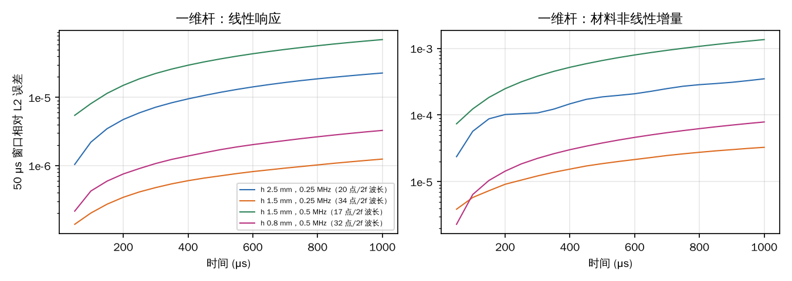
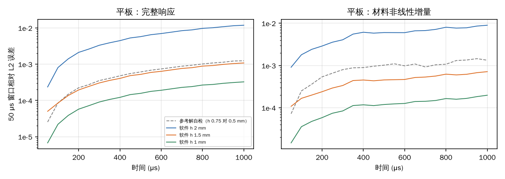
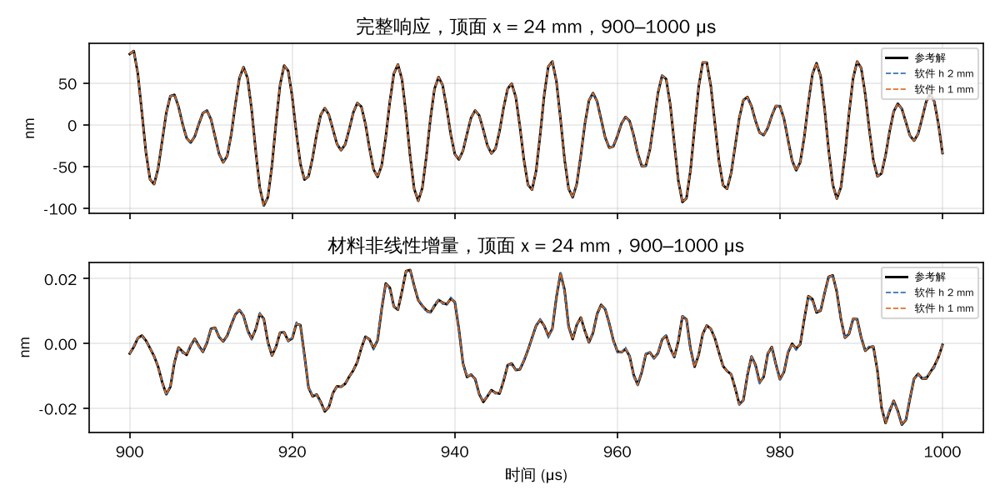

# 1 ms 长记录的精度

2026-11-10。用户需要 1 ms 内仿真的准确性。本文测量离线工作台默认引擎“物理 AI · 冻结网络”在 1 ms 记录上的误差，以及误差与网格、时间的关系。

计算都走工作台的同一条路径：请求校验 → `offline.worker` → 完整 float64 记录 → 结果页取任意点波形所用的 `offline.recording.traces`。对照用的参考解都可以单独核对其收敛程度：

- 一维杆：解析解，以及独立写的一维求解器；
- 平板：另一套二维谱元求解器，在两级更细的网格上计算，并对时间步外推。

## 结论

- **1 ms 内精度可以做到 0.1% 以内。** 要求是网格足够细：工作台状态栏的“2f 分辨率”不低于 15。
- **平板实测**（48 × 2 mm，两端自由，S0 和 A0 同时激发，1 ms 内 S0 往返约 56 次、A0 约 29 次，共 200 个载波周期）：

  | 单元尺寸 | 2f 分辨率 | 0–1 ms 完整响应误差 | 最后 50 μs | 几何增量 | 材料增量 |
  |---|---|---|---|---|---|
  | h 2 mm | 11.5 | 0.72% | 1.2% | 0.30% | 0.71% |
  | h 1.5 mm | 15.4 | 0.065% | 0.11% | 0.11% | 0.056% |
  | h 1.0 mm | 23 | 0.020% | 0.033% | 0.058% | 0.015% |

- **一维纵波杆实测**（两端自由，1 ms 内来回反射约 80 次）：四种网格下线性误差 2e-6 到 4e-5，二阶非线性增量误差 2e-5 到 8e-4。振幅不衰减，相速度误差约 1e-8。
- **误差特征：**
  - 误差随时间大致线性增长；
  - 不出现振幅衰减；
  - 网格加密后误差快速下降。
- **建议：**
  - 需要 1 ms 精度时，把单元尺寸调到 2f 分辨率 ≥ 15（0.2 MHz 的铝板约 h ≤ 1.5 mm）；
  - 更长的记录按长度线性估计误差，例如 5 ms 约为 1 ms 的 5 倍。这是外推，没有在 5 ms 上实测。
- **工作台已加提示：** 记录长于 100 个载波周期、2f 分辨率又低于 15 时，状态栏会显示本页的实测数量级。

## 1. 一维杆：解析解对照

**算例。** 杆长 40 mm，截面为一个单元，四个侧面都设对称面，即单轴应变下的一维平面纵波。

- 端面 xmin 施加 1 MPa、5 周期 Hann 脉冲，另一端自由；
- 记录 1 ms，期间来回反射约 80 次，相当于传播 6.4 m；
- 在 x = 10、20、30 mm 取轴向位移。

**线性参考：镜像法精确解。** 自由端反射时速度不变号：

```text
u(x,t) = (1/ρc) Σₙ [S(t − (2nL + x)/c) + S(t − (2(n+1)L − x)/c)]，S(t) = ∫σ dt
```

Hann 脉冲的积分有闭式解。

**非线性参考：独立写的一维求解器**（`scripts/reference1d.py`），不调用软件的求解器或网络：

- 三种控制都用严格的单轴应变运动学，P = (1 + u_x)S(E)，E = u_x + u_x²/2；
- 8 阶谱元，单元 0.5 mm，经典 RK4，Δt = 0.5 ns；
- 自身精度：线性部分与精确解差 ≤ 1e-9；单元 0.5 mm 与 1 mm 两级相差 ≤ 2e-8。

**结果（1 ms 末，全时段相对 L2）：**

| 算例 | 频率 | 单元 | 每 2f 纵波长节点 | 线性 vs 精确解 | 几何增量 | 材料增量 | 末段相速度误差 |
|---|---|---|---|---|---|---|---|
| T1 | 0.25 MHz | 2.5 mm | 20 | 1.4e-5 | 2.1e-4 | 2.1e-4 | −1.2e-8 |
| T2 | 0.25 MHz | 1.5 mm | 34 | 7.9e-7 | 2.1e-5 | 2.1e-5 | −3.2e-10 |
| T3 | 0.5 MHz | 1.5 mm | 17 | 4.3e-5 | 8.0e-4 | 8.0e-4 | −2.0e-8 |
| T4 | 0.5 MHz | 0.8 mm | 32 | 2.0e-6 | 4.7e-5 | 4.7e-5 | −5.5e-10 |

- **振幅无衰减：** 末段振幅比 1.000000（T3 为 0.999998）。
- **相速度略偏慢：** 符合 Ainsworth & Wajid（2009）对 GLL 集中质量谱元的分析，即集中质量格式表现为相位滞后。
- **几何、材料增量的相对误差相同：** 一维单轴应变下两者都正比于 (3C₁₁ + C₁₁₁) 中的相应部分，形状相同。



## 2. 平板：二维谱元参考

**算例。** 48 × 2 mm 铝板，两端自由，0.2 MHz、5 周期 Hann 脉冲，1 ms。

- **载荷：** 端面均匀牵引，方向 (1, 0, 1)：x 分量激发 S0，z 分量激发 A0。
- **为什么不用顶面高斯贴片：** 圆形高斯分布在三维模型的窄宽度方向上不均匀，不等价于平面应变。
- **软件计算：** 三维板，两个 y 面设对称面，即平面应变。
- **接收点：** 顶面 x = 24、32、40 mm 取 u_z；中面 x = 24、32 mm 取 u_x。

**参考解：** 本仓库的二维平面应变谱元求解器 `spectral2d`。它是独立于网络的另一条计算路径，显式速度 Verlet、4 阶 GLL、CFL 0.35。

- 两级网格：h 0.75 mm（Δt = 5.95 ns）和 h 0.5 mm（Δt = 4.46 ns）；
- 两级相差 0.076%（1 ms），主要是速度 Verlet 的二阶时间误差，即每弧度相位误差 (ωΔt)²/24；
- 按 Δt² 做 Richardson 外推，得到对照用的参考解；
- 0.5 mm 一级与外推参考相差 0.097%（1 ms）。

外推前，h 1.0 mm 与 0.5 mm 一级参考的差（0.080%）比 h 1.5 mm 的（0.050%）还大，说明比较已到参考解自身的误差。外推后，误差随网格单调下降，见结论中的表。



最后 100 μs 的波形（顶面 x = 24 mm）：h 2 mm 和 h 1 mm 与参考解在图上重合，材料非线性增量也一样。



## 3. 网格选择与工作台提示

- **2f 分辨率的定义：** 2f 分辨率是状态栏显示的“每个二倍频剪切波长内的节点数”，按信号 −30 dB 频带上限计算。
- **两个算例的差别：**
  - 平板里 A0 与剪切波决定了需要的分辨率；
  - 一维杆只有纵波，同一 2f 分辨率下误差小得多。实际使用以平板为准。
- **平板实测给出的门槛：** 2f 分辨率 15 以上时，1 ms（200 个周期）末段误差约 0.1%；11.5 时约 1%。
- **预检提示：** 预检对每个激励源检查一次，记录长度 ≥ 100 个载波周期且 2f 分辨率 < 15 时给出提示（`offline/preview.py` 的 `long_record_warnings`，测试 `test_long_records_with_coarse_meshes_are_flagged`）。

## 4. 计算时间

同一台 4 核云机器，同时还在运行其他 2–3 个任务，所以以下是偏慢的数字：

| 计算 | 节点数 | 1 ms 三组控制总耗时 |
|---|---|---|
| 平板 h 2 mm | 2425 | 10 min |
| 平板 h 1.5 mm | 5805 | 50 min |
| 平板 h 1.0 mm | 8685 | 64 min |
| 一维杆 h 0.8 mm | 5025 | 54 min |

作为对比，同类 48 mm 板 30 μs 的 COMSOL 隐式计算，回执中线性 6.8–8.8 h、Murnaghan 20.8–28.8 h（见 [P1 运行说明](../../docs/comsol/p1-remaining-runs.md)，硬件不同）。

## 5. 适用范围

- **几何与材料：** 只测了平板（含多次板端反射）与一维杆，铝材料。缺口、孔、管的长时间散射没有测。
- **频率与网格：** 平板只测了 0.2 MHz 一个频率、4 阶图。其他频率按 2f 分辨率换算，原则上适用，没有逐一实测。
- **吸收层：** 吸收层的回波（见[文献核验](../literature-verification/README.md)第 5 节）是另一类误差，与本文的传播误差无关。
- **5 ms 记录：** 本文只测到 1 ms。[COMSOL 对照](../comsol-validation/README.md)中 5 ms 记录的大差异，那里的参考解本身没有收敛，不能据以判断软件。

## 参考文献

1. M. Ainsworth, H. A. Wajid, *Dispersive and dissipative behavior of the spectral element method*, SIAM J. Numer. Anal. 47(5), 3910–3937 (2009)；[DOI 10.1137/080724976](https://doi.org/10.1137/080724976)（摘要：GLL 集中质量谱元表现为相位滞后；约 π 个模态每波长即可分辨）。
2. H. Lamb (1917)；J. L. Rose, *Ultrasonic Guided Waves in Solid Media* (2014)：Rayleigh–Lamb 频散，见[文献核验](../literature-verification/README.md)。
3. 镜像法与一维波动方程的 d'Alembert 解：K. F. Graff, *Wave Motion in Elastic Solids* (1975)，第 2 章（书目）。

## 复现

```sh
export WORKAI_VERIFY_JOBS=/path/to/jobs          # 记录 1–7 GB/算例，放在仓库外
python research/long-record-accuracy/scripts/make_reference.py     # 一维参考与精确解（约 30 min）
python research/long-record-accuracy/scripts/cases.py              # 一维杆四个算例
python research/long-record-accuracy/scripts/analyze.py
python research/long-record-accuracy/scripts/plate.py reference 0.75 && python research/long-record-accuracy/scripts/plate.py reference 0.5
for h in 2.0 1.5 1.0; do python research/long-record-accuracy/scripts/plate.py network $h; done
python research/long-record-accuracy/scripts/analyze_plate.py
python research/long-record-accuracy/scripts/plots.py                # 需要 matplotlib
```

结果在 [`results/bar-1ms.json`](results/bar-1ms.json) 与 [`results/plate-1ms.json`](results/plate-1ms.json)。参考数组（`reference/*.npy`）可重新生成，不入库。
