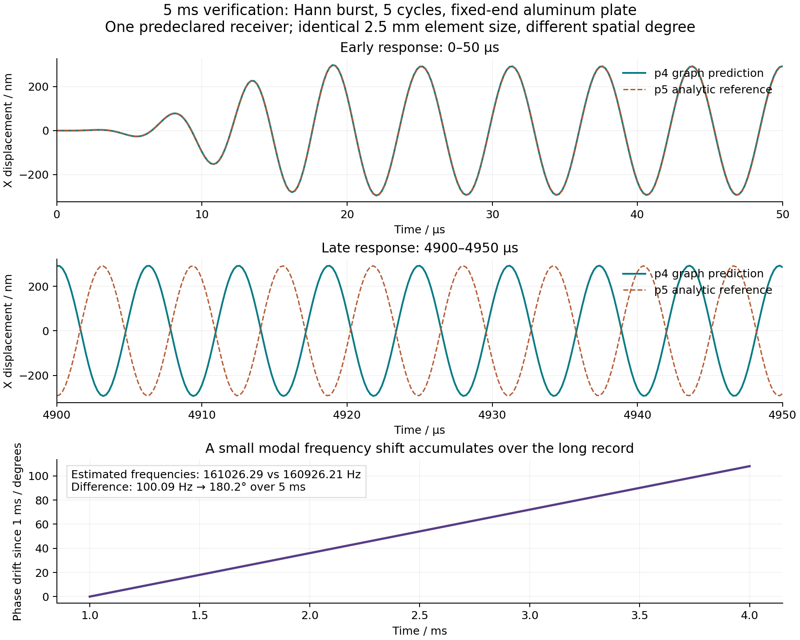

# 5 ms 激励验证

本目录固定了四种信号与五种周期数，共 20 组输入。它验证一个固定端铝板上的长时响应，不代表任意几何、网格或实验条件均达到 5% 精度。

- 激励：Hann 窗正弦、Gaussian 窗正弦（6σ 截断）、矩形窗正弦、Hann 窗线性扫频。
- 周期：1、3、5、10、20；扫频周期数为总相位周期数，脉冲时长等于周期数除以平均频率。
- 板：8 × 3 × 1.5 mm；X 最大端固定，X 最小端施加轴向全端面牵引。
- 幅值：1 MPa；延迟 0.2 μs；相位 0°。单频激励为 0.2 MHz，扫频为 0.2 → 0.28 MHz。
- 完整记录：5000 μs；输出采样间隔 0.2 μs；25001 个时间点。
- 预测：冻结权重的四阶空间图，单元尺寸 2.5 mm，训练后的四阶时间组合。
- 对照：独立解析本构程序、五阶 GLL 空间离散、由自身节点间距确定的更小时间步。
- 五种响应、八个预先指定接收点、XYZ 分量均检查。全部时间点参与误差统计，动画抽帧不参与精度计算。

`plan.json` 在评估前生成，并记录输入、源代码、推理权重和时间系数的 SHA-256。评估结果不用于重新拟合权重。研究工作流为 [Five millisecond excitation validation](https://github.com/lx016922-dot/workAI/actions/workflows/long-validation.yml)。

## 已完成的 20 组结果

**20／20 组均实际计算到 5000 μs，每组 25001 点；0／20 组通过全部 5% 判据。** 完整位移全场相对 L2 为 **24.83%–141.97%**。全部 20 组的能量收支通过 1% 检查，但波形精度没有通过。数值大于 100% 可由长时错相造成，不表示相同大小的幅值比例误差。

下面三列均为全场向量相对 L2；整组判定还包含各分量、接收点和频谱检查。原始小数与全部指标见 [CSV](cases.csv)、[汇总 JSON](summary.json) 和逐组链接。

| 激励 | 周期 | 完整场误差 | 材料增量误差 | 几何增量误差 | 全部 5% 判据 |
| --- | ---: | ---: | ---: | ---: | --- |
| [Hann 窗正弦](metrics/hann-01.json) | 1 | 141.41% | 90.07% | 73.34% | 未通过 |
| [Hann 窗正弦](metrics/hann-03.json) | 3 | 141.45% | 93.16% | 40.69% | 未通过 |
| [Hann 窗正弦](metrics/hann-05.json) | 5 | 141.53% | 94.56% | 41.29% | 未通过 |
| [Hann 窗正弦](metrics/hann-10.json) | 10 | 88.58% | 5.54% | 3.41% | 未通过 |
| [Hann 窗正弦](metrics/hann-20.json) | 20 | 35.83% | 0.95% | 0.64% | 未通过 |
| [Gaussian 窗正弦](metrics/gaussian-01.json) | 1 | 141.33% | 91.84% | 81.90% | 未通过 |
| [Gaussian 窗正弦](metrics/gaussian-03.json) | 3 | 141.43% | 91.94% | 40.03% | 未通过 |
| [Gaussian 窗正弦](metrics/gaussian-05.json) | 5 | 141.48% | 94.06% | 40.17% | 未通过 |
| [Gaussian 窗正弦](metrics/gaussian-10.json) | 10 | 141.12% | 53.33% | 35.53% | 未通过 |
| [Gaussian 窗正弦](metrics/gaussian-20.json) | 20 | 24.83% | 1.46% | 1.52% | 未通过 |
| [矩形窗正弦](metrics/rectangular-01.json) | 1 | 141.43% | 114.03% | 67.12% | 未通过 |
| [矩形窗正弦](metrics/rectangular-03.json) | 3 | 141.60% | 123.00% | 40.84% | 未通过 |
| [矩形窗正弦](metrics/rectangular-05.json) | 5 | 126.36% | 109.57% | 108.01% | 未通过 |
| [矩形窗正弦](metrics/rectangular-10.json) | 10 | 136.20% | 119.89% | 116.10% | 未通过 |
| [矩形窗正弦](metrics/rectangular-20.json) | 20 | 141.97% | 120.12% | 103.48% | 未通过 |
| [线性扫频](metrics/chirp-01.json) | 1 | 141.23% | 89.72% | 89.84% | 未通过 |
| [线性扫频](metrics/chirp-03.json) | 3 | 141.50% | 81.82% | 88.95% | 未通过 |
| [线性扫频](metrics/chirp-05.json) | 5 | 141.51% | 129.03% | 129.86% | 未通过 |
| [线性扫频](metrics/chirp-10.json) | 10 | 139.65% | 135.09% | 134.84% | 未通过 |
| [线性扫频](metrics/chirp-20.json) | 20 | 111.30% | 135.07% | 134.80% | 未通过 |

## 误差与判据

全场比较将预测的高阶插值映射到参考网格，以参考节点质量加权。向量 RMS 定义为时间平均的向量模平方根；各分量另算 RMS。相对 L2 为误差 RMS / 参考 RMS。

参考 RMS 大于 `1e-13 m` 时，要求相对 L2 ≤ 5%；低于此门槛时检查绝对误差 RMS ≤ `1e-13 m`，不报告相对百分比。所有预先指定的检查都通过，才将该组的对比状态标为通过。

单频激励在整段记录上以 Hann 加权去均值后计算准确 f、2f 复系数；比较的是复系数差，包含幅值和相位差。扫频不使用单一载频的 f/2f 判据，而比较 STFT 的 0.18–0.30 MHz 和 0.36–0.60 MHz 频带复系数。STFT 采用 512 点窗、384 点重叠；这项检查不声称能分辨短于该窗的瞬时扫频轨迹。

每组还检查三种控制的能量收支，传播过程检查有限能量、最大应变 ≤ 0.001、J > 0。能量收支通过不等于波形精度通过。材料增量与几何增量是控制场之差，不为它们另定义独立能量。

五阶参考解本身仍需独立收敛检查。因此，即使某组对比小于 5%，也不能据此宣称真实物理误差或实验误差小于 5%。`accuracy_certified` 保持为 false，直到相应的参考质量门槛通过。

## 复现

冻结的评估代码位于提交 `511d06a23a6a0108c4d8753df4aaf3e97ff85d70`，权重为 `ee413a70b30e6402e174e8d16a92df9ddd96aaa4a6192df472b74f877311df83`。使用 Python 3.12 和固定依赖：

```sh
python -m pip install numpy==2.2.6 scipy==1.15.3 numba==0.63.1 llvmlite==0.46.0
OPENBLAS_NUM_THREADS=1 OMP_NUM_THREADS=1 python tools/run-long-case.py --case hann-01 --output validation/hann-01
```

将 case 替换为 `hann`、`gaussian`、`rectangular`、`chirp` 与 `01`、`03`、`05`、`10`、`20` 的组合。各组保存每个分块的完整接收点波形、摘要、完整时域误差累加量和最终指标。停止后在同一输出目录可继续；不得在修改冻结代码或权重后沿用检查点。

本验证进程会使用数值参考程序。离线软件的预测进程不加载这些参考程序，也不执行预测后校正。

## 长时误差诊断

六阶参考的完整 5 ms 检查已经完成：五阶／六阶参考在八个接收点的完整位移向量相对 L2 最大为 **80.93%**，全部响应与分量中的最大有效相对误差为 **153.85%**。接收点收敛检查未通过；六阶参考自身的能量、应变和 J 检查通过。这说明本轮五阶参考仍不能作为 5% 精度认证的依据。[完整参考对照指标](diagnostics/reference-convergence.json)


另做一组完整 5 ms 的同网格检查：Hann 窗、5 周期，解析本构使用与图网络相同的四阶网格和内部时间步。完整场相对 L2 为 **0.000378629%**，材料增量为 **0.000301104%**，几何增量为 **0.000197350%**。这只隔离了该工况中的模型近似误差，不能代替与收敛参考解的比较。详见 [同网格指标](diagnostics/same-grid-hann-05.json)。

同一激励的四阶预测与五阶参考在开始的 50 μs 几乎重合，到约 5 ms 时已明显错相。P1 的 X 分量在 0.13–0.19 MHz 带内做零相位滤波，再对 1–4 ms 的解析相位作线性回归，得到约 161026.29 Hz 与 160926.21 Hz；约 100.09 Hz 的差异在 5 ms 累积约 180.16°。这是该工况的模态诊断，不是实验精度或 FFT 零填充后频率分辨率的声明。[诊断数据](diagnostics/phase-diagnostic.json)



还将矩形窗、1 周期的五阶参考与六阶解析参考在全部 25001 个时间点、8 个接收点上比较，检查参考解自身的变化。它不改变原 20 组判据或权重，也不能提供任意几何的收敛证书。复现命令：

```sh
OPENBLAS_NUM_THREADS=1 OMP_NUM_THREADS=1 python tools/run-long-case.py --case rectangular-01 --output validation
OPENBLAS_NUM_THREADS=1 OMP_NUM_THREADS=1 python tools/check-long-reference.py --output validation/reference-p6
python tools/compare-long-reference.py --baseline validation/rectangular-01 --higher validation/reference-p6 --output reference-convergence.json
```

发布包附带逐组 CSV、完整指标和原始接收点记录。Actions 的绿色执行状态表示程序正常结束；科学验收状态应以 `all_comparisons_under_5_percent` 为准。

验证证据 ZIP 中，`cases/<工况>/<工况>/probes-*.npz` 保存全部接收点采样；`candidate` 与 `reference` 的维度依次为三种控制（线性、StVK、完整）、时间、8 个点、XYZ。文件名中的编号是起始采样序号，间隔为 0.2 μs。`state.npz` 保存最终传播状态和全时域全场误差累加量，不是训练优化器检查点。验证包不保存二十组参考解的全部节点场；需要这些场时应按冻结代码重算。软件内置示例和用户导出的完整结果则保留全部节点场。

汇总前核对了工作流 ZIP、计划、每个波形分块及指标的 SHA-256；接收点和频谱指标从原始采样重新计算，全场指标与保存的全时域累加量交叉核对。对应脚本为 `tools/summarize-long-validation.py`。

同网格检查使用独立的完整场记录，可按以下命令重算：

```sh
OPENBLAS_NUM_THREADS=1 OMP_NUM_THREADS=1 python -m graphwave.long_rollout --input research/long-validation/input.json --weights research/long-validation/weights.npz --temporal research/long-validation/time-coefficients.json --output validation/same-grid-prediction
OPENBLAS_NUM_THREADS=1 OMP_NUM_THREADS=1 python tools/check-same-grid.py --input research/long-validation/input.json --record validation/same-grid-prediction --output validation/same-grid-reference
```
