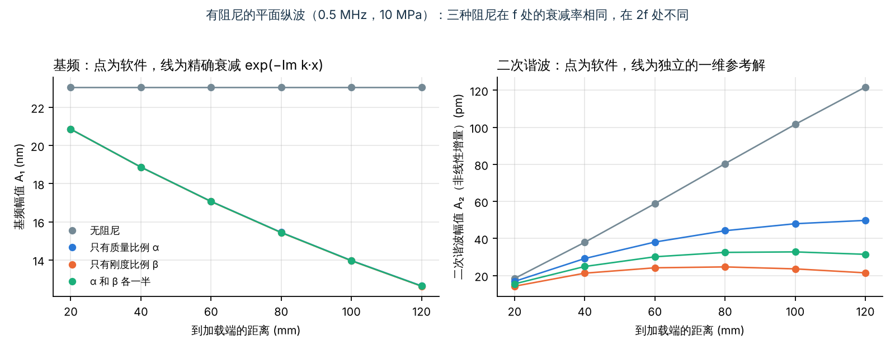
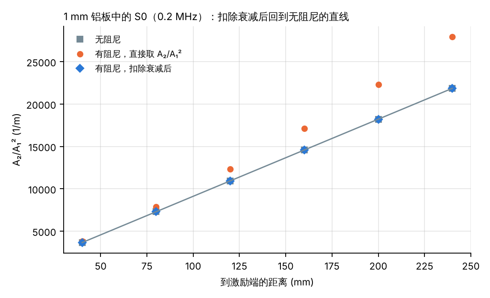

# 材料阻尼的核对（2026-11-21）

软件新增了材料阻尼：整个物体的 Rayleigh 阻尼 `m ü + (α m + β K) u̇ + f(u) = F`（[使用说明](../../docs/material-damping.md)）。这里核对它在软件里算得对不对：衰减率、有阻尼时的波形、有阻尼时二次谐波的累积，以及结果页“扣除衰减”的修正。

## 结论

| 核对的量 | 参考 | 结果 |
|---|---|---|
| 平面纵波的沿程衰减（f 处） | 精确的复波数 | 三种阻尼组合都差 0.01% 以内 |
| 线性波形（6 个接收点） | 独立的一维参考解 | 相对差 2.2×10⁻⁴–2.4×10⁻⁴，与无阻尼时相同 |
| 非线性增量的波形（几何、材料、合计） | 同上 | 2.4×10⁻⁴–8.0×10⁻⁴；网格加密后 1.8×10⁻⁴ |
| 二次谐波幅值 A₂ | 同上 | 2×10⁻⁵–1.3×10⁻⁴ |
| 板中 S0 的衰减 | 衰减率 / 理论群速度 | 差 0.05% |
| 扣除衰减后 A₂/A₁² 的斜率 | 同一块板无阻尼时的斜率 | 差 0.05%（不扣除时差 32.5%） |
| 计算量 | 无阻尼的同一模型 | 时间层相同，每组控制的单元消息数相同 |

没有与实验对照：这里核对的是“给定 α、β，软件算得对不对”，不是某种材料的阻尼是多少。

## 1. 参考解

都在 [`scripts/damped_bar.py`](scripts/damped_bar.py) 里，不导入软件的求解器。

四个侧面都是对称面的杆里是平面纵波，是一维介质：

    ρ ü + αρ u̇ = ∂ₓ[(1 + β∂ₜ) P(uₓ)]

其中 P 是单轴应变下的第一类 Piola–Kirchhoff 应力（线性、StVK、Murnaghan 三种）。

- **精确的复波数。** 线性时 `k² = (ω/c)²(1 − iα/ω)/(1 + iβω)`。用它把软件在第一个接收点的线性波形搬到后面的接收点，与软件在那里的波形比较（只比猝发音所在的频带）。
- **独立的一维数值解。** 6 阶谱元，上式里精确的应力，四阶 Runge–Kutta。单元从 0.5 mm 减半到 0.25 mm，完整响应变化 8×10⁻¹⁰，非线性增量变化 5×10⁻⁹，所以它本身的误差可以忽略。
- **带衰减的累积公式。** 准单频近似下 `A₂ ∝ (e^{−2a₁x} − e^{−a₂x})/(a₂ − 2a₁)`，a₁、a₂ 是 f 和 2f 处的衰减。阻尼乘在整个应力上，所以它不改变非线性耦合的大小。

## 2. 算例

杆：200 × 0.8 × 0.8 mm，端面牵引，0.5 MHz，5 个周期，10 MPa，接收点在 20–120 mm。单元 0.8 mm、4 阶，自动时间层。三组控制都算。

阻尼取得让基频每 100 mm 衰减到约 0.6（f 处的衰减率 γ = 32000 1/s，约 5 Np/m），三种组合在 f 处相同，在 2f 处不同：

| 算例 | α (1/s) | β (ns) | f 处 Np/m | 2f 处 Np/m |
|---|---|---|---|---|
| B-none | 0 | 0 | 0 | 0 |
| B-mass | 64000 | 0 | 5.006 | 5.007 |
| B-stiffness | 0 | 6.5 | 5.017 | 20.05 |
| B-both | 32000 | 3.25 | 5.012 | 12.54 |

另有 B-both-5MPa（幅值减半）、B-both-fine（单元 0.5 mm）、两个 20 周期的长脉冲算例（记录里含远端的回波），以及板的算例（第 4 节）。

```sh
export WORKAI_VERIFY_JOBS=<放计算记录的目录>
python research/material-damping/scripts/cases.py            # 运行全部算例
python research/material-damping/scripts/analyze.py          # 杆：results/bar.json、results/formula.json
python research/material-damping/scripts/analyze_plate.py    # 板：results/plate.json
python research/material-damping/scripts/plots.py            # figures/，需要 matplotlib
```

## 3. 杆的结果



左图里三种阻尼的点重合：它们在 f 处的衰减率相同。右图里它们分开：2f 处的衰减不同，二次谐波能累积到多高也就不同。

各接收点中最差的一个：

| 算例 | 衰减：软件 / 精确 (Np/m) | 线性波形对精确传播 | 线性波形对参考解 | 增量波形对参考解 | A₂ 对参考解 |
|---|---|---|---|---|---|
| B-none | — | 2.0×10⁻⁴ | 2.4×10⁻⁴ | 7.3×10⁻⁴ | 1.9×10⁻⁵ |
| B-mass | 5.0059 / 5.0064 | 8.0×10⁻⁴ | 2.4×10⁻⁴ | 8.0×10⁻⁴ | 2.4×10⁻⁵ |
| B-stiffness | 5.0179 / 5.0172 | 1.8×10⁻⁴ | 2.2×10⁻⁴ | 2.4×10⁻⁴ | 1.3×10⁻⁴ |
| B-both | 5.0119 / 5.0123 | 8.5×10⁻⁴ | 2.3×10⁻⁴ | 4.4×10⁻⁴ | 6.1×10⁻⁵ |
| B-both-5MPa | 5.0116 / 5.0123 | 8.5×10⁻⁴ | 2.3×10⁻⁴ | 4.4×10⁻⁴ | 6.1×10⁻⁵ |
| B-both-fine | 5.0119 / 5.0123 | 8.3×10⁻⁴ | 9.4×10⁻⁵ | 1.8×10⁻⁴ | 2.5×10⁻⁵ |
| B-none-20cycles | 含回波 | 含回波 | 4.2×10⁻⁴ | 2.3×10⁻³ | 1.6×10⁻³ |
| B-both-20cycles | 含回波 | 含回波 | 3.1×10⁻⁴ | 6.5×10⁻⁴ | 7.1×10⁻⁵ |

- **有阻尼与无阻尼一样准。** 与参考解的差没有因为阻尼变大；加密网格后继续减小，说明剩下的是软件的网格误差。
- **几何、材料、合计三种增量的差相同**：这部分差来自线性波形本身，不是非线性项。
- **幅值减半，相对差不变**：差不是高阶非线性造成的。
- **“对精确传播”一列在有质量比例阻尼时是 8×10⁻⁴**，高于“对参考解”。原因是位移脉冲带一个很低频的分量，质量比例阻尼下它是扩散型的，40 μs 的记录分辨不了；这是这种比法的限制，不是软件的误差，参考解一列不受影响。

**带衰减的累积公式。** 同一个接收点上，有阻尼的 A₂ 除以无阻尼的 A₂，与公式 `e^{−2a₁x}(1 − e^{−mx})/(mx)`（m = a₂ − 2a₁）比（[formula.json](results/formula.json)）：

| 算例 | 20 mm | 40 mm | 60 mm | 80 mm | 100 mm | 120 mm |
|---|---|---|---|---|---|---|
| B-mass | +6.2% | +3.7% | +1.2% | −0.4% | −1.0% | −0.8% |
| B-stiffness | +4.3% | +1.7% | −0.2% | −0.5% | +0.3% | +1.0% |
| B-both | +5.5% | +2.9% | +0.7% | −0.5% | −0.6% | −0.3% |

60 mm 以外一致到 1%；靠近加载端差 3%–6%。那里有一列由端面产生、不随距离累积的二次谐波，公式里没有它。所以这个公式（结果页“扣除衰减”用的就是它）适用于累积的部分已经占主导的距离。

## 4. 板中的 S0

1 mm 铝板（建上半个板厚，中面为对称面），平面应变，端面面内牵引，0.2 MHz，10 个周期，阻尼与 B-both 相同。接收点在 40–320 mm，每 40 mm 一个。用软件自己的沿程累积分析（`offline.nonlinear.accumulation`）处理有阻尼和无阻尼两次计算。



| 量 | 软件 | 参考 | 差 |
|---|---|---|---|
| S0 的群速度 | 5422.85 m/s | 5422.80 m/s（板理论） | +0.001% |
| S0 在 f 处的衰减 | 3.4221 Np/m（有阻尼与无阻尼的 A₁ 之比） | 3.4237 Np/m（γ(f) / 群速度） | −0.05% |
| A₂/A₁² 的斜率，无阻尼 | 90976 m⁻² | — | — |
| 有阻尼，不扣除衰减 | 120557 m⁻²，R² 0.9968 | 无阻尼的斜率 | +32.5% |
| 有阻尼，扣除衰减后 | 90930 m⁻²，R² 0.9999995 | 无阻尼的斜率 | **−0.05%** |

- 有阻尼时 A₂/A₁² 不再是直线，直接拟合的斜率偏高三分之一。原因是 2f 处的衰减（4.87 Np/m）小于 f 处的两倍（6.85 Np/m），分母 A₁² 掉得比分子快。
- 按两个模态的衰减扣除后，回到无阻尼时的直线。

## 5. 计算量

| 算例 | 时间层 | 每组控制的单元消息 |
|---|---|---|
| B-none | 二阶单级，3.125 ns | 12800 |
| B-both、B-mass、B-stiffness | 二阶单级，3.125 ns | 12800 |

刚度比例阻尼是显式处理的：阻尼力取一层里单元消息的变化率，再由本层和上一层外推到层末，保持二阶精度（`graphnet/recurrence.py`、`graphnet/timestep.py`）。不外推时它滞后半层，同样的精度需要 6.5 倍的层数。外推多占两个与位移同样大的数组。阻尼很大时稳定极限下降，时间层会自动加密。

## 6. 没有做的

- 没有与实验的衰减数据对照。
- 阻尼模型只有两个参数：能让两个频率处的衰减对上，其他频率处按 γ = α/2 + βω²/2 变化，这是模型，不是材料规律。
- 非线性控制里，刚度比例项按切线刚度作用，相当于粘性应力取弹性应力的变化率乘 β。没有核对别的粘弹性本构。
- 快速引擎和训练时的三级时间层不支持刚度比例项，只支持质量比例项。
- 二维平面应变求解器和四面体求解器不支持材料阻尼。
