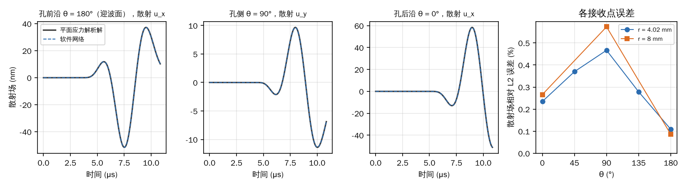
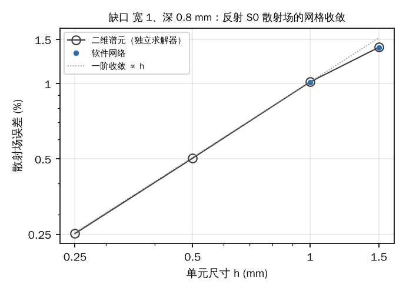
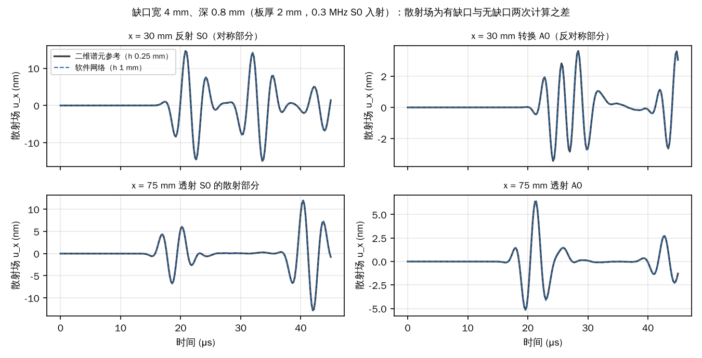
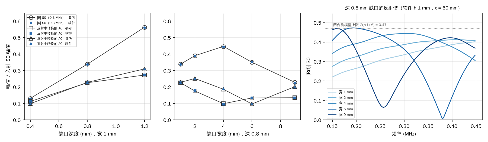

# 缺口与通孔的散射

2026-11-11。核验离线工作台默认引擎“物理 AI · 冻结网络”计算导波遇到缺口和通孔时的散射。两类缺陷各用一个与软件无关的参考：

- **通孔：** 平面应力解析解（Pao & Mow 级数解），完全不经过软件；
- **矩形缺口：** 本仓库另一套二维平面应变谱元求解器 `spectral2d`，与网络不共用代码路径。它在比软件细 2–4 倍的网格上计算作为参考，自身收敛程度用两级网格核对；另外也在软件自己的网格尺寸上算一遍，用来区分“网络误差”和“网格误差”。

缺口算例走工作台的同一条路径：请求校验 → `offline.worker` → 完整 float64 记录 → 结果页取波形用的 `offline.recording.traces`。通孔网格有 8.6 万个节点，超过工作台 3 万节点的显示上限，所以直接调用 worker 内部同一个网络推演函数（`graphnet.rollout`），记录仍用 `offline.recording.traces` 读取。

## 结论

- **缺口（0.3 MHz S0 入射 2 mm 铝板，7 种宽度和深度）：**
  - **同一网格下，软件与独立的二维谱元求解器一致到 1e-4 量级**（散射场相差 0.005–0.13%）。网络本身复现了谱元离散，几乎不引入额外误差；
  - **与细网格参考相比，h 1 mm 的散射场差 0.6–2.1%**（四个通道中的最大值）。宽 4、6 mm 缺口的 A0 通道为 3.8% 和 5.8%：缺口两端各自转换出的 A0 在这两个宽度下大部分抵消，剩下的信号很小，相对误差被放大。总场差 0.2–0.9%；
  - **这部分差异是网格误差，不是网络误差：** 二维求解器在 h 1 mm 上的误差与软件相同。缺口直角处应力奇异，散射场按 h 一阶收敛，h 减半误差减半；
  - **工程量：** S0 反射系数、透射幅值、反射和透射中转换的 A0 幅值，软件与参考相差中位数 0.4%、最大 2.3%，折合入射幅值的 ≤ 0.0035；
  - **物理规律与文献一致：** 反射随缺口深度单调增大；反射谱随缺口宽度出现干涉极小，极小频率与宽度成反比，即 Lowe & Diligent（2002）所述反射随宽度/波长的周期变化。
- **通孔（S0 入射，ka = 1.16）：** 孔边 5 个方位和 r = 2a 处 3 个方位，共 8 个接收点。
  - 软件的散射场与解析解相差 0.1–0.6%（相对 L2），散射峰值相差 ≤ 0.4%；
  - 总场相差 0.1–0.4%，其中最多约 0.2% 来自三维板中 S0 的真实频散，平面应力模型不含这部分。
- **只核验了线性响应。** 缺口和孔处的非线性散射（如二次谐波）没有独立参考，未作定量核验。

## 1. 通孔：平面应力解析解

**算例。** 铝板 48 × 48 × 1 mm，中心有半径 a = 4 mm 的通孔。

- **边界：** 两个 y 面设对称面，相当于沿 y 方向间隔 48 mm 的一列孔，入射波是严格的直峰 S0 平面波；
- **激励：** xmin 端面施加均匀轴向牵引，0.25 MHz、2 周期 Hann 脉冲，载频处 ka = 1.16；
- **软件计算：** h 2.5 mm、4 阶，86240 个节点，记录 20 μs，另算一个无孔板（32805 个节点）提供入射波；
- **接收点：** 中面上孔边 r = a + 0.02 mm 的 θ = 180°、135°、90°、45°、0°，以及 r = 2a 的 180°、90°、0°。θ 从 +x 量起，θ = 180° 是迎波面。

**解析解**（`scripts/hole_theory.py`）。低频 S0 在薄板中是二维纵波，常数取平面应力值 λ' = 2λμ/(λ + 2μ)。Diligent 等（2002）研究 S0 被通孔散射时，同样限于 S0 不频散的低频范围（据摘要）。在这一范围内，沿板厚的应力和位移分布简单，可以按二维平面应力处理。

- **级数形式：** 入射 φ = e^{iαx}，散射势 φ_s = Σ A_n H_n(αr) cos nθ，ψ_s = Σ B_n H_n(βr) sin nθ；
- **求解：** 孔边 σ_rr = σ_rθ = 0，逐阶解 2 × 2 方程（Pao & Mow 1973）。
- **自检：**
  - ka → 0 时孔边 90° 环向应力为 2.6550 σ₀，等于静力 Kirsch 解 3 − ν（直峰平面波带有 σ_yy = ν σ_xx，相当于双轴拉伸）；
  - 孔边牵引残差 9e-16；
  - 3 MHz、r = 2a 处，级数取 40 阶与 80 阶相差 1e-4。

**对照方法**（`scripts/analyze_hole.py`）。

- **入射波：** 取无孔板在孔中心处的 u_x，作为入射波；
- **预测：** 乘以解析传递函数，得到各接收点的总场和散射场；
- **软件散射场：** 有孔与无孔两次计算之差；
- **比较窗口：** 从 0 到 10.86 μs，即孔散射的波经 y 对称面反射（镜像孔）回到孔边之前；
- **入射波截断：** 入射波在远端反射到达孔中心（13.25 μs）之前平滑截断，频带取到 3 MHz，3 MHz 以上的频谱只占峰值的 6e-7。

**结果：**

| r (mm) | θ | 散射场 / 入射峰值 | 总场误差 | 散射场误差 | 散射峰值比（软件/解析） |
|---|---|---|---|---|---|
| 4.02 | 180° | 0.89 | 0.09% | 0.11% | 0.9992 |
| 4.02 | 135° | 0.71 | 0.16% | 0.28% | 0.9992 |
| 4.02 | 90° | 0.20 | 0.13% | 0.47% | 0.9961 |
| 4.02 | 45° | 0.53 | 0.37% | 0.37% | 1.0012 |
| 4.02 | 0° | 1.01 | 0.32% | 0.23% | 0.9978 |
| 8 | 180° | 0.63 | 0.20% | 0.09% | 0.9994 |
| 8 | 90° | 0.21 | 0.12% | 0.57% | 0.9956 |
| 8 | 0° | 0.64 | 0.12% | 0.27% | 0.9992 |

误差来源：

- **S0 频散：** 无孔板中 S0 的拟合相速度为 5427 m/s，平面应力值为 5433 m/s，两者相差 0.1%。这是 1 mm 板在 0.25 MHz 的真实频散，接收点离孔中心越远，这部分越明显；
- **镜像波：** r = 8 mm、θ = 90° 的接收点离镜像孔最近，窗口末尾约 0.5 μs 已混入镜像孔的散射波，因此误差稍大。



## 2. 矩形缺口：网络与二维谱元对照

**算例。** 铝板长 110 mm、厚 2 mm，顶面有贯穿宽度方向的矩形缺口，缺口中心在 x = 60 mm。

- **激励：** xmin 端面施加均匀轴向牵引（只激发 S0），0.3 MHz、3 周期 Hann 脉冲。S0 波长 18 mm；
- **边界：** xmax 端 30 mm 吸收层；
- **缺口：** 宽 1 mm 时深 0.4、0.8、1.2 mm（板厚的 20%、40%、60%）；深 0.8 mm 时宽 1、2、4、6、9 mm（9 mm 为半个 S0 波长）；
- **软件计算：** 三维板沿宽度取一个单元，两个 y 面设对称面（即平面应变），4 阶，h 1 mm，约 2.8 万节点，记录 45 μs。宽 1、深 0.8 mm 的缺口另算 h 1.5 mm；
- **接收点：** x = 30 mm（缺口前，看反射）与 x = 75 mm（缺口后，看透射），各取顶面和底面的 u_x。两者之和的一半是对称部分（S0），之差的一半是反对称部分（A0）；
- **散射场：** 有缺口与无缺口两次计算之差；
- **参考解：** `spectral2d` 平面应变，4 阶 GLL，h 0.5 与 0.25 mm；另在 h 1 和 1.5 mm（软件的网格尺寸）上各算一遍。

**无缺口时只有传播误差。** 无缺口板上，软件与参考相差 6e-6（x = 30 mm）和 1.5e-5（x = 75 mm），所以下面的差异全部来自缺口处的散射。

**散射场误差**（四个通道 S0/A0 × 反射/透射中的最大值，45 μs 全程相对 L2）：

| 缺口（宽 × 深, mm） | 软件 vs 同网格二维 | 软件 vs 参考（h 0.25） | 二维 h 1 vs 参考 | 软件 vs 外推极限 | 参考自检（h 0.5 vs 0.25） | 总场 |
|---|---|---|---|---|---|---|
| 1 × 0.4 | 1.3e-03 | 1.46% | 1.46% | 2.04% | 0.59% | 0.22% |
| 1 × 0.8 | 4.4e-04 | 0.89% | 0.90% | 1.19% | 0.30% | 0.35% |
| 1 × 1.2 | 3.2e-04 | 0.62% | 0.63% | 0.84% | 0.21% | 0.30% |
| 2 × 0.8 | 4.1e-04 | 1.31% | 1.31% | 1.75% | 0.44% | 0.27% |
| 4 × 0.8 | 3.9e-04 | 3.84% | 3.84% | 5.08% | 1.28% | 0.57% |
| 6 × 0.8 | 3.8e-04 | 5.84% | 5.84% | 7.81% | 1.96% | 0.89% |
| 9 × 0.8 | 5.0e-04 | 2.11% | 2.11% | 2.81% | 0.71% | 0.60% |

各列的含义：

- **软件 vs 同网格二维：** 软件 h 1 mm 与二维求解器 h 1 mm 相比。两套代码路径独立，结果一致到 1e-4 量级，说明网络准确复现了谱元离散；
- **软件 vs 参考、二维 h 1 vs 参考：** 两列几乎相同，即软件与参考的差异几乎全部是 h 1 mm 网格本身的误差，同一网格上的同阶谱元离散都有这部分误差；
- **软件 vs 外推极限：** 二维 h 1 → 0.5 → 0.25 mm 的差按 3 : 1 下降（深 0.8、1.2 mm 的六个缺口比值为 2.9–3.0），即一阶收敛。按一阶 Richardson 外推（2 × h 0.25 − h 0.5）估计网格无穷细的极限，再与软件比较。深 0.4 mm 缺口的比值为 2.4，0.4 mm 薄层使各级网格不相似，外推只是近似；
- **总场：** 有缺口算例的完整波形与参考相比。

宽 4、6 mm 缺口的最大误差都在 A0 通道：宽 4 mm 是反射 A0（3.8%），宽 6 mm 是透射 A0（5.8%）。

- **原因：** 缺口两端各自转换出 A0，在这两个宽度下大部分相互抵消，剩下的 A0 幅值只有入射的 0.10 左右。小信号对两端相位很敏感，相对误差因此被放大；
- **同一宽度的 S0 通道：** 误差为 0.6–1.9%；
- **幅值：** 这两个 A0 与参考相差 0.0001–0.0022（以入射为 1，见下表）。

**网格收敛**（宽 1、深 0.8 mm，反射 S0 通道，对外推极限）：软件在 h 1.5 和 1 mm 的误差与二维求解器在同样网格上的误差重合，一起落在一阶收敛线上。



**使用建议：**

- 缺口散射场误差约与单元尺寸成正比：h 1 mm 约 1–2%，h 0.5 mm 约 0.5–1%（按一阶收敛推算，没有用网络实测 0.5 mm）；
- 反射系数这类工程量受影响更小，h 1 mm 时多数在 1% 以内（中位数 0.4%，最大 2.3%）；
- 真实缺口的角部不是理想直角，奇异性更弱，收敛会更快。



上图为宽 4、深 0.8 mm 缺口四个通道的散射场，软件与参考在图上重合。

## 3. 缺口：反射、透射、模态转换与文献对照

**幅值对照**（参考 / 软件 h 1 mm，均相对入射 S0 幅值）。

- **S0 反射 |R|：** x = 30 mm 处 0.3 MHz 的频谱比；
- **其余三项：** 时间窗内的包络峰值。

| 缺口（宽 × 深, mm） | S0 反射 \|R\|（0.3 MHz） | S0 透射（包络） | 反射中的 A0 | 透射中的 A0 |
|---|---|---|---|---|
| 1 × 0.4 | 0.131 / 0.130 | 0.969 / 0.970 | 0.112 / 0.111 | 0.099 / 0.097 |
| 1 × 0.8 | 0.339 / 0.337 | 0.843 / 0.845 | 0.226 / 0.226 | 0.228 / 0.227 |
| 1 × 1.2 | 0.563 / 0.561 | 0.641 / 0.643 | 0.273 / 0.274 | 0.310 / 0.309 |
| 2 × 0.8 | 0.390 / 0.389 | 0.831 / 0.832 | 0.176 / 0.178 | 0.252 / 0.251 |
| 4 × 0.8 | 0.447 / 0.444 | 0.848 / 0.848 | 0.099 / 0.096 | 0.186 / 0.189 |
| 6 × 0.8 | 0.350 / 0.354 | 0.878 / 0.878 | 0.134 / 0.134 | 0.097 / 0.097 |
| 9 × 0.8 | 0.228 / 0.225 | 0.870 / 0.871 | 0.135 / 0.134 | 0.202 / 0.199 |

28 个幅值中 20 个相差 ≤ 1%，中位数 0.4%。最大的是宽 4 mm 的反射 A0（2.3%，0.099 对 0.096）；以入射幅值计，所有差别 ≤ 0.0035。

**与文献对照的物理规律。** Lowe & Diligent（2002）与 Lowe 等（2002）的原文无法读取，以下只对照其摘要中的定性结论：

- **深度：** 宽 1 mm 时，0.3 MHz 的 S0 反射系数从深 20% 的 0.13 增到 40% 的 0.34、60% 的 0.56，单调增大。Lowe 等（2002）关于 A0 入射的摘要也写到，反射随缺口深度增大。
- **宽度：** 反射谱 |R(f)| 在 x = 50 mm 由软件的完整记录取得，那里缺口回波与端面二次反射在时间上分开：
  - 宽 6 mm 与 9 mm 的缺口出现干涉极小，分别在 0.38 MHz（|R| = 0.004）和 0.257 MHz（|R| = 0.065）；
  - 极小频率 × 宽度分别为 2.28 和 2.31 MHz·mm，基本不变，即极小出现在固定的“宽度/波长”处；
  - 宽 4 mm 与 6 mm 的极大在 0.306 和 0.193 MHz，频率 × 宽度为 1.22 和 1.16 MHz·mm，约为极小处的一半；
  - 极大、极小按宽度/波长交替出现，这正是 Lowe & Diligent 所说的反射随宽度周期变化，来自缺口起止两端反射的干涉。
- **峰值：** 宽 4、6、9 mm 反射谱的峰值为 0.44–0.47。这与最简单的低频模型一致：把缺口看成两个台阶，S0 阻抗正比于厚度，2 → 1.2 mm 台阶的反射 r = (2 − 1.2)/(2 + 1.2) = 0.25，两端同相叠加的上限是 2r/(1 + r²) = 0.47。
  - 该模型预测极小在宽度等于半个 S0 波长处（极小频率 × 宽度 = 2.7 MHz·mm），实测在约 0.42–0.43 个波长处。模型忽略了缺口两端的 A0 转换和角部近场，位置有偏差是预期的；
  - 窄缺口（宽 ≪ 波长）的反射比该模型大得多，例如宽 1 mm 时实测 0.34，模型只有 0.18，因为窄缺口更像裂纹，主要由深度决定。
- **模态转换：** 顶面缺口不对称，S0 在缺口处转换出 A0，反射和透射中都有，幅值为入射的 0.10–0.31，随深度增大。

反射谱只用了软件 h 1 mm 的结果，因为参考解只保存了 x = 30、75 mm 两处的波形。x = 30 mm 处 0.3 MHz 的反射系数，软件与参考相差 ≤ 1.4%（见上表）。



## 4. 适用范围

- **只核验线性响应：** 缺口和孔处的二次谐波等非线性散射没有独立参考，未作定量核验。
- **通孔：** 只测了一个 ka（1.16）和一个板厚（1 mm）。平面应力模型只在低 fd 下成立，更高频率需要三维参考。
- **缺口：** 只测了贯穿宽度的矩形缺口（平面应变）。有限宽度的三维缺口、裂纹（闭合接触）不在本页范围。
- **文献：** 期刊全文在本环境无法读取，文献只用于物理规律（深度、宽度趋势）的定性对照，定量对照用的是上面的独立参考解。

## 5. 计算时间

同一台 4 核云机器，同时运行 3–5 个任务，所以以下是偏慢的数字：

| 计算 | 节点数 | 记录 | 三组控制总耗时 |
|---|---|---|---|
| 缺口，h 1 mm | 2.8 万 | 45 μs | 30–48 min |
| 缺口，h 1.5 mm | 1.3 万 | 45 μs | 12 min |
| 无缺口板，h 1 mm | 2.0 万 | 45 μs | 15 min |
| 通孔板，h 2.5 mm | 8.6 万 | 20 μs | 84 min |
| 无孔板，h 2.5 mm | 3.3 万 | 20 μs | 11 min |

二维参考解只算线性响应、单线程：h 0.25 mm 每个算例 27–36 min，h 0.5 mm 4–5 min，h 1 mm 约 1 min。

## 参考文献

1. Y.-H. Pao, C.-C. Mow, *Diffraction of Elastic Waves and Dynamic Stress Concentrations*, Crane Russak (1973)，第 4 章：圆孔对平面 P 波的散射级数解（书目）。
2. O. Diligent, T. Grahn, A. Boström, P. Cawley, M. J. S. Lowe, *The low-frequency reflection and scattering of the S0 Lamb mode from a circular through-thickness hole in a plate: Finite Element, analytical and experimental studies*, J. Acoust. Soc. Am. 112(6), 2589–2601 (2002)；[DOI 10.1121/1.1512292](https://doi.org/10.1121/1.1512292)（摘要：限于 S0 不频散的低频范围，有限元、解析解（模态叠加）与实验三方对照）。
3. M. J. S. Lowe, O. Diligent, *Low-frequency reflection characteristics of the s0 Lamb wave from a rectangular notch in a plate*, J. Acoust. Soc. Am. 111(1), 64–74 (2002)（摘要：反射系数随缺口宽度周期变化，来自缺口两端反射的干涉）。
4. M. J. S. Lowe, P. Cawley, J.-Y. Kao, O. Diligent, *The low frequency reflection characteristics of the fundamental antisymmetric Lamb wave a0 from a rectangular notch in a plate*, J. Acoust. Soc. Am. 112(6), 2612–2622 (2002)；[DOI 10.1121/1.1512702](https://doi.org/10.1121/1.1512702)（摘要：A0 反射系数随缺口宽度呈余弦型周期变化，来自缺口两端反射的干涉；反射随频率和深度增大）。
5. G. Kirsch (1898)：无限板圆孔的静力应力集中（经典结果，用于解析解的静力极限自检）。

## 复现

```sh
export WORKAI_VERIFY_JOBS=/path/to/jobs          # 记录 0.6–1.9 GB/算例，放在仓库外
for n in plate d0.4-w1 d0.8-w1 d1.2-w1 d0.8-w2 d0.8-w4 d0.8-w6 d0.8-w9; do
  python research/scattering/scripts/notch.py reference $n      # 二维参考，h 0.5 与 0.25 mm
  python research/scattering/scripts/notch.py reference $n 1    # 二维，软件的网格尺寸 h 1 mm
  python research/scattering/scripts/notch.py network $n 1      # 软件，h 1 mm
done
for n in plate d0.8-w1; do
  python research/scattering/scripts/notch.py reference $n 1.5 && python research/scattering/scripts/notch.py network $n 1.5
done
python research/scattering/scripts/analyze_notch.py
python research/scattering/scripts/hole.py run plate && python research/scattering/scripts/hole.py run hole
(cd research/scattering/scripts && python hole_theory.py && python analyze_hole.py)
python research/scattering/scripts/plots.py                     # 需要 matplotlib
```

结果在 [`results/notch.json`](results/notch.json) 与 [`results/hole.json`](results/hole.json)。参考数组（`reference/*.npy`）可重新生成，不入库。
