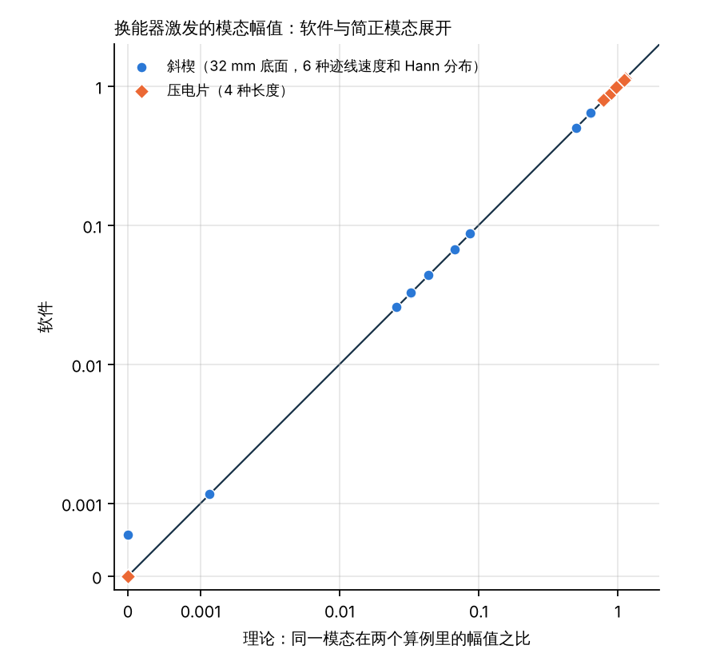

# 换能器模型的核对（2026-11-21）

软件新增了两种按“加在板面上的牵引”建模的换能器：斜楔（沿表面行进的压力）和粘贴的压电片（边缘剪力）（[使用说明](../../docs/transducers.md)）。这里核对：它们激发出的各个导波模态的幅值，是否符合简正模态展开的预测。

## 结论

| 核对的量 | 结果 |
|---|---|
| 斜楔：同一模态在不同迹线速度下的幅值之比（11 组，其中 2 组理论值为零） | 与理论差 0.9% 以内；与“软件实际施加的条带载荷”的理论差 0.2% 以内 |
| 斜楔：迹线速度对准底面波数谱的零点 | S0 幅值降到对准时的 0.06%，A0 降到 0.002% |
| 斜楔：向后与向前辐射之比 | A0：0.01689，理论 0.01690；S0：0.0008，理论 0.0006 |
| 斜楔：Hann 分布对均匀分布 | 对准的模态幅值之比 0.5000（理论 0.5），旁瓣上的 A0 0.0012（理论 0.0012） |
| 压电片：同一模态在不同片长下的幅值之比（24 组，其中 8 组理论值为零） | 非零的 16 组差 0.02% 以内；零点处降到 0.002% 以下 |
| 压电片：向左与向右辐射 | 相同到 10⁻¹¹ |
| 网格（单元 1 mm → 0.7 mm） | 各模态幅值变化 0.01% 以内 |

没有核对的：电压到牵引的换算、压电体和楔块本身、三维（有限宽度）的换能器、圆片压电片。这些要么不在模型里，要么需要实验。

## 1. 依据

表面牵引 t(x)e^{iωt} 激发波数为 k 的模态。朝 +x 走的那一列的幅值正比于 ∫ t(x) e^{ikx} dx，朝 −x 的正比于 ∫ t(x) e^{−ikx} dx。比例系数只与模态有关（它的形状和能流），与载荷无关。所以**同一个模态在两个算例里的幅值之比，等于这两个积分之比**，不需要知道模态的形状：

- 斜楔，均匀底面长 L，迹线波数 k_t = ω/v：积分 = L·sinc((k ∓ k_t)L/2)，“−”对应顺着行波方向出去的波。
- 压电片，半长 a，边缘传力区宽 e：积分 = ±2i·e·sinc(ke/2)·sin(k(a − e/2))。

软件内部把斜楔底面分成互相重叠的条带（延迟的线性插值），所以它实际施加的载荷与理想的行波略有不同。两种都算了：“理想”是物理上想要的，“实际施加”是软件应当精确重现的。

## 2. 算例

2 mm 铝板，0.5 MHz（fd = 1 MHz·mm，Lamb 模态有 A0 和 S0）。两个 y 面为对称面（平面应变），两端各 40 mm 吸收层。换能器在上表面 x = 120 mm 处；两侧各 16 个接收点（离中心 30–60 mm，间隔 2 mm）读离面位移。幅值 1 kPa，只算完整控制（这个幅值下就是线性响应）。单元 1 mm、4 阶，43,245 个节点，每个算例 2–5 分钟。

板理论给出的两个模态（`offline/guided.py`）：

| 模态 | 相速度 (m/s) | 波长 (mm) |
|---|---|---|
| A0 | 2329.2 | 4.66 |
| S0 | 5336.5 | 10.67 |

- **W-…**：斜楔，底面 32 mm。迹线速度取 6 个：让 S0（或 A0）落在底面波数谱的峰上、主瓣半高处、第一个零点上。另有 Hann 分布和细网格各一个。
- **P-…**：条形压电片，传力区 0.5 mm。片长取 4 个：让 S0（或 A0）落在 sin(k(a − e/2)) 的零点和极大上。另有细网格一个。

每个接收点取 f 处的 Fourier 系数（整段记录），每一侧用 S0、A0 各两个方向共 4 个波做最小二乘，波数取自板理论。拟合残差：压电片 10⁻⁴；斜楔向前一侧 0.04%–1.4%。

```sh
export WORKAI_VERIFY_JOBS=<放计算记录的目录>
python research/transducers/scripts/cases.py       # 13 个算例，约 50 分钟
python research/transducers/scripts/analyze.py     # results/transducers.json
python research/transducers/scripts/plots.py       # figures/，需要 matplotlib
```

## 3. 结果



图中每个点是一个幅值之比（共 36 个）；理论值为零的画在左下角。

**斜楔**（向前辐射的模态，相对“对准”的那个算例）：

| 算例 | 模态 | 软件 | 理想行波 | 软件实际施加的条带 |
|---|---|---|---|---|
| S0 半高 / S0 对准 | S0 | 0.6362 | 0.6366 | 0.6367 |
| S0 零点 / S0 对准 | S0 | 0.0006 | 0 | 0 |
| A0 对准 / S0 对准 | S0 | 0.0324 | 0.0324 | 0.0322 |
| A0 半高 / S0 对准 | S0 | 0.0871 | 0.0868 | 0.0867 |
| A0 零点 / S0 对准 | S0 | 0.0440 | 0.0436 | 0.0436 |
| Hann / 均匀 | S0 | 0.5000 | 0.5000 | 0.5000 |
| S0 对准 / A0 对准 | A0 | 0.0326 | 0.0324 | 0.0326 |
| S0 半高 / A0 对准 | A0 | 0.0674 | 0.0669 | 0.0674 |
| S0 零点 / A0 对准 | A0 | 0.0259 | 0.0257 | 0.0259 |
| A0 半高 / A0 对准 | A0 | 0.6402 | 0.6366 | 0.6402 |
| A0 零点 / A0 对准 | A0 | 0.00002 | 0 | 0 |
| Hann（对准 S0）/ A0 对准 | A0 | 0.0012 | 0.0012 | 0.0012 |

- 软件与“实际施加的条带”一致到第四位：载荷的装配和传播都是对的。
- 与理想行波的差最大 0.9%（A0，波长 4.66 mm，底面有 6.9 个波长，条带间隔约 0.5 mm）。这是分条带近似的大小；S0 的波长长一倍多，差在 0.1% 以内。
- S0 零点处剩下 0.06%，相当于吸收层的残余回波（向后一侧的拟合残差也是 1%–2%）。

**压电片**（S0 极大的片长为参考；左右两侧结果相同）：

| 片长 | 模态 | 软件 | 理论 |
|---|---|---|---|
| S0 零点（11.17 mm） | S0 | 0.00001 | 0 |
| S0 零点 | A0 | 0.8082 | 0.8083 |
| A0 零点（5.16 mm） | A0 | 0.00001 | 0 |
| A0 零点 | S0 | 0.9801 | 0.9801 |
| A0 极大（7.49 mm） | A0 | 1.0200 | 1.0201 |
| A0 极大 | S0 | 0.8842 | 0.8842 |

压电片的“模态调谐”（片长为波长整数倍时该模态消失）被准确重现。

## 4. 这说明了什么，没说明什么

- **说明了**：给定牵引分布，软件算出的各模态幅值、方向性和选择性是对的；斜楔的分条带近似在每个波长 10 条时误差不到 1%；载荷的精确积分使结果不依赖网格线的位置。
- **没说明**：这种牵引分布是不是真实换能器的好模型。pin-force 模型和“行进的均匀压力”是文献里常用的简化；真实的压电片有胶层的剪切滞后，真实的楔块有底面上的压力分布和多次反射。要知道差多少，需要与实验对照。
- 接收端（结果页的斜楔和压电片接收）只有单元测试，没有做算例核对。
